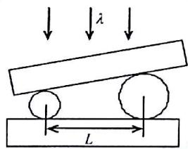
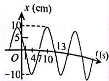
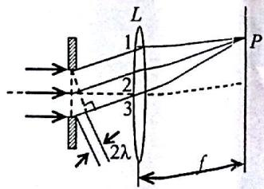
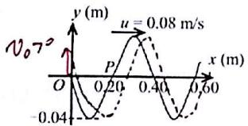

【题目来源】15161 大学物理2B A卷 T1
【教材溯源】第9章 振动 - 9.1 简谐振动
【题目正文】
1、一质点在 x 轴上作简谐振动，振幅 A = 4 cm，周期 T = 2 s，其平衡位置取作坐标原点。若 t = 0 时刻质点第一次通过 x = -2 cm 处，且向 x 轴负方向运动，则质点第二次通过 x = -2 cm 处的时刻为

A. 1 s.
B. (2/3) s.
C. (4/3) s.
D. 2 s.
【答案】B
【AI解析】由旋转矢量法，$t=0$ 时质点位于 $x=-2\ \mathrm{cm}$ 且向负方向运动，对应相位 $\varphi_0=\frac{2\pi}{3}$。设振动方程 $x=4\cos(\pi t+\frac{2\pi}{3})\ \mathrm{cm}$，其中 $\omega=\frac{2\pi}{T}=\pi\ \mathrm{rad/s}$。第二次通过 $x=-2\ \mathrm{cm}$ 时相位为 $\frac{4\pi}{3}$，由 $\pi t+\frac{2\pi}{3}=\frac{4\pi}{3}$ 解得 $t=\frac{2}{3}\ \mathrm{s}$。易错点：第一次通过的时刻是 $t=0$，第二次是质点从负最大位移返回该位置，相位增加了 $\frac{2\pi}{3}$。

【题目来源】15161 大学物理2B A卷 T2
【教材溯源】第10章 波动 - 10.6 波的干涉
【题目正文】
2、在弦线上有一简谐波，其表达式是

$$
y _ {1} = 2. 0 \times 1 0 ^ {- 2} \cos [ 2 \pi (\frac {t}{0 . 0 2} - \frac {x}{2 0}) + \frac {\pi}{3} ] \quad (\mathrm{SI})
$$

为了在此弦线上形成驻波，并且在 x=0 处为一波节，此弦线上还应有一简谐波，其表达式为：

A. $y_{2}=2.0\times10^{-2}\cos\left[2\pi\left(\frac{t}{0.02}+\frac{x}{20}\right)+\frac{\pi}{3}\right]$ (SI).
B. $y_{2}=2.0\times10^{-2}\cos\left[2\pi\left(\frac{t}{0.02}+\frac{x}{20}\right)+\frac{2\pi}{3}\right]$ (SI).
C. $y_{2}=2.0\times10^{-2}\cos\left[2\pi\left(\frac{t}{0.02}+\frac{x}{20}\right)+\frac{4\pi}{3}\right]$ (SI).
D. $y_{2}=2.0\times10^{-2}\cos\left[2\pi\left(\frac{t}{0.02}+\frac{x}{20}\right)-\frac{\pi}{3}\right]$ (SI).
【答案】C
【AI解析】要形成驻波，第二列波必须与 $y_1$ 反向传播，即含 $+\frac{x}{20}$ 项。驻波在 $x=0$ 处为波节，要求该处两列波振动反相。$y_1$ 在 $x=0$ 处的相位为 $2\pi\frac{t}{0.02}+\frac{\pi}{3}$。设 $y_2$ 的初相为 $\varphi$，反相要求 $\varphi-\frac{\pi}{3}=\pi$，得 $\varphi=\frac{4\pi}{3}$。易错点：波节处两列波相位差为 $\pi$ 而非同相，同相叠加处是波腹。

【题目来源】15161 大学物理2B A卷 T3
【教材溯源】第10章 波动 - 10.2 波的能量、能流密度
【题目正文】
3、当一平面简谐机械波在弹性媒质中传播时，下述各结论哪个是正确的？

A. 媒质质元的振动动能增大时，其弹性势能减小，总机械能守恒.
B. 媒质质元的振动动能和弹性势能都作周期性变化，但二者的相位不相同.
C. 媒质质元的振动动能和弹性势能的相位在任一时刻都相同，但二者的数值不相等.
D. 媒质质元在其平衡位置处弹性势能最大.
【答案】D
【AI解析】媒质质元的弹性势能与振动动能同相位同步变化，并非此消彼长。在平衡位置处质元形变最大，动能与势能同时达到最大。在最大位移处形变为零，动能与势能同时为零。故选项 D 正确。易错点：媒质质元机械能不守恒，不能套用孤立弹簧振子的能量转换结论。

【题目来源】15161 大学物理2B A卷 T4
【教材溯源】第12章 波动光学 - 12.2 光的衍射
【题目正文】
4、波长 $\lambda=550\ nm(1nm=10^{-9}\ m)$ 的单色光垂直入射于光栅常数 $d=2\times10^{-4}\ cm$ 的平面衍射光栅上，可能观察到的光谱线的最大级次为

A. 2.
B. 3.
C. 4.
D. 5.
【答案】B
【AI解析】光栅方程 $d\sin\theta=k\lambda$，$k$ 取整数。最大级次满足 $k_{\max}<\frac{d}{\lambda}$。代入 $d=2\times10^{-4}\ \mathrm{cm}=2000\ \mathrm{nm}$、$\lambda=550\ \mathrm{nm}$，得 $k_{\max}<\frac{2000}{550}\approx3.6$。故可能观察到的最大级次为 3。易错点：$\sin\theta\le1$ 对应严格不等式，级次不能取 4。

【题目来源】15161 大学物理2B A卷 T5
【教材溯源】第10章 波动 - 10.4 电磁波
【题目正文】
5、在真空中沿着 x 轴正方向传播的平面电磁波，其电场强度波的表达式是 $E_{z}=E_{0}\cos2\pi(vt-x/\lambda)$ ，则磁场强度波的表达式是：

A. $H_{y}=\sqrt{\varepsilon_{0}/\mu_{0}}E_{0}\cos2\pi(vt-x/\lambda)$ .
B. $H_{z}=\sqrt{\varepsilon_{0}/\mu_{0}}E_{0}\cos2\pi(vt-x/\lambda)$ .
C. $H_{y} = -\sqrt{\varepsilon_{0} / \mu_{0}} E_{0} \cos 2\pi (vt - x / \lambda)$ .
D. $H_{y} = -\sqrt{\varepsilon_{0} / \mu_{0}} E_{0} \cos 2\pi (vt + x / \lambda)$ .
【答案】C
【AI解析】平面电磁波中 $E$、$H$ 与传播方向构成右手螺旋关系。传播方向沿 $+x$、$E$ 沿 $z$ 方向，由 $\vec{E}\times\vec{H}$ 指向 $+x$ 得 $H$ 沿 $-y$ 方向。真空中 $E$ 与 $H$ 同相位，幅值关系为 $H_0=\sqrt{\frac{\varepsilon_0}{\mu_0}}E_0$。故 $H_y=-\sqrt{\frac{\varepsilon_0}{\mu_0}}E_0\cos2\pi(\nu t-x/\lambda)$。易错点：用叉乘判定方向时不要丢掉负号，D 项的相位 $t+x/\lambda$ 对应反向传播。

【题目来源】15161 大学物理2B A卷 T6
【教材溯源】第12章 波动光学 - 12.1 光的干涉
【题目正文】
6、如图所示，两个直径有微小差别的彼此平行的滚柱之间的距离为 L，夹在两块平晶的中间，形成空气劈尖，当单色光垂直入射时，产生等厚干涉条纹。如果两滚柱之间的距离 L 变大，则在 L 范围内干涉条纹的

A. 数目增加，间距不变.
B. 数目减少，间距变大.
C. 数目增加，间距变小.
D. 数目不变，间距变大.

【答案】D
【AI解析】劈尖干涉条纹间距 $\Delta l\approx\frac{\lambda}{2\theta}$。两滚柱直径差不变，故空气膜两端厚度差不变。条纹总数由膜两端厚度差决定，与 $L$ 无关，数目不变。$L$ 变大使劈尖角 $\theta$ 减小，条纹间距随之变大。易错点：条纹数目由厚度差决定，不能由 $\frac{L}{\Delta l}$ 机械推断。

【题目来源】15161 大学物理2B A卷 T7
【教材溯源】第12章 波动光学 - 12.3 光的偏振
【题目正文】
7、一束光强为 $I_{0}$ 的自然光，相继通过三个偏振片 $P_{1}$ 、 $P_{2}$ 、 $P_{3}$ 后，出射光的光强为 $I = I_{0} / 8$ ，已知 $P_{1}$ 和 $P_{3}$ 的偏振化方向相互垂直，若以入射光线为轴，旋转 $P_{2}$ ，要使出射光的光强为零， $P_{2}$ 最少要转过的角度是

A. $30^{\circ}$ .
B. $45^{\circ}$ .
C. $60^{\circ}$ .
D. $90^{\circ}$ .
【答案】B
【AI解析】自然光通过 $P_1$ 后光强为 $\frac{I_0}{2}$。设 $P_2$ 与 $P_1$ 偏振化方向夹角为 $\theta$，由马吕斯定律 $I=\frac{I_0}{2}\cos^2\theta\cos^2(90^\circ-\theta)=\frac{I_0}{8}\sin^2 2\theta$。由 $\sin^2 2\theta=1$ 得 $\theta=45^\circ$。要使出射光为零，只需 $P_2$ 转到与 $P_1$ 平行，最少转过 $45^\circ$。易错点：出射为零的条件是 $P_2$ 与 $P_1$ 或 $P_3$ 平行，而不是转到与两者都成 $45^\circ$。

【题目来源】15161 大学物理2B A卷 T8
【教材溯源】第14章 物质的波粒二象性 - 14.1 黑体辐射与能量子
【题目正文】
8、在加热黑体过程中，其单色辐出度的最大值对应的波长由 $0.8 \mu m$ 变到 $0.4 \mu m$ ，则其总辐出度增大为原来的

A. 2 倍.
B. 4 倍.
C. 8 倍.
D. 16 倍.
【答案】D
【AI解析】由维恩位移定律 $\lambda_m T=b$，$\lambda_m$ 减半说明黑体温度加倍。由斯特藩-玻尔兹曼定律，总辐出度 $M=\sigma T^4$。总辐出度与温度的四次方成正比，温度加倍后增大为原来的 $2^4=16$ 倍。易错点：辐出度与温度是四次方关系，不能用一次方或平方关系估算。

【题目来源】15161 大学物理2B A卷 T9
【教材溯源】第14章 物质的波粒二象性 - 14.4 物质波与德布罗意关系
【题目正文】
9、电子显微镜中的电子从静止开始通过电势差为 U 的静电场加速后，其德布罗意波长是 0.04 nm，则 U 约为

A. 150 V.
B. 330 V.
C. 630 V.
D. 940 V.

$$
(h = 6. 6 3 \times 1 0 ^ {- 3 4} \mathrm{J} \cdot \mathrm{s}, m _ {e} = 9. 1 \times 1 0 ^ {- 3 1} \mathrm{kg}, e = 1. 6 \times 1 0 ^ {- 1 9} \mathrm{C})
$$
【答案】D
【AI解析】电子经电场加速后动能 $E_k=eU$。非相对论情形下德布罗意波长 $\lambda=\frac{h}{\sqrt{2m_e eU}}$。变形得 $U=\frac{h^2}{2m_e e\lambda^2}$。代入 $\lambda=0.04\ \mathrm{nm}=4\times10^{-11}\ \mathrm{m}$ 及题给常量，得 $U\approx940\ \mathrm{V}$。易错点：波长需换算成米代入，加速获得的动能为 $eU$ 而非 $2eU$。

【题目来源】15161 大学物理2B A卷 T10
【教材溯源】第15章 量子力学基础 - 15.5 电子的自旋 原子的壳层结构
【题目正文】
10、在氢原子的 L 壳层中，电子可能具有的量子数 $(n, l, m_{l}, m_{s})$ 是

A. $(1, 0, 0, -\frac{1}{2})$ .
B. $(2, 1, -1, \frac{1}{2})$ .
C. $(2, 0, 1, -\frac{1}{2})$ .
D. $(3, 1, -1, -\frac{1}{2})$ .
【答案】B
【AI解析】L 壳层对应主量子数 $n=2$。角量子数满足 $0\le l\le n-1$，故 $l=0$ 或 $1$。磁量子数满足 $|m_l|\le l$，自旋磁量子数 $m_s=\pm\frac{1}{2}$。选项 B 中 $(2,1,-1,\frac{1}{2})$ 满足全部条件。易错点：$l=0$ 时 $m_l$ 只能取 0，故 $(2,0,1,-\frac{1}{2})$ 不合法。

【题目来源】15161 大学物理2B A卷 T11
【教材溯源】第9章 振动 - 9.1 简谐振动
【题目正文】
11、一简谐振动用余弦函数表示，其振动曲线如图所示，则此简谐振动的三个特征量为

$$
A = \_\_\_\_,\quad \omega = \_\_\_\_,\quad \varphi_0 = \_\_\_\_
$$

【答案】A = 10 cm，$\omega=\frac{\pi}{6}$ rad/s，$\varphi_0=-\frac{\pi}{6}$
【AI解析】由图读出振幅 $A=10\ \mathrm{cm}$。$t=4\ \mathrm{s}$ 处曲线自上而下过零，$t=10\ \mathrm{s}$ 处自下而上过零，两者相隔半个周期，故 $T=12\ \mathrm{s}$。角频率 $\omega=\frac{2\pi}{T}=\frac{\pi}{6}\ \mathrm{rad/s}$。设 $x=10\cos(\frac{\pi}{6}t+\varphi_0)$，由 $t=4\ \mathrm{s}$ 时 $x=0$ 且向负方向运动得 $\frac{\pi}{6}\times4+\varphi_0=\frac{\pi}{2}$，解得 $\varphi_0=-\frac{\pi}{6}$。易错点：过零点对应的相位需结合运动方向判断象限，不能只看 $x=0$。

【题目来源】15161 大学物理2B A卷 T12
【教材溯源】第9章 振动 - 9.4 简谐振动的合成
【题目正文】
12、两个同方向同频率的简谐振动，其振动表达式分别为：

$$
x _ {1} = 6 \times 1 0 ^ {- 2} \cos (5 t + \frac {1}{2} \pi) \quad (\mathrm{SI}), \quad x _ {2} = 2 \times 1 0 ^ {- 2} \cos (\pi - 5 t) \tag {SI}
$$

它们的合振动的振幅为 \_\_\_\_，初相为 \_\_\_\_.
【答案】$A=\sqrt{40}\times10^{-2}\approx6.3\times10^{-2}\ \mathrm{m}$；$\varphi=\pi-\arctan3\approx1.89\ \mathrm{rad}$
【AI解析】将 $x_2$ 改写为 $2\times10^{-2}\cos(5t+\pi)$（SI），与 $x_1$ 的相位差为 $\frac{\pi}{2}$。合振幅 $A=\sqrt{6^2+2^2}\times10^{-2}=\sqrt{40}\times10^{-2}\approx6.3\times10^{-2}\ \mathrm{m}$。由 $\tan\varphi=\frac{6\sin\frac{\pi}{2}+2\sin\pi}{6\cos\frac{\pi}{2}+2\cos\pi}=-3$，且合矢量位于第二象限，得初相 $\varphi=\pi-\arctan3\approx1.89\ \mathrm{rad}$。易错点：$\cos(\pi-5t)$ 应先化为 $\cos(5t+\pi)$ 再判断相位差。

【题目来源】15161 大学物理2B A卷 T13
【教材溯源】第10章 波动 - 10.6 波的干涉
【题目正文】
13、两个相干点波源 $S_{1}$ 和 $S_{2}$ , 它们的振动方程分别是 $y_{1}=A\cos(\omega t+\frac{1}{2}\pi)$ 和 $y_{2}=A\cos(\omega t-\frac{1}{2}\pi)$ . 波从 $S_{1}$ 传到 $P$ 点经过的路程等于 2 个波长, 波从 $S_{2}$ 传到 $P$ 点的路程等于 7/2 个波长. 设两波波速相同, 在传播过程中振幅不衰减, 则两波传到 $P$ 点的振动的合振幅为 \_\_\_\_.
【答案】2A
【AI解析】P 点处 $S_1$ 引起振动的相位为 $\omega t+\frac{\pi}{2}-2\pi\frac{2\lambda}{\lambda}=\omega t+\frac{\pi}{2}-4\pi$。$S_2$ 引起振动的相位为 $\omega t-\frac{\pi}{2}-2\pi\frac{\frac{7}{2}\lambda}{\lambda}=\omega t-\frac{\pi}{2}-7\pi$。两者相位之差为 $(\frac{\pi}{2}-4\pi)-(-\frac{\pi}{2}-7\pi)=4\pi$，恰为 $2\pi$ 的整数倍。两列波在 P 点同相叠加，合振幅为 $2A$。易错点：初相差与波程差引起的相位差都要计入，二者符号要一致。

【题目来源】15161 大学物理2B A卷 T14
【教材溯源】第12章 波动光学 - 12.1 光的干涉
【题目正文】
14、若在迈克耳孙干涉仪的可动反射镜 M 移动 0.620 mm 过程中，观察到干涉条纹移动了 2300 条，则所用光波的波长为 \_\_\_\_ nm. (1 nm=10 $^{-9}$ m)
【答案】539 nm
【AI解析】迈克耳孙干涉仪中反射镜移动 $\Delta d$，光在动臂往返一次，光程变化为 $2\Delta d$。条纹移动数 $N$ 与波长满足 $2\Delta d=N\lambda$。故 $\lambda=\frac{2\Delta d}{N}$。代入 $\Delta d=0.620\ \mathrm{mm}=0.620\times10^{6}\ \mathrm{nm}$、$N=2300$，得 $\lambda\approx539\ \mathrm{nm}$。易错点：光程变化是镜移动距离的两倍，不能漏乘 2。

【题目来源】15161 大学物理2B A卷 T15
【教材溯源】第12章 波动光学 - 12.2 光的衍射
【题目正文】
15、在单缝夫琅禾费衍射示意图中，所画出的各条正入射光线间距相等，那么光线1与2在幕上P点上相遇时
的相位差为\_\_\_\_\_\_\_\_，P点处应为\_\_\_\_\_\_\_\_纹.

【答案】$2\pi$；暗
【AI解析】图中单缝被等间距光线分成两个条带，图中标注 $a\sin\theta=2\lambda$。相邻两条光线（1 与 2）之间的光程差为 $\frac{a\sin\theta}{2}=\lambda$。相位差 $\Delta\varphi=\frac{2\pi}{\lambda}\cdot\lambda=2\pi$。此时 $a\sin\theta=2\lambda$，缝处波面可分成 4 个半波带，为偶数。半波带成对相消，故 P 点处为暗纹。易错点：相邻光线相位差为 $2\pi$ 只说明二者同相，P 点明暗由半波带总数决定。

【题目来源】15161 大学物理2B A卷 T16
【教材溯源】第12章 波动光学 - 12.2 光的衍射
【题目正文】
16、用波长为λ的单色平行红光垂直照射在光栅常数d=2μm(1μm=10-6m)的光栅上，用焦距f=0.500m的透镜将光聚在屏上，测得第一级谱线与透镜主焦点的距离l=0.1667m.则可知该入射的红光波长λ=\_\_\_\_nm.(1nm=10-9m)
【答案】632 nm
【AI解析】光栅方程 $d\sin\theta=k\lambda$，第一级 $k=1$。谱线位于透镜焦平面上，几何关系为 $\tan\theta=\frac{l}{f}=\frac{0.1667}{0.500}=0.3334$。由此得 $\sin\theta=\frac{\tan\theta}{\sqrt{1+\tan^2\theta}}=0.3162$。故 $\lambda=d\sin\theta=2\times10^{-6}\times0.3162\approx632\ \mathrm{nm}$。易错点：应先用 $\tan\theta$ 求角度再代入光栅方程，不能直接用 $\frac{l}{f}$ 当作 $\sin\theta$。

【题目来源】15161 大学物理2B A卷 T17
【教材溯源】第12章 波动光学 - 12.3 光的偏振
【题目正文】
17、一束平行的自然光，以60°角入射到某平板玻璃表面上。若反射光束是完全偏振的，则透射光束的折射角是\_\_\_\_；该玻璃的折射率为\_\_\_\_。
【答案】$30^\circ$；$n=\sqrt{3}\approx1.73$
【AI解析】反射光完全偏振说明入射角等于布儒斯特角 $i_B=60^\circ$。布儒斯特角下反射光与折射光相互垂直。故透射光束的折射角 $\gamma=90^\circ-i_B=30^\circ$。玻璃折射率 $n=\tan i_B=\tan60^\circ=\sqrt{3}\approx1.73$。易错点：折射角与入射角互余，而不是由普通折射定律另行求解。

【题目来源】15161 大学物理2B A卷 T18
【教材溯源】第14章 物质的波粒二象性 - 14.3 康普顿散射
【题目正文】
18、在康普顿散射中，若入射光子与散射光子的波长分别为 $\lambda$ 和 $\lambda'$ ，则反冲电子获得的动能 $E_{K}=\_\_\_\_$
【答案】$E_K=\frac{hc}{\lambda}-\frac{hc}{\lambda'}$
【AI解析】入射光子能量为 $h
u=\frac{hc}{\lambda}$，散射光子能量为 $h
u'=\frac{hc}{\lambda'}$。康普顿散射中能量守恒，光子损失的能量全部转化为反冲电子的动能。故 $E_K=h
u-h
u'=\frac{hc}{\lambda}-\frac{hc}{\lambda'}$。易错点：不能直接用经典动能公式求解，光子能量的减少量才是电子获得的动能。

【题目来源】15161 大学物理2B A卷 T19
【教材溯源】第15章 量子力学基础 - 15.1 物质波波函数的特性
【题目正文】
19、设描述微观粒子运动的波函数为 $\psi(\bar{r},t)$ ，则 $\psi\psi^{*}$ 表示粒子在t时刻在 $(x,y,z)$ 处出现的概率密度. $\psi(\bar{r},t)$ 须满足的标准条件是\_\_\_\_；其归一化条件是\_\_\_\_
【答案】单值、有限、连续；$\int|\psi|^2 dV=1$（积分遍及全空间）
【AI解析】波函数 $\psi(\vec{r},t)$ 须满足单值、有限、连续三个标准条件，这是概率密度物理意义的必然要求。$|\psi|^2$ 表示概率密度，粒子在全空间出现的总概率必为 1。故归一化条件为 $\int|\psi|^2dV=1$，积分遍及全空间。易错点：归一化条件针对 $|\psi|^2$ 而非 $\psi$ 本身。

【题目来源】15161 大学物理2B A卷 T20
【教材溯源】第14章 物质的波粒二象性 - 14.5 氢原子和玻尔的量子论
【题目正文】
20、氢原子从能量为 -0.85 eV 的状态跃迁到能量为 -3.4 eV 的状态时, 所发射的光子能量是 2.55 eV, 这是电子从 n = \_\_\_\_的能级到 n = 2 的能级的跃迁.
【答案】n = 4
【AI解析】氢原子能级公式 $E_n=-\frac{13.6}{n^2}\ \mathrm{eV}$。由 $-0.85=-\frac{13.6}{n^2}$ 得 $n^2=16$，即初态 $n=4$。终态能量 $-3.4\ \mathrm{eV}$ 对应 $n=2$。故这是电子从 $n=4$ 的能级到 $n=2$ 的能级的跃迁。易错点：光子能量 $2.55\ \mathrm{eV}$ 恰等于两能级之差，可据此反查能级量子数。

【题目来源】15161 大学物理2B A卷 T21
【教材溯源】第9章 振动 - 9.1 简谐振动
【题目正文】
21、在一轻弹簧下端悬挂 $m_0 = 100 \text{ g}$ 砝码时，弹簧伸长 $8 \text{ cm}$ 。现在这根弹簧下端悬挂 $m = 250 \text{ g}$ 的物体，构成弹簧振子。将物体从平衡位置向下拉动 $4 \text{ cm}$ ，并给以向上的 $21 \text{ cm/s}$ 的初速度（令这时 $t = 0$ ）。选 $x$ 轴向下为正方向，求振动方程的表达式。
【答案】$x=5\times10^{-2}\cos(7t+0.64)\ \mathrm{m}$
【AI解析】由平衡条件 $m_0g=k\Delta l$ 得劲度系数 $k=\frac{0.1\times9.8}{0.08}=12.25\ \mathrm{N/m}$。振动角频率 $\omega=\sqrt{\frac{k}{m}}=\sqrt{\frac{12.25}{0.25}}=7\ \mathrm{rad/s}$。初始条件 $x_0=4\ \mathrm{cm}$、$v_0=-21\ \mathrm{cm/s}$，得振幅 $A=\sqrt{x_0^2+\frac{v_0^2}{\omega^2}}=\sqrt{16+\frac{441}{49}}=5\ \mathrm{cm}$。由 $\cos\varphi=\frac{x_0}{A}=\frac{4}{5}$、$\sin\varphi=-\frac{v_0}{\omega A}=\frac{3}{5}$ 得初相 $\varphi=\arctan\frac{3}{4}\approx0.64\ \mathrm{rad}$。振动方程为 $x=5\times10^{-2}\cos(7t+0.64)\ \mathrm{m}$。易错点：$x$ 轴向下为正，初速度向上应取 $v_0=-21\ \mathrm{cm/s}$。

【题目来源】15161 大学物理2B A卷 T22
【教材溯源】第10章 波动 - 10.1 波动方程、平面简谐波
【题目正文】
22、图示一平面简谐波在 t=0 时刻的波形图，求

(1) 该波的波动表达式;

(2) P 处质点的振动方程.

【答案】(1) $y=0.04\cos(0.4\pi t-5\pi x-\frac{\pi}{2})\ \mathrm{SI}$；(2) $y_P=0.04\cos(0.4\pi t-\frac{3\pi}{2})\ \mathrm{SI}$
【AI解析】由图读出振幅 $A=0.04\ \mathrm{m}$、波长 $\lambda=0.40\ \mathrm{m}$、波速 $u=0.08\ \mathrm{m/s}$。角频率 $\omega=2\pi\frac{u}{\lambda}=0.4\pi\ \mathrm{rad/s}$，波数 $k=\frac{2\pi}{\lambda}=5\pi\ \mathrm{m^{-1}}$。$t=0$ 时 O 处质点过平衡位置向 $+y$ 方向运动，得初相 $\varphi_0=-\frac{\pi}{2}$。波沿 $+x$ 传播，波动表达式为 $y=0.04\cos(0.4\pi t-5\pi x-\frac{\pi}{2})$（SI）。P 点在 $x=0.20\ \mathrm{m}$ 处，代入得振动方程 $y_P=0.04\cos(0.4\pi t-\pi-\frac{\pi}{2})=0.04\cos(0.4\pi t-\frac{3\pi}{2})$（SI）。易错点：P 点坐标 $0.20\ \mathrm{m}$ 是波线上的坐标值，代入相位时要乘以波数 $k$。

【题目来源】15161 大学物理2B A卷 T23
【教材溯源】第12章 波动光学 - 12.1 光的干涉
【题目正文】
23、在双缝干涉实验中，波长 $\lambda=550\ nm$ 的单色平行光垂直入射到双缝间距 $d=2\times10^{-4}\ m$ 的双缝上，屏到双缝的距离D=2m．求：

(1) 中央明纹两侧的两条第 10 级明纹中心的间距；

(2) 用一厚度为 $e=6.6\times10^{-6}m$ 、折射率为 n=1.50 的玻璃片覆盖一缝后，零级明纹将移到原来的第几级明纹处？ $(1\ nm=10^{-9}\ m)$
【答案】(1) 0.11 m；(2) 第 6 级明纹处
【AI解析】双缝干涉明纹位置 $x=k\frac{D\lambda}{d}$。第 10 级明纹到中央的距离 $x_{10}=10\times\frac{2\times550\times10^{-9}}{2\times10^{-4}}=0.055\ \mathrm{m}$。中央明纹两侧两条第 10 级明纹间距为 $2x_{10}=0.11\ \mathrm{m}$。覆盖玻璃片后该缝光程增加 $(n-1)e$，零级明纹移过的级数 $k=\frac{(n-1)e}{\lambda}=\frac{0.5\times6.6\times10^{-6}}{550\times10^{-9}}=6$。故零级明纹移到原来的第 6 级明纹处。易错点：两侧对称明纹的间距是单侧距离的两倍，不能只算一侧。

【题目来源】15161 大学物理2B A卷 T24
【教材溯源】第14章 物质的波粒二象性 - 14.2 光电效应与光子
【题目正文】
24、光电管的阴极用逸出功为A=2.2eV的金属制成，今用一单色光照射此光电管，阴极发射出光电子，测得遏止电势差为 $|U_{a}|=5.0V$ ，试求：

(1) 光电管阴极金属的光电效应红限波长；

(2) 入射光波长.

(普朗克常量 $h=6.63\times10^{-34}$ J·s，基本电荷 $e=1.6\times10^{-19}$ C)
【答案】(1) $\lambda_0\approx565\ \mathrm{nm}$；(2) $\lambda\approx172\ \mathrm{nm}$
【AI解析】红限频率满足 $h\nu_0=A$，故红限波长 $\lambda_0=\frac{hc}{A}=\frac{6.63\times10^{-34}\times3\times10^8}{2.2\times1.6\times10^{-19}}\approx5.65\times10^{-7}\ \mathrm{m}\approx565\ \mathrm{nm}$。由光电效应方程 $h\nu=A+e|U_a|$，入射光子能量为 $2.2+5.0=7.2\ \mathrm{eV}$。入射光波长 $\lambda=\frac{hc}{7.2\ \mathrm{eV}}\approx\frac{1240\ \mathrm{nm\cdot eV}}{7.2\ \mathrm{eV}}\approx172\ \mathrm{nm}$。易错点：遏止电压对应光电子的最大动能，红限与入射波长是两个不同的物理量。
