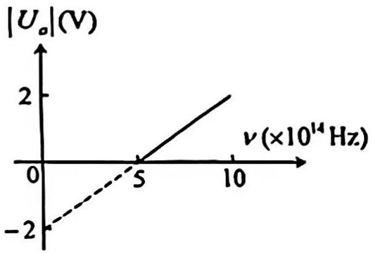
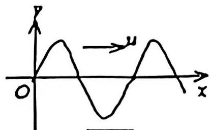

【题目来源】16171 大学物理1B A卷 T1
【教材溯源】第10章 波动 - 10.6 波的干涉
【题目正文】
1、在驻波中，两个相邻波节间各质点的振动

A. 振幅相同，相位相同；
B. 振幅不同，相位相同
C. 振幅相同，相位不同；
D. 振幅不同，相位不同
【答案】B
【AI解析】驻波中两相邻波节之间各质点的振动相位相同，同为一段振动的腹段。但各点到波节的距离不同，位移幅值 $2A\cos\frac{2\pi x}{\lambda}$ 不同，波节处为零、波腹处最大。故振幅不同、相位相同。易错点：两相邻波节之间同相，跨过一个波节相位反相，不要误认为各点相位不同。

【题目来源】16171 大学物理1B A卷 T2
【教材溯源】第12章 波动光学 - 12.1 光的干涉
【题目正文】
2、在双缝干涉实验中，用单色自然光，在屏上形成干涉条纹。若在两缝后放一个偏振片，则

A. 干沙条纹的间距不变，但明纹的亮度加强.
B. 干涉条纹的间距不变，但明纹的亮度减弱.
C. 干涉条纹的间距变窄，且明纹的亮度减弱.
D. 无干涉条纹.
【答案】B
【AI解析】两缝的光通过同一个偏振片后偏振方向变为一致，仍满足相干条件。干涉条纹间距 $\Delta x=\frac{D\lambda}{d}$ 与偏振无关，间距不变。自然光经过偏振片光强减半，故明纹亮度减弱。易错点：只有两缝各放方向不同的偏振片才会破坏干涉，同一个偏振片不影响相干性。

【题目来源】16171 大学物理1B A卷 T3
【教材溯源】第9章 振动 - 9.1 简谐振动
【题目正文】
3、一弹簧振子作简谐振动，当位移为振幅的一半时，其动能为总能量的

A. 1/4.
B. 1/2.
C. $1/\sqrt{2}$
D. 3/4.
E. $\sqrt{3}/2.$
【答案】D
【AI解析】总能量 $E=\frac{1}{2}kA^2$。位移 $x=\frac{A}{2}$ 时势能 $E_p=\frac{1}{2}kx^2=\frac{1}{8}kA^2=\frac{E}{4}$。动能 $E_k=E-E_p=\frac{3}{4}E$。故动能为总能量的 3/4。易错点：势能与位移的平方成正比，位移一半时势能是总能量的四分之一而非一半。

【题目来源】16171 大学物理1B A卷 T4
【教材溯源】第10章 波动 - 10.6 波的干涉
【题目正文】
4、沿着相反方向传播的两列相干波，其表达式为 $y_{1}=A\cos2\pi(vt-x/\lambda)$ 和 $y_{2}=A\cos2\pi(vt+x/\lambda)$ 。在叠加后形成的驻波中，各处简谐振动的振幅是

A. λ.
B. 2A.
C. $2A\cos(2\pi x/\lambda)$ .
D. $\left|2A\cos(2\pi x/\lambda)\right|$ .
【答案】D
【AI解析】两列波叠加得 $y=y_1+y_2=2A\cos\frac{2\pi x}{\lambda}\cos2\pi\nu t$。这是驻波表达式，各点作简谐振动。各处振幅为 $|2A\cos\frac{2\pi x}{\lambda}|$，随位置 $x$ 变化。易错点：振幅是位置的正弦函数取值，波腹处为 $2A$ 而波节处为零，不能说各处振幅都等于 $2A$。

【题目来源】16171 大学物理1B A卷 T5
【教材溯源】第12章 波动光学 - 12.1 光的干涉
【题目正文】
5、如图所示，两个直径有微小差别的彼此平行的滚柱之间的距离为 L，夹在两块平晶的中间，形成空气劈尖，当单色光垂直入射时，产生等厚干涉条纹。如果两滚柱之间的距离 L 变大，则在 L 范围内干涉条纹的

A. 数目增加，间距不变.
B. 数目减少，间距变大.
C. 数目增加，间距变小.
D. 数目不变，间距变大.

![[Pasted image 20260823135653.png|304]]
【答案】D
【AI解析】劈尖干涉条纹间距 $\Delta l\approx\frac{\lambda}{2\theta}$。两滚柱直径差不变，空气膜两端厚度差不变。条纹总数由膜两端厚度差决定，与 $L$ 无关。$L$ 变大使劈尖角 $\theta$ 减小，条纹间距变大。易错点：条纹数目由厚度差决定，不要由 $\frac{L}{\Delta l}$ 机械推断。

【题目来源】16171 大学物理1B A卷 T6
【教材溯源】第15章 量子力学基础 - 15.1 物质波波函数的特性
【题目正文】
6、将波函数在空间各点的振幅同时增大D倍，则粒子在空间的分布概率将

A. 增大 $D^{2}$ 倍.
B. 增大 2D 倍.
C. 增大 D 倍.
D. 不变.
【答案】D
【AI解析】波函数乘常数 $D$ 后，概率密度变为 $D^2|\psi|^2$，各点同时放大 $D^2$ 倍。波函数须满足归一化条件，归一化后的新波函数仍是原来的形式。粒子在空间各点的分布概率不因整体缩放而改变。易错点：概率分布由相对比值决定，整体乘常数不影响归一化后的分布。

【题目来源】16171 大学物理1B A卷 T7
【教材溯源】第14章 物质的波粒二象性 - 14.1 黑体辐射与能量子
【题目正文】
7、在加热照体过程中，其最大单色辐出度（单色辐射本领）对应的波长由 $0.8 \mu m$ 变到 $0.4 \mu m$ ，则其辐射出射度（总辐射本领）增大为原来的

A. 2 倍.
B. 4 倍.
C. 8 倍.
D. 16倍.
【答案】D
【AI解析】由维恩位移定律 $\lambda_m T=b$，$\lambda_m$ 减半说明黑体温度加倍。由斯特藩-玻尔兹曼定律，总辐出度 $M=\sigma T^4$。总辐出度与温度的四次方成正比，温度加倍后增大为原来的 $2^4=16$ 倍。易错点：辐出度与温度是四次方关系，不能用一次方或平方关系估算。

【题目来源】16171 大学物理1B A卷 T8
【教材溯源】第10章 波动 - 10.2 波的能量、能流密度
【题目正文】
8、当一平面简谐机械波在弹性媒质中传播时，下述各结论哪个是正确的？

A. 媒质质元的振动动能增大时，其弹性势能减小，总机械能守恒.
B. 媒质质元的振动动能和弹性势能都作周期性变化，但二者的相位不相同.
C. 媒质质元的振动动能和弹性势能的相位在任一时刻都相同，但二者的数值不相等.
D. 媒质质元在其平衡位置处弹性势能最大.
【答案】D
【AI解析】媒质质元的弹性势能与振动动能同相位同步变化，并非此消彼长。在平衡位置处质元形变最大，动能与势能同时达到最大。在最大位移处形变为零，动能与势能同时为零。故选项 D 正确。易错点：媒质质元机械能不守恒，不能套用孤立弹簧振子的能量转换结论。

【题目来源】16171 大学物理1B A卷 T9
【教材溯源】第13章 狭义相对论 - 13.3 相对论力学
【题目正文】
9、一匀质矩形薄板，在它静止时测得其长为a，宽为b，质量为 $m_{0}$ 。由此可算出其面积密度为 $m_{0}/ab$ 、假定该薄板沿长度方向以接近光速的速度v作匀速直线运动，此时在地面再测算该矩形薄板的面积密度则为

A. $\frac{m_{0}\sqrt{1-(v/c)^{2}}}{ab}$
B. $\frac{m_{0}}{ab\sqrt{1-(v/c)^{2}}}$
C. $\frac{m_{0}}{ab[1-(v/c)^{2}]}$
D. $\frac{m_{0}}{ab[1-(v/c)^{2}]^{2}}$
【答案】C
【AI解析】薄板沿长度方向运动，长度收缩为 $a\sqrt{1-(v/c)^2}$，宽度方向不变。同时相对论动质量 $m=\frac{m_0}{\sqrt{1-(v/c)^2}}$。地面测得的面积密度为 $\frac{m}{a\sqrt{1-(v/c)^2}\cdot b}=\frac{m_0}{ab[1-(v/c)^2]}$。易错点：长度收缩只发生在运动方向，宽度不变；动质量与长度收缩两个效应都要计入。

【题目来源】16171 大学物理1B A卷 T10
【教材溯源】第15章 量子力学基础 - 15.5 电子的自旋 原子的壳层结构
【题目正文】
10、下列各组量子数中，哪一组可以描述原子中电子的状态？

A. n=2, l=2, $m_{l}=0, m_{s}=1/2$
B. n=3, l=1, $m_{l}=-1, m_{s}=-1/2$
C. n=1, l=2, $m_{1}=1, m_{s}=1/2$
D. n=1, l=0, $m_{l}=1, m_{s}=-1/2$
【答案】B
【AI解析】四个量子数须满足 $0\le l\le n-1$、$|m_l|\le l$、$m_s=\pm\frac{1}{2}$。A 中 $l=2$ 超过 $n-1=1$，不合法。B 中 $n=3, l=1, m_l=-1$ 满足全部条件。C 中 $n=1$ 时 $l$ 只能为 0。D 中 $l=0$ 时 $m_l$ 只能为 0。易错点：$l$ 的上限是 $n-1$，$m_l$ 的上限是 $l$，两个约束都要检验。

【题目来源】16171 大学物理1B A卷 T11
【教材溯源】第15章 量子力学基础 - 15.2 薛定谔方程
【题目正文】
11、设描述微观粒子运动的波函数为 $\psi(\bar{r},t)$ ，则 $\psi\psi^{*}$ 表示\_\_\_\_；
$\psi(\bar{r},t)$ 须满足的条件是\_\_\_\_；
其归一化条件是\_\_\_\_。
【答案】概率密度；单值、有限、连续；$\int|\psi|^2 dV=1$（积分遍及全空间）
【AI解析】波函数 $\psi(\vec{r},t)$ 须满足单值、有限、连续三个标准条件，这是概率密度物理意义的必然要求。$|\psi|^2$ 表示概率密度，粒子在全空间出现的总概率必为 1。故归一化条件为 $\int|\psi|^2dV=1$，积分遍及全空间。易错点：归一化条件针对 $|\psi|^2$ 而非 $\psi$ 本身。

【题目来源】16171 大学物理1B A卷 T12
【教材溯源】第11章 几何光学基础 - 11.1 几何光学的基本实验定律和基本原理
【题目正文】
12、费马原理可用下面的说法来表述：光线由空间的一点进行到另一点时，实际传播路径的总光程同附近的路径比起来，不是\_\_\_\_，便是\_\_\_\_，或者\_\_\_\_。
【答案】极小值（最小值）；极大值（最大值）；恒定值（相等）
【AI解析】费马原理指出，光在两点间传播时实际路径的光程取极值或恒定值。即光程同附近路径相比不是极小值，便是极大值，或者相等。三种情形分别对应通常的成像光路、凹面反射等特殊光路以及等光程面的情形。易错点：费马原理不仅包含光程极小，还包含极大和恒定两种情形。

【题目来源】16171 大学物理1B A卷 T13
【教材溯源】第9章 振动 - 9.1 简谐振动
【题目正文】
13、一质点作简谐振动，速度最大值 $v_{m}=5cm/s$ ，振幅A=2cm。若令速度具有正最大值的那一时刻为t=0，则振动表达式为\_\_\_\_
【答案】$x=2\cos(2.5t-\frac{\pi}{2})\ \mathrm{cm}$
【AI解析】由 $v_m=\omega A$ 得角频率 $\omega=\frac{v_m}{A}=\frac{5}{2}=2.5\ \mathrm{rad/s}$。速度具有正最大值的时刻质点过平衡位置向正方向运动。对应初相 $\varphi_0=-\frac{\pi}{2}$。故振动表达式为 $x=2\cos(2.5t-\frac{\pi}{2})\ \mathrm{cm}$。易错点：速度正最大对应 $x=0$ 且 $v>0$，初相取 $-\frac{\pi}{2}$ 而非 $\frac{\pi}{2}$。

【题目来源】16171 大学物理1B A卷 T14
【教材溯源】第12章 波动光学 - 12.3 光的偏振
【题目正文】
14、用相互平行的一束自然光和一束线偏振光构成的混合光垂直照射在一偏振片上，以光的传播方向为轴旋转偏振片时，发现透射光强的最大值为最小值的5倍，则入射光中，自然光强 $I_{0}$ 与线偏振光强I之比为\_\_\_\_。
【答案】$I_0:I=1:2$
【AI解析】自然光过偏振片后光强恒为 $\frac{I_0}{2}$。线偏振光过偏振片后光强随角度在 $0\sim I$ 之间变化。透射光强最大值 $I_{max}=\frac{I_0}{2}+I$，最小值 $I_{min}=\frac{I_0}{2}$。由 $\frac{I_{max}}{I_{min}}=5$ 得 $\frac{\frac{I_0}{2}+I}{\frac{I_0}{2}}=5$。解得 $I=2I_0$，即 $I_0:I=1:2$。易错点：自然光分量的透射光强与偏振片取向无关，始终为原光强的一半。

【题目来源】16171 大学物理1B A卷 T15
【教材溯源】第14章 物质的波粒二象性 - 14.2 光电效应与光子
【题目正文】
15、在光电效应实验中，测得某金属的遏止电压 $\left|U_{o}\right|$ 与入射光频率v的关系曲线如图所示，由此可知该金属的红限频率 $v_{0}=$ \_\_\_\_Hz，逸出功 $W=$ \_\_\_\_cV。

【答案】$\nu_0=5\times10^{14}\ \mathrm{Hz}$；$W=2\ \mathrm{eV}$
【AI解析】遏止电压与频率的关系为 $e|U_0|=h\nu-W$，即 $|U_0|=\frac{h}{e}\nu-\frac{W}{e}$。直线与横轴的交点对应 $|U_0|=0$，即红限频率 $\nu_0=5\times10^{14}\ \mathrm{Hz}$。直线在纵轴上的截距为 $-2\ \mathrm{V}$，由 $\frac{W}{e}=2\ \mathrm{V}$ 得 $W=2\ \mathrm{eV}$。易错点：横轴交点给的是红限频率，逸出功需由纵轴截距读取。

【题目来源】16171 大学物理1B A卷 T16
【教材溯源】第14章 物质的波粒二象性 - 14.4 物质波与德布罗意关系
【题目正文】
16、静止质量为 $m_{e}$ 的电子，经电势差为 $U_{12}$ 的静电场加速后，若不考虑相对论效应，电子的德布罗曼波长 $\lambda=$ \_\_\_\_.
【答案】$\lambda=\frac{h}{\sqrt{2m_e eU_{12}}}$
【AI解析】电子经电场加速后动能 $E_k=eU_{12}$。非相对论情形下动量 $p=\sqrt{2m_e E_k}=\sqrt{2m_e eU_{12}}$。由德布罗意关系 $\lambda=\frac{h}{p}$。故 $\lambda=\frac{h}{\sqrt{2m_e eU_{12}}}$。易错点：加速获得的动能为 $eU_{12}$，代入动量的表达式后即可得到波长。

【题目来源】16171 大学物理1B A卷 T17
【教材溯源】第12章 波动光学 - 12.1 光的干涉
【题目正文】
17、用 $\lambda=600\ nm$ 的单色光垂直照射牛顿环装置时，从中央向外数第4个(不计中央暗斑)暗环对应的空气膜厚度为\_\_\_\_μm. $(1\ nm=10^{-9}\ m)$
【答案】1.2 μm
【AI解析】牛顿环反射光暗环满足 $2e=k\lambda$，$k=0,1,2,\cdots$。中央暗斑对应 $e=0$ 即 $k=0$。从中央向外数第 4 个暗环对应 $k=4$。空气膜厚度 $e=\frac{k\lambda}{2}=\frac{4\times600}{2}=1200\ \mathrm{nm}$。即 $e=1.2\ \mu\mathrm{m}$。易错点：中央暗斑不计入编号，第 4 个暗环取 $k=4$ 而非 $k=3$。

【题目来源】16171 大学物理1B A卷 T18
【教材溯源】第15章 量子力学基础 - 15.3 一维定态系统
【题目正文】
18、已知粒子在无限深势阱中运动，其波函数为 $\psi(x)=\sqrt{2/a}\sin(\pi x/a)\quad(0\leqslant x\leqslant a)$ ，发现粒子的概率为最大的位置在 \_\_\_\_。
【答案】$x=\frac{a}{2}$
【AI解析】概率密度 $|\psi|^2=\frac{2}{a}\sin^2\frac{\pi x}{a}$。在 $0\le x\le a$ 内 $\sin^2\frac{\pi x}{a}$ 的最大值为 1。此时 $\frac{\pi x}{a}=\frac{\pi}{2}$。解得 $x=\frac{a}{2}$，即阱的中央。易错点：求概率最大位置是求 $|\psi|^2$ 的极大值点，而不是求波函数本身的极大值。

【题目来源】16171 大学物理1B A卷 T19
【教材溯源】第9章 振动 - 9.4 简谐振动的合成
【题目正文】
19、一个质点同时参与两个在同一直线上的简谐振动，其表达式分别为

$$
x _ {1} = 4 \times 1 0 ^ {- 2} \cos (2 t + \frac {\pi}{6}) \tag {SI}
$$

$$
x _ {2} = 3 \times 1 0 ^ {- 2} \cos (2 t - \frac {5 \pi}{6}) (\mathrm{SI})
$$

则其合成振动的振幅为\_\_\_\_，初相为\_\_\_\_。
【答案】$A=1\times10^{-2}\ \mathrm{m}$；$\varphi_0=\frac{\pi}{6}$
【AI解析】两振动的相位差为 $\frac{\pi}{6}-(-\frac{5\pi}{6})=\pi$，即两振动反相。反相合成时振幅为两振幅之差 $A=|4-3|\times10^{-2}=1\times10^{-2}\ \mathrm{m}$。合振动的初相与振幅较大的分振动相同。故 $\varphi_0=\frac{\pi}{6}$。易错点：反相合成振幅取差，初相跟随振幅大的分振动。

【题目来源】16171 大学物理1B A卷 T20
【教材溯源】第13章 狭义相对论 - 13.3 相对论力学
【题目正文】
20. 设电子静止质量为 m，将一个电子从静止加速到速率为 0.6c (c 为真空中光速)，需作功\_\_\_\_
【答案】$0.25mc^2$（即 $\frac{1}{4}mc^2$）
【AI解析】加速电子所作的功等于电子动能的增量 $E_k$。相对论动能 $E_k=mc^2-mc^2_{\text{静}}=mc^2\left(\frac{1}{\sqrt{1-\frac{v^2}{c^2}}}-1\right)$。代入 $v=0.6c$，得 $\frac{1}{\sqrt{1-0.36}}=1.25$。故 $E_k=mc^2(1.25-1)=0.25mc^2$。易错点：动能是总能量与静能之差，不能直接用 $\frac{1}{2}mv^2$ 计算高速情形。

【题目来源】16171 大学物理1B A卷 T21
【教材溯源】第14章 物质的波粒二象性 - 14.3 康普顿散射
【题目正文】
21、（1）波长为 $\lambda_{0}=0.500\lambda$ 的X射线被静止的自由电子所散射，若散射线的波长变为 $\lambda=0.522\lambda$ ，试求反冲电子的动能 $E_{K}$

（2）已知氢光谱的某一线系的极限波长为3647 A. 其中有一谱线波长为6565 A. 试由玻尔氢原子理论, 求与该波长相应的始态与终态能级的能量.

(普朗克常量 $h=6.63\times10^{-34}$ J·s, $1\lambda=10^{-10}$ m, $R=1.097\times10^{7}$ m $^{-1}$ )
【答案】(1) $E_K=hc(\frac{1}{\lambda_0}-\frac{1}{\lambda})\approx1.7\times10^{-16}\ \mathrm{J}$；(2) 始态 $E_3=-1.51\ \mathrm{eV}$，终态 $E_2=-3.4\ \mathrm{eV}$
【AI解析】散射中能量守恒，反冲电子动能 $E_K=hc(\frac{1}{\lambda_0}-\frac{1}{\lambda})$。按题给单位换算（$1\lambda=10^{-10}\ \mathrm{m}$），代入 $\lambda_0=0.500\times10^{-10}\ \mathrm{m}$、$\lambda=0.522\times10^{-10}\ \mathrm{m}$，得 $E_K\approx1.7\times10^{-16}\ \mathrm{J}$。极限波长 3647 Å 对应氢光谱中 $n\to2$ 的线系极限，即巴尔末系，终态为 $n=2$。6565 Å 是巴尔末系第一谱线，对应 $n=3\to2$ 的跃迁。由 $E_n=-\frac{13.6}{n^2}\ \mathrm{eV}$，得始态 $E_3=-1.51\ \mathrm{eV}$，终态 $E_2=-3.4\ \mathrm{eV}$。易错点：线系极限波长对应 $n\to\infty$ 到该终态的跃迁，据此可先确定终态量子数。

【题目来源】16171 大学物理1B A卷 T22
【教材溯源】第9章 振动 - 9.1 简谐振动
【题目正文】
22、在一竖直轻弹簧的下端悬挂一小球，质量为 $m$ ，弹簧被拉长 $l_o = 1.2 \, \text{cm}$ 而平衡。再经拉动后，该小球在竖直方向作振幅为 $A = 2 \, \text{cm}$ 的振动。

（1）用牛顿第二定律列出振子的振动方程，并求出振动的角频率；

（2）选小球在正最大位移处开始计时，写出此振动的表达式。
【答案】(1) $m\frac{d^2x}{dt^2}=-kx$，$\omega=\sqrt{\frac{g}{l_0}}\approx28.6\ \mathrm{rad/s}$；(2) $x=2\cos(28.6t)\ \mathrm{cm}$
【AI解析】由平衡条件 $mg=kl_0$ 得 $k=\frac{mg}{l_0}$。由牛顿第二定律得振动方程 $m\frac{d^2x}{dt^2}=-kx$。角频率 $\omega=\sqrt{\frac{k}{m}}=\sqrt{\frac{g}{l_0}}=\sqrt{\frac{9.8}{0.012}}\approx28.6\ \mathrm{rad/s}$。选正最大位移处开始计时，即 $t=0$ 时 $x=A$。初相 $\varphi_0=0$，振动表达式为 $x=2\cos(28.6t)\ \mathrm{cm}$。易错点：竖直弹簧振子以平衡位置为原点时重力不参与振动方程，角频率只由 $k$ 和 $m$ 决定。

【题目来源】16171 大学物理1B A卷 T23
【教材溯源】第10章 波动 - 10.1 波动方程、平面简谐波
【题目正文】
23、一平面简谐波沿 x 轴正向传播，其振幅为 A，频率为 $\omega$ ，波速为 $u_{c}$ ，设 $t = t'$ 时刻的波形曲线如图所示。求：

（1） x = 0 处质点振动表达式

（2）该波的表达式.

【答案】(1) $y(0,t)=A\cos[\omega(t-t')-\frac{\pi}{2}]$；(2) $y=A\cos[\omega(t-t'-\frac{x}{u_c})-\frac{\pi}{2}]$
【AI解析】由图可知 $t=t'$ 时刻 O 处质点位于平衡位置且向 $+y$ 方向运动。设 O 点振动 $y(0,t)=A\cos[\omega(t-t')+\varphi_0]$，代入 $y(0,t')=0$ 且向上，得 $\varphi_0=-\frac{\pi}{2}$。故 $x=0$ 处振动表达式为 $y(0,t)=A\cos[\omega(t-t')-\frac{\pi}{2}]$。波沿 $+x$ 传播，把 $(t-t')$ 换成 $(t-t'-\frac{x}{u_c})$ 即得波动表达式 $y=A\cos[\omega(t-t'-\frac{x}{u_c})-\frac{\pi}{2}]$。易错点：波形图给出的是 $t=t'$ 时刻，振动表达式中要保留 $t-t'$ 的时间差。

【题目来源】16171 大学物理1B A卷 T24
【教材溯源】第12章 波动光学 - 12.2 光的衍射
【题目正文】
24、一衍射光栅，每厘米200条透光缝，每条透光缝宽度为 $a=2\times10^{-3}$ cm，在光栅后放一个焦距f=1m的凸透镜，现以波长为600nm（ $1nm=10^{-9}m$ ）的单色平行光垂直照射光栅，求：

（1）透光缝 a 的单缝衍射中央明纹宽度为多少？

（2）在该宽度内，有几个光栅衍射主极大？
【答案】(1) 0.06 m（6 cm）；(2) 5 个（$k=0,\pm1,\pm2$）
【AI解析】单缝衍射中央明纹宽度 $\Delta x=2f\frac{\lambda}{a}$。代入 $f=1\ \mathrm{m}$、$\lambda=600\times10^{-9}\ \mathrm{m}$、$a=2\times10^{-5}\ \mathrm{m}$，得 $\Delta x=0.06\ \mathrm{m}$。光栅常数 $d=\frac{1}{200}\ \mathrm{cm}=5\times10^{-5}\ \mathrm{m}$，第 $k$ 级主极大到中央的距离 $x_k\approx f\frac{k\lambda}{d}=k\times0.012\ \mathrm{m}$。中央明纹半宽为 $0.03\ \mathrm{m}$，满足 $|x_k|<0.03\ \mathrm{m}$ 的有 $k=0,\pm1,\pm2$。故共有 5 个光栅衍射主极大。易错点：$k=3$ 级已落在单缝中央明纹之外，不能计入。

