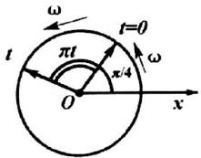
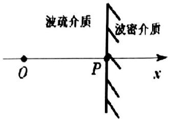
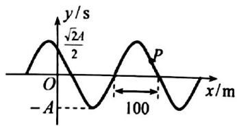

【题目来源】17181 大学物理2B B卷 T1
【教材溯源】第12章 波动光学 - 12.1 光的干涉
【题目正文】
1、在双缝干涉实验中，为了使屏上的条纹间距变大，可以采取的办法是

A. 使屏幕靠近双缝.
B. 使两缝的间距变小.
C. 把两缝的宽度稍微调窄.
D. 改用波长较小的单色光源.
【答案】B
【AI解析】双缝干涉条纹间距 $\Delta x=\frac{D\lambda}{d}$。使两缝间距 $d$ 变小，间距 $\Delta x$ 变大。屏幕靠近双缝使 $D$ 减小，间距变小。缝宽与条纹间距无关，只影响亮度。波长变小使间距变小。易错点：条纹间距与缝宽无关，调节缝宽不能改变条纹间距。

【题目来源】17181 大学物理2B B卷 T2
【教材溯源】第10章 波动 - 10.6 波的干涉
【题目正文】
2、波函数为 $y_{1}=0.01\cos(100\pi t-x)$ m 和 $y_{2}=0.01\cos(100\pi t+x)$ m 的两列波相遇叠加后，两相邻波腹之间的间距为

A. 0.55m;
B. 1.5m;
C. 3.14m;
D. 2m
【答案】C
【AI解析】两列波叠加得 $y=y_1+y_2=0.02\cos x\cos(100\pi t)\ \mathrm{m}$，形成驻波。驻波波腹间距为半个波长。由 $k=1\ \mathrm{rad/m}$，波长 $\lambda=\frac{2\pi}{k}=2\pi\ \mathrm{m}$。故两相邻波腹间距 $\frac{\lambda}{2}=\pi\approx3.14\ \mathrm{m}$。易错点：波腹间距是半个波长，不是整个波长。

【题目来源】17181 大学物理2B B卷 T3
【教材溯源】第9章 振动 - 9.1 简谐振动
【题目正文】
3、一简谐振动的旋转矢量如图所示，设图中圆的半径为 R，则该简谐振动的表达式为

A. $x = R \cos(\pi t + \pi / 4)$
B. $x = R \sin(\pi t + \pi / 4)$
C. $x = R\cos (\pi t - \pi /4)$
D. $x = R \cos(\pi t / 2 + \pi / 4)$

【答案】A
【AI解析】由图读出 $t=0$ 时旋转矢量与 $x$ 轴正方向夹角为 $\frac{\pi}{4}$。图中标注旋转矢量转过的角度为 $\pi t$，故角速度 $\omega=\pi\ \mathrm{rad/s}$。简谐振动用余弦函数表示，初相即 $\frac{\pi}{4}$。故振动表达式为 $x=R\cos(\pi t+\frac{\pi}{4})$。易错点：旋转矢量图给出的是余弦形式初相，若写成正弦形式须调整初相。

【题目来源】17181 大学物理2B B卷 T4
【教材溯源】第12章 波动光学 - 12.1 光的干涉
【题目正文】
4、一束波长为 $\lambda$ 的单色光从空气垂直入射到折射率为 n 的透明薄膜上，要使反射光得到增强，薄膜的厚度应为

A. $\lambda/4$ .
B. $\lambda/(4n)$ .
C. $\lambda/2$ .
D. $\lambda/(2n)$
【答案】B
【AI解析】薄膜上下表面均为空气，上表面反射有半波损失，下表面反射无半波损失。反射光干涉增强条件为 $2ne+\frac{\lambda}{2}=k\lambda$。取 $k=1$ 得最小厚度 $e=\frac{\lambda}{4n}$。易错点：两表面反射光程差为 $2ne$ 且只附加一次半波损失，最小厚度对应 $k=1$。

【题目来源】17181 大学物理2B B卷 T5
【教材溯源】第12章 波动光学 - 12.2 光的衍射
【题目正文】
5、波长为 $\lambda$ 的单色光垂直入射在缝宽 $a=4\lambda$ 的单缝上。对应于衍射角 $\phi=30^{\circ}$ ，单缝处的波面可以划分的半波带的个数为

A. 2.
B. 3.
C. 4.
D. 8.
【答案】C
【AI解析】单缝衍射中半波带个数 $N=\frac{a\sin\phi}{\lambda/2}$。代入 $a=4\lambda$、$\phi=30^\circ$，得 $N=\frac{4\lambda\times\sin30^\circ}{\lambda/2}=\frac{2\lambda}{\lambda/2}=4$。故波面可划分为 4 个半波带。易错点：半波带个数按 $\frac{\lambda}{2}$ 的光程差划分，不是按 $\lambda$ 划分。

【题目来源】17181 大学物理2B B卷 T6
【教材溯源】第14章 物质的波粒二象性 - 14.1 黑体辐射与能量子
【题目正文】
6、假设太阳辐射可以被当作黑体辐射，测得太阳单色辐出度的最大值所对应的波长为 $\lambda_{m}=465\ nm$ ，于是估算出太阳的温度为 $(b=2.898\times10^{-3}\ m\cdot K)$

A. 3780 K.
B. 6232 K .
C. 7800 K.
D.12000 K .
【答案】B
【AI解析】由维恩位移定律 $\lambda_m T=b$。温度 $T=\frac{b}{\lambda_m}$。代入 $\lambda_m=465\ \mathrm{nm}=4.65\times10^{-7}\ \mathrm{m}$、$b=2.898\times10^{-3}\ \mathrm{m\cdot K}$，得 $T=\frac{2.898\times10^{-3}}{4.65\times10^{-7}}\approx6232\ \mathrm{K}$。易错点：波长须换算成米再代入，量纲才会一致。

【题目来源】17181 大学物理2B B卷 T7
【教材溯源】第14章 物质的波粒二象性 - 14.2 光电效应与光子
【题目正文】
7、用频率为 $\nu$ 的单色光波照射金属，发生光电效应，光电子的动能为 $E_{k}$ ，如果入射光的频率变为原来的两倍，则光电子的动能为

A. $2h\nu + E_{k}$ .
B. $2h\nu - E_{k}$ .
C. $h\nu + E_{k}$ .
D. $h\nu - E_{k}$ .
【答案】C
【AI解析】光电效应方程 $E_k=h
u-W$，逸出功 $W=h
u-E_k$。频率变为 $2
u$ 后，光电子动能 $E_k'=2h
u-W=2h
u-(h
u-E_k)$。化简得 $E_k'=h
u+E_k$。易错点：逸出功不随入射光频率变化，直接相减即可消去。

【题目来源】17181 大学物理2B B卷 T8
【教材溯源】第10章 波动 - 10.1 波动方程、平面简谐波
【题目正文】
8、关于波，下面叙述中正确的是

A. 波动表达式中的坐标原点一定要放在波源位置
B. 机械振动一定能产生机械波
C. 质点振动的周期与波的周期数值相等
D. 振动的速度与波的传播速度大小相等
【答案】C
【AI解析】坐标原点可任意选取，不一定在波源处。机械振动需要弹性媒质才能形成机械波。波源质点的振动周期与波的周期数值相等，波上各质点都按此周期振动。质点振动速度与波的传播速度是两个不同概念。故只有 C 正确。易错点：振动速度是质点的瞬时速度，波速是振动状态传播的速度，两者不可混淆。

【题目来源】17181 大学物理2B B卷 T9
【教材溯源】第15章 量子力学基础 - 15.5 电子的自旋 原子的壳层结构
【题目正文】
9、氢原子中处于 3d 量子态的电子，描述其量子态的四个量子数(n, l, m, m\_s)可能取的值为

A. $(3, 0, 1, \frac{1}{2})$
B. $(1, 1, 1, \frac{1}{2})$
C. $(2, 1, 2, -\frac{1}{2})$
D. $(3, 2, 0, -\frac{1}{2})$
【答案】D
【AI解析】3d 态对应 $n=3$、$l=2$（d 态）。磁量子数满足 $|m_l|\le l=2$，自旋磁量子数 $m_s=\pm\frac{1}{2}$。D 中 $(3,2,0,-\frac{1}{2})$ 满足全部条件。A 中 $l=0$ 时 $m_l$ 只能为 0。B 中 $n$ 应为 3。C 中 $m_l=2$ 超过 $l=1$。易错点：d 态对应 $l=2$，与主量子数 $n=3$ 同时满足才能构成 3d 态。

【题目来源】17181 大学物理2B B卷 T10
【教材溯源】第13章 狭义相对论 - 13.3 相对论力学
【题目正文】
10、根据相对论力学，动能为 0.25Mev 的电子，其运动速度约等于

A.0.1c
B.0.5c
C.0.75c
D.0.85c

(c 是真空中的光速，电子的静止能量是 0.51MeV)
【答案】C
【AI解析】电子总能量 $E=E_k+m_ec^2=0.25+0.51=0.76\ \mathrm{MeV}$。洛伦兹因子 $\gamma=\frac{E}{m_ec^2}=\frac{0.76}{0.51}=1.49$。由 $\gamma=\frac{1}{\sqrt{1-\frac{v^2}{c^2}}}$ 得 $\frac{v}{c}=\sqrt{1-\frac{1}{\gamma^2}}=\sqrt{1-0.45}\approx0.74$。故速度约为 $0.75c$。易错点：先由动能加静能求总能量，再由 $\gamma$ 反解速度。

【题目来源】17181 大学物理2B B卷 T11
【教材溯源】第10章 波动 - 10.1 波动方程、平面简谐波
【题目正文】
11、如图所示 O 点是一机械波的波源，振动形式为 $y(0,t)=5\cos(\pi t+\pi/4)$ (SI)，设机械波的波长为 $\lambda$ ，则向 x 轴正向传播的简谐波的波函数为\_\_\_\_；
如果波在 P 点发生反射，并且 O 到 P 的距离是机械波波长的一半，则反射波的形式为\_\_\_\_。

【答案】$y=5\cos(\pi t-\frac{2\pi x}{\lambda}+\frac{\pi}{4})$；$y=5\cos(\pi t+\frac{2\pi x}{\lambda}-\frac{3\pi}{4})$
【AI解析】波沿 $+x$ 传播，把 $y(0,t)$ 中的 $t$ 换成 $t-\frac{x}{u}$，得 $y=5\cos(\pi t-\frac{2\pi x}{\lambda}+\frac{\pi}{4})$。图中反射面为波密介质，反射点相当于固定端，有半波损失。入射波在 P 点（$x=\frac{\lambda}{2}$）的相位为 $\pi t-\frac{3\pi}{4}$。反射波在 P 点反相，相位为 $\pi t-\frac{3\pi}{4}+\pi=\pi t+\frac{\pi}{4}$。反射波沿 $-x$ 传播，形式为 $y=5\cos[\pi t+\frac{2\pi(x-\lambda/2)}{\lambda}+\frac{\pi}{4}]=5\cos(\pi t+\frac{2\pi x}{\lambda}-\frac{3\pi}{4})$。易错点：从波疏介质入射到波密介质的反射有半波损失，反射点处反射波与入射波反相。

【题目来源】17181 大学物理2B B卷 T12
【教材溯源】第10章 波动 - 10.2 波的能量、能流密度
【题目正文】
12、当机械波在介质中传播时，一介质质元的最大形变发生在\_\_\_\_位置。
【答案】平衡位置
【AI解析】介质质元的形变程度决定其弹性势能的大小。质元在平衡位置处相对形变最大，弹性势能最大。在最大位移处质元相对形变为零。故最大形变发生在平衡位置。易错点：波的能量与弹簧振子不同，平衡位置处动能和势能同时最大。

【题目来源】17181 大学物理2B B卷 T13
【教材溯源】第14章 物质的波粒二象性 - 14.3 康普顿散射
【题目正文】
13、在康普顿散射实验中，如果散射角是 $\pi$ ，那么波长的改变量是 \_\_\_\_。
【答案】$\Delta\lambda=\frac{2h}{m_ec}\approx4.85\times10^{-12}\ \mathrm{m}$
【AI解析】康普顿波长改变量 $\Delta\lambda=\frac{h}{m_ec}(1-\cos\theta)$。散射角 $\theta=\pi$ 时 $\cos\theta=-1$。故 $\Delta\lambda=\frac{2h}{m_ec}$。代入 $h=6.63\times10^{-34}\ \mathrm{J\cdot s}$、$m_e=9.11\times10^{-31}\ \mathrm{kg}$、$c=3\times10^8\ \mathrm{m/s}$，得 $\Delta\lambda\approx4.85\times10^{-12}\ \mathrm{m}$。易错点：散射角为 $\pi$ 时波长改变量取最大值，等于康普顿波长的两倍。

【题目来源】17181 大学物理2B B卷 T14
【教材溯源】第15章 量子力学基础 - 15.1 物质波波函数的特性
【题目正文】
14、在电子单缝衍射实验中，若缝宽为a=0.1nm，电子束垂直射在单缝面上，则衍射的电子横向动量的最小不确定量 $\Delta p_{y}=$ \_\_\_\_ N·s.
【答案】$\Delta p_y\approx\frac{h}{a}\approx6.6\times10^{-24}\ \mathrm{N\cdot s}$
【AI解析】电子通过单缝时横向位置的不确定量 $\Delta y=a=10^{-10}\ \mathrm{m}$。由不确定关系 $\Delta y\Delta p_y\ge h$。横向动量最小不确定量 $\Delta p_y=\frac{h}{a}$。代入 $h=6.63\times10^{-34}\ \mathrm{J\cdot s}$，得 $\Delta p_y\approx6.6\times10^{-24}\ \mathrm{N\cdot s}$。易错点：位置不确定量取缝宽 $a$，注意单位为纳米需换算成米。

【题目来源】17181 大学物理2B B卷 T15
【教材溯源】第12章 波动光学 - 12.1 光的干涉
【题目正文】
15、若在迈克耳孙干涉仪的可动反射镜 M 移动 0.620mm 的过程中，观察到干涉条纹移动了 2300 条，则所用光的波长为 \_\_\_\_ nm。
【答案】539 nm
【AI解析】迈克耳孙干涉仪中反射镜移动 $\Delta d$，光在动臂往返一次，光程变化为 $2\Delta d$。条纹移动数 $N$ 与波长满足 $2\Delta d=N\lambda$。故 $\lambda=\frac{2\Delta d}{N}=\frac{2\times0.620\times10^6}{2300}\approx539\ \mathrm{nm}$。易错点：光程变化是镜移动距离的两倍，不能漏乘 2。

【题目来源】17181 大学物理2B B卷 T16
【教材溯源】第12章 波动光学 - 12.1 光的干涉
【题目正文】
16、在牛顿环实验中，平凸透镜和平板玻璃的折射率相同，观察反射光，开始时平凸透镜和平板玻璃之间是真空，此时测得干涉环的第 k 个暗环的半径是 $r_{1}$ ；接下来将某种液体注入到平凸透镜和平板玻璃之间，此时测得干涉环的第 k 个暗环的半径是 $r_{2}$ ，则注入液体的折射率 n= \_\_\_\_.
【答案】$n=(\frac{r_1}{r_2})^2$
【AI解析】真空时第 k 级暗环满足 $r_1^2=kR\lambda$，其中 $R$ 为透镜曲率半径。注入折射率 $n$ 的液体后，膜内波长变为 $\frac{\lambda}{n}$，暗环满足 $r_2^2=kR\frac{\lambda}{n}$。两式相除得 $\frac{r_1^2}{r_2^2}=n$。故 $n=(\frac{r_1}{r_2})^2$。易错点：液体改变的是膜内波长，暗环条件中的波长要用 $\frac{\lambda}{n}$。

【题目来源】17181 大学物理2B B卷 T17
【教材溯源】第14章 物质的波粒二象性 - 14.5 氢原子和玻尔的量子论
【题目正文】
17、根据玻尔氢原子理论，当大量氢原子处于 n = 3 的激发态时，原子跃迁将发出\_\_\_\_种波长的光.
【答案】3
【AI解析】大量氢原子处于 $n=3$ 激发态，电子可向 $n=2$、$n=1$ 跃迁，$n=2$ 上的电子还可继续向 $n=1$ 跃迁。可能的跃迁组合数为 $C_3^2=3$。即 $3\to2$、$3\to1$、$2\to1$ 共 3 种波长的光。易错点：谱线数目是组合数 $C_n^2$，不是从最高能级直接向下数的链式跃迁数。

【题目来源】17181 大学物理2B B卷 T18
【教材溯源】第12章 波动光学 - 12.1 光的干涉
【题目正文】
18、波长λ的单色光垂直照射折射率为n的劈形膜形成等厚干涉条纹，若测得相邻条纹的间距为L，则劈尖角θ=\_\_\_\_.
【答案】$\theta=\frac{\lambda}{2nL}$
【AI解析】劈形膜干涉条纹间距 $L=\frac{\lambda}{2n\sin\theta}$。劈尖角很小时 $\sin\theta\approx\theta$。故 $\theta=\frac{\lambda}{2nL}$。易错点：膜内波长为 $\frac{\lambda}{n}$，折射率 $n$ 要计入条纹间距公式的分母。

【题目来源】17181 大学物理2B B卷 T19
【教材溯源】第13章 狭义相对论 - 13.3 相对论力学
【题目正文】
19、设电子静止质量为 $m_{e}$ ，将一个电子从静止加速到速率为 0.6 c (c 为真空中光速)，电子的相对论质量是 \_\_\_\_。
【答案】$m=1.25m_e$
【AI解析】相对论质量 $m=\frac{m_e}{\sqrt{1-\frac{v^2}{c^2}}}$。代入 $v=0.6c$，得 $m=\frac{m_e}{\sqrt{1-0.36}}=\frac{m_e}{0.8}$。故 $m=1.25m_e$。易错点：$\sqrt{1-0.6^2}=0.8$，质量增大为静质量的 1.25 倍。

【题目来源】17181 大学物理2B B卷 T20
【教材溯源】第10章 波动 - 10.1 波动方程、平面简谐波
【题目正文】
20、已知一简谐波的波函数为 $y = 5 \cos(\pi t + 4 \pi x + \pi / 2)$ (SI 单位)，可知该简谐波的传播方向为 \_\_\_\_，其波长为 \_\_\_\_，原点的初相为 \_\_\_\_。
【答案】沿 x 轴负方向；$\lambda=0.5\ \mathrm{m}$；$\frac{\pi}{2}$
【AI解析】波函数中 $t$ 与 $x$ 同号，即含 $+\frac{2\pi x}{\lambda}$ 项，波沿 $x$ 轴负方向传播。由 $k=4\pi=\frac{2\pi}{\lambda}$ 得波长 $\lambda=0.5\ \mathrm{m}$。原点 $x=0$ 处振动为 $y=5\cos(\pi t+\frac{\pi}{2})$。故初相为 $\frac{\pi}{2}$。易错点：$t$ 与 $x$ 异号沿正方向传播、同号沿负方向传播，不要只看 $x$ 前符号。

【题目来源】17181 大学物理2B B卷 T21
【教材溯源】第9章 振动 - 9.4 简谐振动的合成
【题目正文】
21、两个同方向同频率的简谐振动分别为

$$
x _ {1} = 0. 8 \cos (1 0 0 \pi t + \pi / 6) \mathrm{m}
$$

$$
x _ {2} = 0. 8 \cos (1 0 0 \pi t + 5 \pi / 6) \mathrm{m}
$$

(1)求合振动的表达式;

(2)合振动由初始位置到负向最大位移处的时间。
【答案】(1) $x=0.8\cos(100\pi t+\frac{\pi}{2})\ \mathrm{m}$；(2) $t=0.005\ \mathrm{s}$
【AI解析】两振动相位差为 $\frac{5\pi}{6}-\frac{\pi}{6}=\frac{2\pi}{3}$。合振幅 $A=\sqrt{0.8^2+0.8^2+2\times0.8^2\cos\frac{2\pi}{3}}=0.8\ \mathrm{m}$。由旋转矢量合成，合振动初相为两振动相位的角平分线方向，即 $\varphi=\frac{\pi}{2}$。合振动表达式为 $x=0.8\cos(100\pi t+\frac{\pi}{2})\ \mathrm{m}$。$t=0$ 时 $x=0$ 且向负方向运动，到达负向最大位移需相位从 $\frac{\pi}{2}$ 到 $\pi$。所需时间 $t=\frac{\pi-\frac{\pi}{2}}{100\pi}=0.005\ \mathrm{s}$。易错点：等幅两振动合成的合矢量沿角平分线方向，初相取两初相的算术平均。

【题目来源】17181 大学物理2B B卷 T22
【教材溯源】第10章 波动 - 10.1 波动方程、平面简谐波
【题目正文】
22、如图所示为一平面简谐波在 t=0 时刻的波形图，设此简谐波的频率为 f=250 Hz，振幅是 A，且此时质点 P 的运动方向向下，求

(1) 该波的波函数.

(2) 求在坐标轴正向距原点 O 为 100 m 处质点的振动表达式与振动速度表达式.

【答案】(1) $y=A\cos(500\pi t+\frac{\pi}{50}x+\frac{\pi}{2})\ \mathrm{SI}$，波沿 x 轴负方向传播；(2) $y=A\cos(500\pi t+\frac{\pi}{2})$，$v=-500\pi A\sin(500\pi t+\frac{\pi}{2})$
【AI解析】由图读出波长 $\lambda=100\ \mathrm{m}$。角频率 $\omega=2\pi f=500\pi\ \mathrm{rad/s}$，波数 $k=\frac{2\pi}{\lambda}=\frac{\pi}{50}\ \mathrm{rad/m}$。P 点位于波形的下降段且向下运动，由波形平移法判断波沿 $-x$ 方向传播。$t=0$ 时 O 处质点过平衡位置向 $-y$ 运动，得初相 $\varphi_0=+\frac{\pi}{2}$。波函数为 $y=A\cos(500\pi t+\frac{\pi}{50}x+\frac{\pi}{2})$。代入 $x=100\ \mathrm{m}$，得该处振动表达式 $y=A\cos(500\pi t+2\pi+\frac{\pi}{2})=A\cos(500\pi t+\frac{\pi}{2})$。对时间求导得振动速度 $v=\frac{dy}{dt}=-500\pi A\sin(500\pi t+\frac{\pi}{2})$。易错点：下降段质点的运动方向与传播方向的关系要按波形平移法判断，先定传播方向再写波函数。

【题目来源】17181 大学物理2B B卷 T23
【教材溯源】第15章 量子力学基础 - 15.3 一维定态系统
【题目正文】
23、在长度为 l 的一维势阱中，粒子的波函数为

$$
\psi (x) = \sqrt {\frac {2}{l}} \sin \frac {n \pi}{l} x
$$

求（1）粒子处于基态时在势阱中某处出现的概率密度；

(2) 从势阱壁 l=0 起到 $\frac{l}{3}$ 区间内粒子出现的概率，又当 n=2 时，此概率是多大？
【答案】(1) $|\psi_1|^2=\frac{2}{l}\sin^2\frac{\pi x}{l}$；(2) $P=\frac{1}{3}-\frac{1}{2n\pi}\sin\frac{2n\pi}{3}$，$n=1$ 时 $P\approx0.196$，$n=2$ 时 $P\approx0.402$
【AI解析】基态 $n=1$，概率密度 $|\psi_1|^2=\frac{2}{l}\sin^2\frac{\pi x}{l}$。在 $0$ 到 $\frac{l}{3}$ 区间的概率 $P=\int_0^{l/3}\frac{2}{l}\sin^2\frac{n\pi x}{l}dx$。用积分公式 $\int\sin^2u\,du=\frac{u}{2}-\frac{\sin2u}{4}$，得 $P=\frac{1}{3}-\frac{1}{2n\pi}\sin\frac{2n\pi}{3}$。$n=1$ 时 $\sin\frac{2\pi}{3}=\frac{\sqrt{3}}{2}$，$P\approx0.196$。$n=2$ 时 $\sin\frac{4\pi}{3}=-\frac{\sqrt{3}}{2}$，$P\approx0.402$。易错点：$n=2$ 时正弦项为负值，代入时要保留符号。

【题目来源】17181 大学物理2B B卷 T24
【教材溯源】第12章 波动光学 - 12.2 光的衍射
【题目正文】
24、用一束具有两种波长的平行光垂直入射在光栅上， $\lambda_{1}=600\ nm,\ \lambda_{2}=400\ nm$ ，发现距中央明纹5cm处 $\lambda_{1}$ 光的第k级主极大和 $\lambda_{2}$ 光的第 $(k+1)$ 级主极大相重合，放置在光栅与屏之间的透镜的焦距f=50cm，试求：

(1) 上述的k值；
(2) 光栅常量d.
【答案】(1) $k=2$；(2) $d\approx1.2\times10^{-5}\ \mathrm{m}$
【AI解析】两主极大重合时衍射角相同，满足 $k\lambda_1=(k+1)\lambda_2$。代入得 $600k=400(k+1)$。解得 $k=2$。重合处距中央明纹 $x=5\ \mathrm{cm}$，由 $\tan\theta=\frac{x}{f}=\frac{5}{50}=0.1$ 得 $\sin\theta\approx0.0995$。由光栅方程 $d\sin\theta=k\lambda_1$，得 $d=\frac{2\times600\times10^{-9}}{0.0995}\approx1.2\times10^{-5}\ \mathrm{m}$。易错点：重合条件是对同一衍射角比较两个波长对应的级次，而不是比较光程差。
