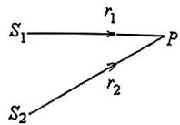
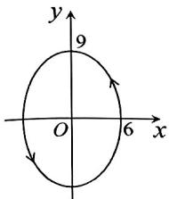
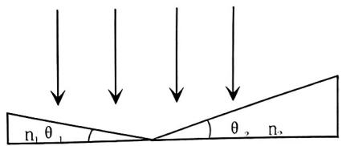
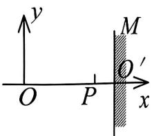
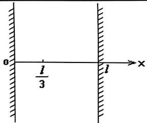

【题目来源】19201 大学物理1B B卷 T1
【教材溯源】第10章 波动 - 10.6 波的干涉
【题目正文】
1、如图所示，两列波长为 $\lambda$ 的相干波在 P 点相遇， $S_{1}$ 点的初相位是 $\varphi_{1}$ ， $S_{1}$ 点到 P 点的距离是 $r_{1}$ ， $S_{2}$ 点的初相位是 $\varphi_{2}$ ， $S_{2}$ 点到 P 点的距离是 $r_{2}$ ，以 k 代表零或正、负整数，则 P 点是干涉极大的条件为：

A. $r_{2}-r_{1}=k\lambda$
B. $\varphi_{2}-\varphi_{1}=2k\pi$
C. $\varphi_{2}-\varphi_{1}+2\pi(r_{2}-r_{1})/\lambda=2k\pi$
D. $\varphi_{2}-\varphi_{1}+2\pi(r_{1}-r_{2})/\lambda=2k\pi$
【答案】D
【AI解析】波从波源传到 P 点，相位要减去传播项 $2\pi\frac{r}{\lambda}$。P 点处两列波的相位差为 $(\varphi_2-2\pi\frac{r_2}{\lambda})-(\varphi_1-2\pi\frac{r_1}{\lambda})$。干涉极大要求该相位差等于 $2k\pi$。化简得 $\varphi_2-\varphi_1+2\pi\frac{r_1-r_2}{\lambda}=2k\pi$。易错点：路程远的波相位落后，传播项的符号是减号，合并后对应 $r_1-r_2$ 而非 $r_2-r_1$。

【题目来源】19201 大学物理1B B卷 T2
【教材溯源】第14章 物质的波粒二象性 - 14.2 光电效应与光子
【题目正文】
2、当照射光的波长从 400nm 变到 300nm 时，对同一金属，在光电效应实验中测得的遏止电压将：
(普朗克常量 $h = 6.63 \times 10^{-34} J \cdot s$ ，基本电荷 $e = 1.60 \times 10^{-19} C$ ) [

A. 减小 0.56V
B. 减小 0.34V
C. 增大 0.165V
D. 增大 1.035V
【答案】D
【AI解析】由光电效应方程 $e|U_0|=h\nu-W$，波长变短时光子能量增大。遏止电压的改变量 $e\Delta U=\Delta(h\nu)=hc(\frac{1}{\lambda_2}-\frac{1}{\lambda_1})$。代入 $\lambda_1=400\ \mathrm{nm}$、$\lambda_2=300\ \mathrm{nm}$，得 $\Delta U=\frac{6.63\times10^{-34}\times3\times10^8}{1.6\times10^{-19}}\times(\frac{1}{300}-\frac{1}{400})\times10^9\approx1.035\ \mathrm{V}$。故遏止电压增大 1.035 V。易错点：波长变短对应光子能量变大，遏止电压是增大而非减小。

【题目来源】19201 大学物理1B B卷 T3
【教材溯源】第15章 量子力学基础 - 15.5 电子的自旋 原子的壳层结构
【题目正文】
3、下列各组量子数中，哪一组可以描述原子中电子的状态？

A. $n = 2, l = 2, m_l = 0, m_s = \frac{1}{2}$
B. n=3, l=1, $m_{l}=-1$ , $m_{s}=-\frac{1}{2}$
C. n=1, l=2, $m_{l}=1$ , $m_{s}=\frac{1}{2}$
D. $n = 1, l = 0, m_l = 1, m_s = -\frac{1}{2}$
【答案】B
【AI解析】四个量子数须满足 $0\le l\le n-1$、$|m_l|\le l$、$m_s=\pm\frac{1}{2}$。A 中 $l=2$ 超过 $n-1=1$，不合法。B 中 $n=3, l=1, m_l=-1$ 满足全部条件。C 中 $n=1$ 时 $l$ 只能为 0。D 中 $l=0$ 时 $m_l$ 只能为 0。易错点：$l$ 的上限是 $n-1$，$m_l$ 的上限是 $l$，两个约束都要检验。

【题目来源】19201 大学物理1B B卷 T4
【教材溯源】第12章 波动光学 - 12.2 光的衍射
【题目正文】
4、一单色平行光束垂直照射在宽度为 $1.0 \, mm$ 的单缝上，在缝后放一焦距为 $2.0 \, m$ 的会聚透镜。已知位于透镜焦平面处的屏幕上的中央明条纹宽度为 $2.0 \, mm$ ，则入射光波长约为 $(1 \, \text{nm} = 10^{-9} \, \text{m})$

A. 100 nm
B. 400 nm
C. 500 nm
D. 600 nm.
【答案】C
【AI解析】单缝衍射中央明纹宽度 $\Delta x=2f\frac{\lambda}{a}$。变形得 $\lambda=\frac{\Delta x\cdot a}{2f}$。代入 $\Delta x=2.0\times10^{-3}\ \mathrm{m}$、$a=1.0\times10^{-3}\ \mathrm{m}$、$f=2.0\ \mathrm{m}$，得 $\lambda=\frac{2\times10^{-3}\times10^{-3}}{4}=5\times10^{-7}\ \mathrm{m}$。即入射光波长约为 500 nm。易错点：中央明纹宽度包含两侧第一级暗纹之间的距离，公式中系数为 2。

【题目来源】19201 大学物理1B B卷 T5
【教材溯源】第10章 波动 - 10.4 电磁波
【题目正文】
5、在真空中沿着 z 轴负方向传播的平面电磁波，其磁场强度波的表达式为 $H_{x} = -H_{0} \cos \omega (t + z / c)$ ，则电场强度波的表达式为： [ ]

A. $E_{y}=\sqrt{\mu_{0}/\varepsilon_{0}}H_{0}\cos\omega(t+z/c)$
B. $E_{x}=\sqrt{\mu_{0}/\varepsilon_{0}}H_{0}\cos\omega(t+z/c)$
C. $E_{y} = -\sqrt{\mu_{0}/\varepsilon_{0}} H_{0} \cos \omega (t + z/c)$
D. $E_{y} = -\sqrt{\mu_{0}/\varepsilon_{0}} H_{0} \cos \omega (t - z/c)$
【答案】C
【AI解析】含 $t+\frac{z}{c}$ 项说明波沿 $z$ 轴负方向传播。$H$ 沿 $-x$ 方向。由 $\vec{E}\times\vec{H}$ 指向传播方向 $-z$，即 $\hat{E}\times(-\hat{x})=-\hat{z}$，得 $\hat{E}=-\hat{y}$。真空中 $E$ 与 $H$ 同相位，幅值关系 $E_0=\sqrt{\frac{\mu_0}{\varepsilon_0}}H_0$。故 $E_y=-\sqrt{\frac{\mu_0}{\varepsilon_0}}H_0\cos\omega(t+z/c)$。易错点：$t+z/c$ 对应负方向传播，D 项相位符号不符。

【题目来源】19201 大学物理1B B卷 T6
【教材溯源】第10章 波动 - 10.2 波的能量、能流密度
【题目正文】
6、当一平面简谐机械波在弹性媒质中传播时，下述各结论哪个是正确的？

A. 媒质质元在其平衡位置处弹性势能最大.
B. 媒质质元的振动动能和弹性势能都作周期性变化，但二者的相位不相同.
C. 媒质质元的振动动能和弹性势能的相位在任一时刻都相同，但二者的数值不相等.
D. 媒质质元的振动动能增大时，其弹性势能减小，总机械能守恒.
【答案】A
【AI解析】媒质质元的弹性势能与振动动能同相位同步变化。在平衡位置处质元形变最大，动能与势能同时达到最大。在最大位移处形变为零，动能与势能同时为零。故选项 A 正确。易错点：媒质质元机械能不守恒，不能套用孤立弹簧振子的能量转换结论。

【题目来源】19201 大学物理1B B卷 T7
【教材溯源】第13章 狭义相对论 - 13.3 相对论力学
【题目正文】
7、设某微观粒子的总能量是它的静止能量的 K 倍，则其运动速度的大小为：

A. $\frac{c}{K-1}$
B. $\frac{c}{K}\sqrt{1-K^{2}}$
C. $\frac{c}{K}\sqrt{K^{2}-1}$
D. $\frac{c}{K+1}\sqrt{K(K+2)}$
【答案】C
【AI解析】总能量 $E=KE_0$，洛伦兹因子 $\gamma=\frac{E}{E_0}=K$。由 $\gamma=\frac{1}{\sqrt{1-\frac{v^2}{c^2}}}$ 得 $\frac{v}{c}=\sqrt{1-\frac{1}{\gamma^2}}$。代入 $\gamma=K$，得 $v=\frac{c}{K}\sqrt{K^2-1}$。易错点：由 $\gamma=K$ 直接反解速度，不要误把 $K$ 当作 $\frac{v}{c}$ 代入。

【题目来源】19201 大学物理1B B卷 T8
【教材溯源】第12章 波动光学 - 12.1 光的干涉
【题目正文】
8、在迈克耳孙干涉仪的一条光路中，放入一折射率为 n，厚度为 d 的透明薄片，放入后，这条光路的光程改变了：

A. $2(n-1)d$
B. 2nd
C. $2(n-1)d+\frac{\lambda}{2}$
D. nd
E. (n-1)d
【答案】A
【AI解析】薄片放入前后该光路的光程差为 $nd-d=(n-1)d$。光在干涉仪该臂中往返一次，光程改变量为 $2(n-1)d$。易错点：往返经过薄片两次，光程改变要乘 2，且比较的是与原来空气段光程之差。

【题目来源】19201 大学物理1B B卷 T9
【教材溯源】第9章 振动 - 9.4 简谐振动的合成
【题目正文】
9、图中椭圆是两个互相垂直的同频率谐振动合成的图形，已知 x 方向的振动方程为 $x = 6 \cos \left( \omega t + \frac{\pi}{2} \right)$ ，动点在椭圆上沿逆时针方向运动，则 y 方向的振动方程应为

A. $y = 9 \cos \left( \omega t + \frac{\pi}{2} \right)$
B. $y = 9 \cos \left( \omega t - \frac{\pi}{2} \right)$
C. $y = 9 \cos(\omega t)$
D. $y = 9 \cos(\omega t + \pi)$
【答案】C
【AI解析】由图读出 y 方向振幅为 9。动点沿逆时针方向运动，要求 x 方向相位超前 y 方向 $\frac{\pi}{2}$。已知 x 相位为 $\omega t+\frac{\pi}{2}$。故 y 的相位为 $\omega t$，即 $y=9\cos(\omega t)$。易错点：x 超前 y $\frac{\pi}{2}$ 对应逆时针，若 x 落后 y $\frac{\pi}{2}$ 则顺时针，方向判断不能颠倒。

【题目来源】19201 大学物理1B B卷 T10
【教材溯源】第12章 波动光学 - 12.3 光的偏振
【题目正文】
10、一束圆偏振光通过二分之一波片后透出的光是

A. 线偏振光.
B. 部分偏振光、
C. 和原来旋转方向相同的圆偏振光
D. 和原来旋转方向相反的圆偏振光.
E. 椭圆偏振光.
【答案】D
【AI解析】圆偏振光可分解为 o 光与 e 光两个等幅、相位差 $\frac{\pi}{2}$ 的分量。二分之一波片使两分量附加 $\pi$ 的相位差。相位差由 $\pm\frac{\pi}{2}$ 变为 $\mp\frac{\pi}{2}$，圆偏振的旋向反转。故透出的是旋转方向相反的圆偏振光。易错点：半波片改变的是旋向而不是偏振态类型，圆偏振光不会变成线偏振光。

【题目来源】19201 大学物理1B B卷 T11
【教材溯源】第11章 几何光学基础 - 11.1 几何光学的基本实验定律和基本原理
【题目正文】
11、叙述费马原理\_\_\_\_。
【答案】光线在两点间传播的实际路径，其光程同附近路径相比取极小值、极大值或恒定值。
【AI解析】费马原理指出，光在两点间传播时，实际路径的光程取极值或恒定值。即与附近各可能路径相比，实际路径的光程不是极小值，便是极大值，或者相等。易错点：费马原理不仅包含光程极小，还包含极大和恒定两种情形。

【题目来源】19201 大学物理1B B卷 T12
【教材溯源】第12章 波动光学 - 12.3 光的偏振
【题目正文】
12、用相互平行的一束自然光和一束线偏振光构成混合光，垂直照射在一偏振片上，以光的传播方向为轴，旋转偏振片时，发现透射光强的最大值为最小值的5倍，则入射光中，自然光的光强 $I_{0}$ 和线偏振光的光强I之比为\_\_\_\_。
【答案】$I_0:I=1:2$
【AI解析】自然光过偏振片后光强恒为 $\frac{I_0}{2}$。线偏振光过偏振片后光强在 $0\sim I$ 之间变化。透射光强最大值 $I_{max}=\frac{I_0}{2}+I$，最小值 $I_{min}=\frac{I_0}{2}$。由 $\frac{I_{max}}{I_{min}}=5$ 得 $\frac{\frac{I_0}{2}+I}{\frac{I_0}{2}}=5$。解得 $I=2I_0$，即 $I_0:I=1:2$。易错点：自然光分量的透射光强与偏振片取向无关，始终为原光强的一半。

【题目来源】19201 大学物理1B B卷 T13
【教材溯源】第10章 波动 - 10.6 波的干涉
【题目正文】
13、设入射波的表达式为 $y_{1}=A\cos2\pi\left(\frac{t}{T}+\frac{x}{\lambda}\right)$ ，在 x=0 处发生反射，反射点为一固定端。设反射时无能量损失，则合成驻波波腹的位置\_\_\_\_；
波节的位置\_\_\_\_。
【答案】波腹 $x=(2k+1)\frac{\lambda}{4}$；波节 $x=k\frac{\lambda}{2}$（$k=0,1,2,\cdots$）
【AI解析】固定端反射有半波损失，反射波为 $y_2=A\cos[2\pi(\frac{t}{T}-\frac{x}{\lambda})+\pi]$。两波叠加得驻波 $y=-2A\sin\frac{2\pi x}{\lambda}\sin\frac{2\pi t}{T}$。振幅为 $|2A\sin\frac{2\pi x}{\lambda}|$。波腹处 $\sin\frac{2\pi x}{\lambda}=\pm1$，得 $x=(2k+1)\frac{\lambda}{4}$。波节处 $\sin\frac{2\pi x}{\lambda}=0$，得 $x=k\frac{\lambda}{2}$。易错点：固定端是波节，$x=0$ 处满足 $k=0$ 的波节条件，可作为验算。

【题目来源】19201 大学物理1B B卷 T14
【教材溯源】第14章 物质的波粒二象性 - 14.1 黑体辐射与能量子
【题目正文】
14、在加热黑体过程中，其最大单色辐出度（单色辐射本领）对应的波长由0.8μm变到0.4μm，则其总辐出度（总辐射本领）增大为原来的\_\_\_\_倍。
【答案】16
【AI解析】由维恩位移定律 $\lambda_m T=b$，$\lambda_m$ 减半说明黑体温度加倍。由斯特藩-玻尔兹曼定律，总辐出度 $M=\sigma T^4$。总辐出度与温度的四次方成正比，温度加倍后增大为原来的 $2^4=16$ 倍。易错点：辐出度与温度是四次方关系，不能用一次方或平方关系估算。

【题目来源】19201 大学物理1B B卷 T15
【教材溯源】第12章 波动光学 - 12.1 光的干涉
【题目正文】
15、在双缝干涉实验中，所用单色光波长 $\lambda=562.5nm(1nm=10^{-9}m)$ 。双缝与观察屏的距离 D=1.2m，若测得屏上相邻明条纹间距为 $\Delta x=1.5mm$ ，则双缝的间距 d= \_\_\_\_ mm.
【答案】0.45 mm
【AI解析】双缝干涉条纹间距 $\Delta x=\frac{D\lambda}{d}$。变形得 $d=\frac{D\lambda}{\Delta x}$。代入 $D=1.2\ \mathrm{m}$、$\lambda=562.5\times10^{-9}\ \mathrm{m}$、$\Delta x=1.5\times10^{-3}\ \mathrm{m}$，得 $d=\frac{1.2\times562.5\times10^{-9}}{1.5\times10^{-3}}=4.5\times10^{-4}\ \mathrm{m}$。即双缝间距为 0.45 mm。易错点：注意单位统一，结果要换算成 mm。

【题目来源】19201 大学物理1B B卷 T16
【教材溯源】第14章 物质的波粒二象性 - 14.5 氢原子和玻尔的量子论
【题目正文】
16、设大量氢原子处于 n=4 的激发态，它们跃迁时发射出一簇光谱线，这簇光谱线最多可能有\_\_\_\_条，其中最短的波长是\_\_\_\_nm。
（普朗克常量 $h = 6.63 \times 10^{-34} J \cdot s$ ，里德伯常数 $R = 1.097 \times 10^{7} m^{-1}$ ）
【答案】6 条；97.2 nm
【AI解析】$n=4$ 的各能级间跃迁组合数为 $C_4^2=6$，最多可发射 6 条谱线。波长最短的谱线对应能量差最大的跃迁，即 $n=4\to n=1$。光子能量 $E=13.6\times(1-\frac{1}{16})=12.75\ \mathrm{eV}$。波长 $\lambda=\frac{hc}{E}=\frac{1240}{12.75}\approx97.2\ \mathrm{nm}$。易错点：最短波长对应最高能级到基态的跃迁，而不是相邻能级间的跃迁。

【题目来源】19201 大学物理1B B卷 T17
【教材溯源】第12章 波动光学 - 12.3 光的偏振
【题目正文】
17、一束自然光从空气投射到玻璃表面上(空气折射率为1)，当折射角为30°时，反射光是完全偏振光，则此玻璃板的折射率等于\_\_\_\_。
【答案】$\sqrt{3}\approx1.73$
【AI解析】反射光完全偏振时入射角为布儒斯特角 $i_B$。布儒斯特角下反射光与折射光垂直。折射角为 $30^\circ$，故 $i_B=90^\circ-30^\circ=60^\circ$。由布儒斯特定律 $n=\tan i_B=\tan60^\circ=\sqrt{3}\approx1.73$。易错点：折射角与布儒斯特角互余，据此先求入射角再取正切。

【题目来源】19201 大学物理1B B卷 T18
【教材溯源】第10章 波动 - 10.2 波的能量、能流密度
【题目正文】
18、一球面波在各向同性均匀介质中传播，已知波源的功率为 100W，若介质不吸收能量，则距波源 10m 处的波的平均能流密度为 \_\_\_\_。
【答案】$\frac{1}{4\pi}\approx0.08\ \mathrm{W/m^2}$
【AI解析】介质不吸收能量时，波源功率均匀分布在球面上。距波源 $r$ 处的平均能流密度 $I=\frac{P}{4\pi r^2}$。代入 $P=100\ \mathrm{W}$、$r=10\ \mathrm{m}$，得 $I=\frac{100}{4\pi\times100}=\frac{1}{4\pi}\approx0.08\ \mathrm{W/m^2}$。易错点：能流均匀分布在整个球面上，面积取 $4\pi r^2$ 而非 $\pi r^2$。

【题目来源】19201 大学物理1B B卷 T19
【教材溯源】第9章 振动 - 9.4 简谐振动的合成
【题目正文】
19、一个质点同时参与两个在同一直线上的简谐振动，其表达式分别为

$$
x _ {1} = 4 \times 1 0 ^ {- 2} \cos \left(2 t + \frac {\pi}{6}\right) \quad (\mathrm{SI}); \quad x _ {2} = 3 \times 1 0 ^ {- 2} \cos \left(2 t - \frac {5 \pi}{6}\right) \quad (\mathrm{SI})
$$

则其合成振动的振幅为\_\_\_\_，初相为\_\_\_\_。
【答案】$A=1\times10^{-2}\ \mathrm{m}$；$\varphi_0=\frac{\pi}{6}$
【AI解析】两振动的相位差为 $\frac{\pi}{6}-(-\frac{5\pi}{6})=\pi$，即两振动反相。反相合成时振幅为两振幅之差 $A=|4-3|\times10^{-2}=1\times10^{-2}\ \mathrm{m}$。合振动的初相与振幅较大的分振动相同。故 $\varphi_0=\frac{\pi}{6}$。易错点：反相合成振幅取差，初相跟随振幅大的分振动。

【题目来源】19201 大学物理1B B卷 T20
【教材溯源】第12章 波动光学 - 12.1 光的干涉
【题目正文】
20、如图所示，波长为 $\lambda$ 的平行单色光垂直照射在两个劈形膜上，两劈形尖角分别为 $\theta_{1}$ 和 $\theta_{2}$ ，折射率分别为 $n_{1}$ 和 $n_{2}$ ，若二者分别形成的干涉条纹的明条纹间距相等，则 $\theta_{1}$ 、 $\theta_{2}$ 、 $n_{1}$ 和 $n_{2}$ 之间满足的关系是 \_\_\_\_。

【答案】$n_1\theta_1=n_2\theta_2$
【AI解析】劈形膜明条纹间距 $L=\frac{\lambda}{2n\sin\theta}\approx\frac{\lambda}{2n\theta}$。两劈形膜条纹间距相等，有 $\frac{\lambda}{2n_1\theta_1}=\frac{\lambda}{2n_2\theta_2}$。化简得 $n_1\theta_1=n_2\theta_2$。易错点：条纹间距与膜内波长有关，折射率要计入分母，不是简单的 $\theta_1=\theta_2$。

【题目来源】19201 大学物理1B B卷 T21
【教材溯源】第10章 波动 - 10.6 波的干涉
【题目正文】
21、

如图，一角频率为 $\omega$ ，振幅为 A 的平面简谐波沿 x 轴正方向传播。设在 t=0 时该波在原点 O 处引起的振动使媒质元由平衡位置向 y 轴的负方向运动。M 是垂直于 x 轴的波密媒质反射面。已知 $OO'=\frac{7\lambda}{4}$ ， $PO'=\frac{\lambda}{4}$ （ $\lambda$ 为该波波长）；设反射波不衰减。求：

(1) 入射波与反射波的表达式;

(2) P 点的振动方程.
【答案】(1) $y_{入}=A\cos(\omega t-\frac{2\pi x}{\lambda}+\frac{\pi}{2})$，$y_{反}=A\cos(\omega t+\frac{2\pi x}{\lambda}+\frac{\pi}{2})$；(2) $y_P=2A\sin\omega t$
【AI解析】$t=0$ 时 O 处质点过平衡位置向 $-y$ 运动，得入射波初相 $\varphi_0=+\frac{\pi}{2}$。入射波沿 $+x$ 传播，表达式为 $y_{入}=A\cos(\omega t-\frac{2\pi x}{\lambda}+\frac{\pi}{2})$。反射面为波密媒质，反射有半波损失。入射波在 M 点（$x=\frac{7\lambda}{4}$）的相位为 $\omega t-\frac{7\pi}{2}+\frac{\pi}{2}=\omega t-3\pi$。反射波在 M 点相位反相，为 $\omega t-2\pi$ 即 $\omega t$。反射波沿 $-x$ 传播，$y_{反}=A\cos(\omega t+\frac{2\pi x}{\lambda}+\frac{\pi}{2})$，代入 $x=\frac{7\lambda}{4}$ 验证相位为 $\omega t+4\pi=\omega t$。P 点在 $x=OO'-PO'=\frac{3\lambda}{2}$ 处，入射波与反射波在该处的振动分别为 $A\cos(\omega t-\frac{\pi}{2})$ 与 $A\cos(\omega t+\frac{3\pi}{2})$。两者同相合成，得 $y_P=2A\sin\omega t$。易错点：P 点坐标要从 O 起算，为 $\frac{3\lambda}{2}$ 而非 $\frac{7\lambda}{4}$。

【题目来源】19201 大学物理1B B卷 T22
【教材溯源】第12章 波动光学 - 12.2 光的衍射
【题目正文】
22、

波长 $\lambda=600nm(1nm=10^{-9}m)$ 的单色光垂直入射到一光栅上，测得第二级主极大的衍射角为 $30^{\circ}$ ，且第三级是缺级。

(1) 光栅常数 $(a+b)$ 等于多少?

(2) 透光缝可能的最小宽度 a 等于多少?

(3) 在选定了上述 $(a+b)$ 和a之后，求在衍射角 $-\frac{1}{2}\pi<\varphi<\frac{1}{2}\pi$ 范围内可能观察到的全部主极大的级次。
【答案】(1) $d=2.4\times10^{-6}\ \mathrm{m}$；(2) $a=8\times10^{-7}\ \mathrm{m}$；(3) $k=0,\pm1,\pm2$
【AI解析】由光栅方程 $d\sin30^\circ=2\lambda$，得光栅常数 $d=4\lambda=2.4\times10^{-6}\ \mathrm{m}$。缺级条件 $\frac{d}{a}=\frac{k}{k'}$，第三级缺级对应 $\frac{d}{a}=3$。透光缝最小宽度 $a=\frac{d}{3}=8\times10^{-7}\ \mathrm{m}$。由 $k<\frac{d}{\lambda}=4$，最高级次为 3，但第 3 级缺级。故可观察到的全部主极大级次为 $k=0,\pm1,\pm2$。易错点：最大级次由 $\frac{d}{\lambda}$ 决定，再扣除缺级的级次。

【题目来源】19201 大学物理1B B卷 T23
【教材溯源】第14章 物质的波粒二象性 - 14.3 康普顿散射
【题目正文】
23、

用波长 $\lambda_{0}=0.02nm$ 的光子做康普顿实验。

(1)散射角 $\varphi=90^{0}$ 的康普顿散射波长是多少?

(2)反冲电子获得的动能有多大？

(普朗克常量 $h=6.63\times10^{-34}J\cdot s$ ，电子静止质量 $m_{e}=9.11\times10^{-31}kg$ )
【答案】(1) $\lambda=0.02243\ \mathrm{nm}$；(2) $E_K\approx1.08\times10^{-15}\ \mathrm{J}$
【AI解析】康普顿波长改变量 $\Delta\lambda=\frac{h}{m_ec}(1-\cos\varphi)$。散射角 $\varphi=90^\circ$ 时 $\Delta\lambda=\frac{h}{m_ec}=2.43\times10^{-12}\ \mathrm{m}=0.00243\ \mathrm{nm}$。散射波长 $\lambda=\lambda_0+\Delta\lambda=0.02+0.00243=0.02243\ \mathrm{nm}$。反冲电子动能 $E_K=hc(\frac{1}{\lambda_0}-\frac{1}{\lambda})$。代入 $\lambda_0=2\times10^{-11}\ \mathrm{m}$、$\lambda=2.243\times10^{-11}\ \mathrm{m}$，得 $E_K\approx1.08\times10^{-15}\ \mathrm{J}$。易错点：散射波长是原波长加上改变量，动能由光子能量之差计算。

【题目来源】19201 大学物理1B B卷 T24
【教材溯源】第15章 量子力学基础 - 15.1 物质波波函数的特性
【题目正文】
24、

一粒子被限制在相距为 l 的两个不可穿透的壁之间，如图所示。描写粒子状态的波函数为 $\psi = cx(l - x)$ ，其中 c 为待定常量。求：

(1)归一化常数 c;

(2)在 x=l/2 处发现该粒子的概率密度;

(3)在 $0 \sim l/3$ 区间发现该粒子的概率。

【答案】(1) $c=\sqrt{\frac{30}{l^5}}$；(2) $\frac{15}{8l}$；(3) $\frac{17}{81}\approx0.210$
【AI解析】归一化条件 $\int_0^l c^2x^2(l-x)^2dx=1$。计算积分 $\int_0^l x^2(l-x)^2dx=\frac{l^5}{30}$。故 $c^2\frac{l^5}{30}=1$，得 $c=\sqrt{\frac{30}{l^5}}$。在 $x=\frac{l}{2}$ 处概率密度 $|\psi|^2=c^2(\frac{l}{2})^2(\frac{l}{2})^2=\frac{30}{l^5}\cdot\frac{l^4}{16}=\frac{15}{8l}$。在 $0\sim\frac{l}{3}$ 区间的概率 $P=\int_0^{l/3}c^2x^2(l-x)^2dx=\frac{30}{l^5}\cdot\frac{17l^5}{2430}=\frac{17}{81}\approx0.210$。易错点：归一化积分上限是 $l$ 而非无穷远，粒子被限制在壁内。

