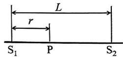
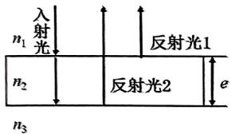
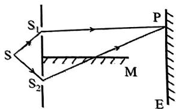
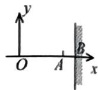
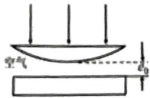

【题目来源】20211 大学物理1B B卷 T1
【教材溯源】第14章 物质的波粒二象性 - 14.4 物质波与德布罗意关系
【题目正文】
1. 某阴极射线管的阴阳极之间的电压为 350V，设电子逸出阴极时的速度为零，质量为 $m_{e}$ 。则电子到达阳极时与其相应的德布罗意波长为

A. $350m_{e}eh$ .
B. $\frac{h}{\sqrt{700m_{e}e}}$ .
C. $\frac{h}{\sqrt{3.5m_{e}e}}$ .
D. $\frac{h}{\sqrt{350m_{e}e}}$ .
【答案】B
【AI解析】电子经电压 $U$ 加速后动能 $E_k=eU$。非相对论德布罗意波长 $\lambda=\frac{h}{\sqrt{2m_e eU}}$。代入 $U=350\ \mathrm{V}$，得 $\lambda=\frac{h}{\sqrt{2m_e e\times350}}=\frac{h}{\sqrt{700m_e e}}$。易错点：动能与动量关系 $p=\sqrt{2m_eE_k}$ 中的 2 要与电压 350 合并为 700。

【题目来源】20211 大学物理1B B卷 T2
【教材溯源】第13章 狭义相对论 - 13.3 相对论力学
【题目正文】
2. 设某微观粒子的总能量是它的静止能量的 K 倍，则其运动速度的大小为（以 c 表示真空中的光速）

A. $\frac{c}{K-1}$ .
B. $\frac{c}{K}\sqrt{1-K^{2}}$
C. $\frac{c}{K}\sqrt{K^{2}-1}$ .
D. $\frac{c}{K+1}\sqrt{K(K+2)}$
【答案】C
【AI解析】总能量 $E=KE_0$，洛伦兹因子 $\gamma=\frac{E}{E_0}=K$。由 $\gamma=\frac{1}{\sqrt{1-\frac{v^2}{c^2}}}$ 得 $\frac{v}{c}=\sqrt{1-\frac{1}{\gamma^2}}$。代入 $\gamma=K$，得 $v=\frac{c}{K}\sqrt{K^2-1}$。易错点：由 $\gamma=K$ 直接反解速度，不要误把 $K$ 当作 $\frac{v}{c}$ 代入。

【题目来源】20211 大学物理1B B卷 T3
【教材溯源】第13章 狭义相对论 - 13.2 洛伦兹变换与狭义相对论的时空观
【题目正文】
3. 在某地发生两件事，静止位于该地的甲测的时间间隔为 4s，若相对于甲作匀速直线运动的乙测得时间间隔为 5s，则乙相对于甲的运动速度为（c 为真空中的光速）

A. $\frac{4}{5}c$ .
B. $\frac{3}{5}c$ .
C. $\frac{2}{5}c$ .
D. $\frac{1}{5}c$ .
【答案】B
【AI解析】同一地点发生的两件事，甲测得的时间间隔 4 s 为固有时间。乙相对运动，测得的时间间隔膨胀为 $5\ \mathrm{s}$。由时间膨胀公式 $5=\frac{4}{\sqrt{1-\frac{v^2}{c^2}}}$。得 $\sqrt{1-\frac{v^2}{c^2}}=\frac{4}{5}$，即 $\frac{v}{c}=\frac{3}{5}$。故 $v=\frac{3}{5}c$。易错点：固有时间是在事件发生地静止的参考系测得的时间，取 4 s 而非 5 s。

【题目来源】20211 大学物理1B B卷 T4
【教材溯源】第10章 波动 - 10.1 波动方程、平面简谐波
【题目正文】
4. 一列波源在 x=0 处的平面简谐波的波动方程为 $y=0.1\cos(3\pi t-\pi x+\pi)$ (SI)，以下说法错误的是：

A. 该波的波长为 2m.
B. 波源振动的周期为 $\frac{2}{3}$ s.
C. 该列波的波速为 3m/s，传播方向沿 x 轴正方向，
D. 波源振动的振幅为 0.1m，初相位为 $\frac{\pi}{2}$ .
【答案】D
【AI解析】与 $y=A\cos(\omega t-\frac{2\pi x}{\lambda}+\varphi_0)$ 比较，波数 $\pi=\frac{2\pi}{\lambda}$ 得波长 $\lambda=2\ \mathrm{m}$。角频率 $\omega=3\pi$，周期 $T=\frac{2\pi}{\omega}=\frac{2}{3}\ \mathrm{s}$。波速 $u=\frac{\omega}{k}=3\ \mathrm{m/s}$，$t$ 与 $x$ 异号，沿 $+x$ 传播。振幅 $0.1\ \mathrm{m}$，初相位为 $\pi$ 而非 $\frac{\pi}{2}$。易错点：波动方程中初相直接读出为 $\pi$，不要把 $\pi$ 与 $\frac{\pi}{2}$ 混淆。

【题目来源】20211 大学物理1B B卷 T5
【教材溯源】第9章 振动 - 9.1 简谐振动
【题目正文】
5. 弹簧振子作简谐振动, 其振动表达式为: $x = A \cos (\omega t + \frac{1}{2} \pi)$ . 则该物体在 $t = 0$ 时刻的动能与 $t = \frac{T}{8}$ ( $T$ 为周期)时刻的动能之比为

A. 1:4
B. 2:1
C. 1:1
D. 1:2
【答案】B
【AI解析】$x=A\cos(\omega t+\frac{\pi}{2})=-A\sin\omega t$。速度 $v=-A\omega\cos\omega t$。$t=0$ 时 $|v|=A\omega$。$t=\frac{T}{8}$ 时 $\omega t=\frac{\pi}{4}$，$|v|=A\omega\cos\frac{\pi}{4}=\frac{A\omega}{\sqrt{2}}$。动能与速度平方成正比，故 $E_{k1}:E_{k2}=(A\omega)^2:(\frac{A\omega}{\sqrt{2}})^2$。化简得 $2:1$。易错点：动能比是速度平方之比，不是速度之比。

【题目来源】20211 大学物理1B B卷 T6
【教材溯源】第10章 波动 - 10.6 波的干涉
【题目正文】
6. 如图， $S_{1}$ 、 $S_{2}$ 为同相位的两相干波源，相距为 L，P 点与 $S_{1}$ 距离为 r，波源 $S_{1}$ 在 P 点引起的振动振幅为 $A_{1}$ ，波源 $S_{2}$ 在 P 点引起的振动振幅为 $A_{2}$ ，两波波长均为 $\lambda$ ，则 P 点的和振幅为:

A. $\sqrt{A_{1}^{2}+A_{2}^{2}+2A_{1}A_{2}\cos(2\pi\frac{L}{\lambda})}$
B. $\sqrt{A_{1}^{2}+A_{2}^{2}+2A_{1}A_{2}\cos(2\pi\frac{L-r}{\lambda})}$
C. $\sqrt{A_{1}^{2}+A_{2}^{2}+2A_{1}A_{2}\cos(2\pi\frac{L-2r}{\lambda})}$
D. $\sqrt{A_{1}^{2}+A_{2}^{2}+2A_{1}A_{2}\cos(2\pi\frac{r}{\lambda})}$
【答案】C
【AI解析】$S_2$ 到 P 点的距离为 $L-r$。两波源同相，波程差为 $(L-r)-r=L-2r$。对应的相位差 $\Delta\varphi=\frac{2\pi}{\lambda}(L-2r)$。合振幅 $A=\sqrt{A_1^2+A_2^2+2A_1A_2\cos\Delta\varphi}$。代入得 $A=\sqrt{A_1^2+A_2^2+2A_1A_2\cos(2\pi\frac{L-2r}{\lambda})}$。易错点：$S_2$ 到 P 点的距离是 $L-r$ 而非 $L$，波程差取两距离之差。

【题目来源】20211 大学物理1B B卷 T7
【教材溯源】第12章 波动光学 - 12.1 光的干涉
【题目正文】
7. 单色平行光垂直照射在薄膜上，经上、下两表面反射的两束光发生干涉，如图所示。若薄膜的厚度为 e，且 $n_{1}<n_{2}>n_{3}$ ， $\lambda_{1}$ 为入射光在 $n_{1}$ 中的波长，则两束反射光的光程差为:

A. $2n_{2}e$ .
B. $2n_{2}e - \lambda_{1} / (2n_{1})$
C. $2n_{2}e - n_{1}\lambda_{1} / 2$ .
D. $2n_{2}e - n_{2}\lambda_{1}/2$
【答案】C
【AI解析】上表面反射发生在 $n_1<n_2$ 界面，有半波损失；下表面反射发生在 $n_2>n_3$ 界面，无半波损失。两束反射光光程差为 $2n_2e-\frac{\lambda}{2}$。入射光在真空中的波长 $\lambda=n_1\lambda_1$。故光程差为 $2n_2e-\frac{n_1\lambda_1}{2}$。易错点：$\lambda_1$ 是 $n_1$ 介质中的波长，附加半波损失项要先换算成真空波长再写。

【题目来源】20211 大学物理1B B卷 T8
【教材溯源】第12章 波动光学 - 12.1 光的干涉
【题目正文】
8. 在双缝干涉实验中，屏幕 E 上的 P 点处是暗纹。若将缝 $S_{2}$ 盖住，并在 $S_{1}S_{2}$ 连线的垂直平分面处放一反射镜 M，如图所示，则此时：

A. E 上不再出现干涉条纹.
B. P 点处为暗纹.
C. P 点处为明纹.
D. 无法确定 P 点处条纹的明、暗情况、
【答案】C
【AI解析】盖住 $S_2$ 放反射镜后，$S_1$ 与其在镜中的虚像构成等效双缝，仍能产生干涉条纹。镜面反射有半波损失，使两束光的相位差附加 $\pi$。原来 $P$ 点处光程差满足暗纹条件，附加 $\pi$ 后变为满足明纹条件。故 P 点处变为明纹。易错点：镜面反射引起的半波损失相当于把明暗条件互换，暗纹变明纹。

【题目来源】20211 大学物理1B B卷 T9
【教材溯源】第12章 波动光学 - 12.1 光的干涉
【题目正文】
9. 在迈克尔逊干涉仪的一支光路中，放入一片折射率为 n 的透明介质薄膜后，测出两束光的光程差的改变量为 $2\lambda$ ，则薄膜的厚度为：

A. $\lambda$ .
B. λ / n.
C. $\lambda / 2n$ .
D. $\lambda/(n-1)$ .
【答案】D
【AI解析】放入薄膜后该光路光程改变 $2(n-1)e$。由题意 $2(n-1)e=2\lambda$。解得 $e=\frac{\lambda}{n-1}$。易错点：光在薄膜中往返一次，光程改变量是 $2(n-1)e$ 而不是 $(n-1)e$。

【题目来源】20211 大学物理1B B卷 T10
【教材溯源】第10章 波动 - 10.7 多普勒效应
【题目正文】
10. 设声波在媒质中的传播速度为 u，声源的频率为 $v_{S}$ ，若声源 S 不动，而接收器 R 相对于媒质以速度 $V_{R}$ 沿着 S、R 连线向着声源 S 运动，则位于 S、R 连线中点的质点 P 的振动频率为

A. $\nu_{s}$
B. $\frac{u+V_{R}}{u}v_{S}$
C. $\frac{u}{u+V_{R}}v_{S}.$
D. $\frac{u}{u-V_{R}}v_{S}$
【答案】A
【AI解析】声源相对媒质静止，媒质中传播的声波波长和频率都由声源决定。位于连线中点的质点 P 是媒质中的质点，其振动频率就是媒质中波的频率 $\nu_s$。多普勒效应只改变接收器接收到的频率，不改变媒质中波的频率。易错点：接收器运动产生的多普勒频移与媒质中质点的振动频率是两回事，质点 P 的振动频率仍是 $\nu_s$。

【题目来源】20211 大学物理1B B卷 T11
【教材溯源】第9章 振动 - 9.4 简谐振动的合成
【题目正文】
11. 一个质点同时参与两个在同一直线上的简谐振动，其表达式分别为 $x_{1} = 8 \times 10^{-2} \cos (2t + \frac{\pi}{3})$ ， $x_{2} = 6 \times 10^{-2} \cos (2t - \frac{2\pi}{3})$ (SI) 则其合成振动的振幅为 \_\_\_\_，初相位 \_\_\_\_。
【答案】$A=2\times10^{-2}\ \mathrm{m}$；$\varphi_0=\frac{\pi}{3}$
【AI解析】两振动的相位差为 $\frac{\pi}{3}-(-\frac{2\pi}{3})=\pi$，即两振动反相。反相合成时振幅为两振幅之差 $A=|8-6|\times10^{-2}=2\times10^{-2}\ \mathrm{m}$。合振动的初相与振幅较大的分振动相同。故 $\varphi_0=\frac{\pi}{3}$。易错点：反相合成振幅取差，初相跟随振幅大的分振动。

【题目来源】20211 大学物理1B B卷 T12
【教材溯源】第9章 振动 - 9.1 简谐振动
【题目正文】
12. 如图所示的弹簧振子质量为 m = 0.40 kg，弹簧劲度系数 $k = 1.60 N \cdot m^{-1}$ ，将物体从平衡位置压缩至 $x_{0} = -0.10 m$ ，给予沿 x 轴负方向的初速度 $v_{0} = -0.20 m \cdot s^{-1}$ 并由此开始计时，忽略弹簧质量及摩擦，则角频率 $\omega_{0} =$ \_\_\_\_ ，振幅 A = \_\_\_\_ ，初相位 $\varphi =$ \_\_\_\_ 。

![[Pasted image 20260822212329.png|361]]
【答案】$\omega_0=2\ \mathrm{rad/s}$；$A=\sqrt{0.02}\approx0.14\ \mathrm{m}$；$\varphi=\frac{3\pi}{4}$
【AI解析】角频率 $\omega_0=\sqrt{\frac{k}{m}}=\sqrt{\frac{1.60}{0.40}}=2\ \mathrm{rad/s}$。振幅 $A=\sqrt{x_0^2+\frac{v_0^2}{\omega_0^2}}=\sqrt{0.01+\frac{0.04}{4}}=\sqrt{0.02}\approx0.14\ \mathrm{m}$。由 $\cos\varphi=\frac{x_0}{A}=-\frac{0.10}{0.141}=-0.707$、$\sin\varphi=-\frac{v_0}{\omega_0 A}=\frac{0.2}{2\times0.141}=0.707$，得 $\varphi=\frac{3\pi}{4}$。易错点：初位置与初速度均为负值，对应第二象限的初相 $\frac{3\pi}{4}$。

【题目来源】20211 大学物理1B B卷 T13
【教材溯源】第10章 波动 - 10.2 波的能量、能流密度
【题目正文】
13. 为了维持一波源的振动不变，需要消耗 8W 的功率。假如此波源发出的是均匀球面波，且媒质不吸收波的能量，则距波源 2m 远处波的平均能流密度 $I=$ \_\_\_\_ 。
【答案】$\frac{1}{2\pi}\approx0.16\ \mathrm{W/m^2}$
【AI解析】媒质不吸收能量时，波源功率均匀分布在球面上。距波源 $r$ 处的平均能流密度 $I=\frac{P}{4\pi r^2}$。代入 $P=8\ \mathrm{W}$、$r=2\ \mathrm{m}$，得 $I=\frac{8}{4\pi\times4}=\frac{1}{2\pi}\approx0.16\ \mathrm{W/m^2}$。易错点：能流均匀分布在整个球面上，面积取 $4\pi r^2$ 而非 $\pi r^2$。

【题目来源】20211 大学物理1B B卷 T14
【教材溯源】第11章 几何光学基础 - 11.1 几何光学的基本实验定律和基本原理
【题目正文】
14. 费马原理指出，当光线在空间中由 A 点传到 B 点时，会选择\_\_\_\_的路径进行传播。
【答案】光程取极值（极小值、极大值或恒定值）
【AI解析】费马原理指出，光在两点间传播时，实际路径的光程取极值或恒定值。即与附近各可能路径相比，实际路径的光程不是极小值，便是极大值，或者相等。易错点：费马原理不仅包含光程极小，还包含极大和恒定两种情形。

【题目来源】20211 大学物理1B B卷 T15
【教材溯源】第12章 波动光学 - 12.3 光的偏振
【题目正文】
15. 两个偏振片堆叠在一起，其偏振化方向互相垂直。当一束强度为 $I_{0}$ 的线偏振光入射，其光矢量振动方向与第一偏振片偏振化方向夹角为 $\frac{\pi}{4}$ ，则穿过第一偏振片后的光强为 \_\_\_\_，穿过两个偏振片后的光强为 \_\_\_\_。
【答案】$\frac{I_0}{2}$；$0$
【AI解析】线偏振光过第一偏振片，由马吕斯定律 $I_1=I_0\cos^2\frac{\pi}{4}=\frac{I_0}{2}$。透过第一偏振片的光偏振方向沿其偏振化方向。第二偏振片偏振化方向与第一偏振片垂直，夹角为 $90^\circ$。由马吕斯定律 $I_2=I_1\cos^290^\circ=0$。故穿过两个偏振片后的光强为零。易错点：第二片偏振片的光强按 $\cos^290^\circ$ 计算，出射光强严格为零。

【题目来源】20211 大学物理1B B卷 T16
【教材溯源】第12章 波动光学 - 12.2 光的衍射
【题目正文】
16. 若对应于衍射角 $\varphi = 30^{\circ}$ ，单缝处的波面可划分为 4 个半波带，则单缝的宽度 $a = \_\_\_\_\lambda$ （ $\lambda$ 为入射光波长）。
【答案】$a=4\lambda$
【AI解析】单缝处波面划分半波带的条件为 $a\sin\varphi=N\cdot\frac{\lambda}{2}$，其中 $N$ 为半波带个数。由 $N=4$、$\varphi=30^\circ$，得 $a\sin30^\circ=4\times\frac{\lambda}{2}=2\lambda$。解得 $a=\frac{2\lambda}{\sin30^\circ}=4\lambda$。易错点：每个半波带对应 $\frac{\lambda}{2}$ 的光程差，$N$ 个半波带对应 $N\frac{\lambda}{2}$。

【题目来源】20211 大学物理1B B卷 T17
【教材溯源】第12章 波动光学 - 12.2 光的衍射
【题目正文】
17. 一束单色平行光垂直照射在光栅常量为 $d = 2 \mu m$ 的光栅上，用焦距为 0.500 m 的透镜将光聚在屏上，测得第一级谱线与透镜主焦点的距离为 $l = 0.1667 m$ 。则可知该入射光的波长 $\lambda$ 为 \_\_\_\_。
【答案】$\lambda\approx632\ \mathrm{nm}$
【AI解析】光栅方程 $d\sin\theta=k\lambda$，第一级 $k=1$。谱线位于透镜焦平面上，几何关系 $\tan\theta=\frac{l}{f}=\frac{0.1667}{0.500}=0.3334$。由此得 $\sin\theta=\frac{\tan\theta}{\sqrt{1+\tan^2\theta}}=0.3162$。故 $\lambda=d\sin\theta=2\times10^{-6}\times0.3162\approx632\ \mathrm{nm}$。易错点：应先用 $\tan\theta$ 求角度再代入光栅方程，不能直接用 $\frac{l}{f}$ 当作 $\sin\theta$。

【题目来源】20211 大学物理1B B卷 T18
【教材溯源】第14章 物质的波粒二象性 - 14.5 氢原子和玻尔的量子论
【题目正文】
18. 在氢原子发射光谱的巴耳末线系中有一频率为 $6.15 \times 10^{14}$ Hz 的谱线，它是氢原子从能级 $E_{n}=$ \_\_\_\_ eV 跃迁到能级 $E_{m}=$ \_\_\_\_ eV 而发出的。
（普朗克常量 $h = 6.63 \times 10^{-34} \, J \cdot s$ ）
【答案】$E_n=-0.85\ \mathrm{eV}$；$E_m=-3.4\ \mathrm{eV}$
【AI解析】光子能量 $E=h\nu=6.63\times10^{-34}\times6.15\times10^{14}=4.08\times10^{-19}\ \mathrm{J}$，即约 $2.55\ \mathrm{eV}$。巴耳末线系终态为 $n=2$，能量 $E_2=-\frac{13.6}{4}=-3.4\ \mathrm{eV}$。始态能量 $E_n=E_2+2.55=-0.85\ \mathrm{eV}$。由 $-0.85=-\frac{13.6}{n^2}$ 得 $n=4$。易错点：巴耳末线系的特点是终态为 $n=2$，据此由光子能量反推始态。

【题目来源】20211 大学物理1B B卷 T19
【教材溯源】第14章 物质的波粒二象性 - 14.2 光电效应与光子
【题目正文】
19. 用频率为 v 的单色光照射某金属，发生光电效应，光电子的动能为 $E_{k}$ 。如果入射光的频率变为原来的两倍，则光电子的动能变为 \_\_\_\_。
【答案】$h\nu+E_k$
【AI解析】光电效应方程 $E_k=h
u-W$，逸出功 $W=h
u-E_k$。频率变为 $2
u$ 后，光电子动能 $E_k'=2h
u-W=2h
u-(h
u-E_k)$。化简得 $E_k'=h
u+E_k$。易错点：逸出功不随入射光频率变化，直接相减即可消去。

【题目来源】20211 大学物理1B B卷 T20
【教材溯源】第15章 量子力学基础 - 15.5 电子的自旋 原子的壳层结构
【题目正文】
20. 氢原子中的电子处于 3d 量子态，该电子所具有的轨道角动量的大小为 \_\_\_\_；轨道角动量有 \_\_\_\_ 个可能的取向。
【答案】$L=\sqrt{6}\hbar$；5
【AI解析】3d 态对应角量子数 $l=2$。轨道角动量大小 $L=\sqrt{l(l+1)}\hbar=\sqrt{6}\hbar$。轨道角动量在空间某方向的投影 $L_z=m_l\hbar$，其中 $m_l=0,\pm1,\pm2$。故有 $2l+1=5$ 个可能的取向。易错点：取向数按 $m_l$ 的取值个数计算，为 $2l+1$ 个。

【题目来源】20211 大学物理1B B卷 T21
【教材溯源】第10章 波动 - 10.6 波的干涉
【题目正文】
21. 如图，一列沿 x 轴正方向传播的平面简谐波，在固定端 B 处反射。A 点处的质点由入射波引起的振动表达式为 $y_{\mathrm{A}} = A \cos(\omega t + 0.2\pi)$ 。已知入射波的波长为 $\lambda$ ， $OA = 0.9\lambda$ 。$AB=0.2\lambda$ ，设振幅不衰减。
求：
(1) 入射波表达式；
(2) 反射波表达式;
(3) 合成驻波表达式。

【答案】(1) $y_{入}=A\cos(\omega t-\frac{2\pi x}{\lambda})$；(2) $y_{反}=A\cos(\omega t+\frac{2\pi x}{\lambda}+0.6\pi)$；(3) $y=2A\cos(\frac{2\pi x}{\lambda}+0.3\pi)\cos(\omega t+0.3\pi)$
【AI解析】设入射波 $y_{入}=A\cos(\omega t-\frac{2\pi x}{\lambda}+\varphi_0)$。A 点在 $x=0.9\lambda$ 处，由题意 $y_A=A\cos(\omega t+0.2\pi)$，代入得 $\varphi_0=2\pi$，可取为 0。故入射波 $y_{入}=A\cos(\omega t-\frac{2\pi x}{\lambda})$。固定端 B 在 $x=1.1\lambda$ 处，入射波在该处相位为 $\omega t-2.2\pi$。反射有半波损失，反射波在 B 处相位为 $\omega t-1.2\pi$。反射波沿 $-x$ 传播，$y_{反}=A\cos(\omega t+\frac{2\pi x}{\lambda}+0.6\pi)$。两波叠加得驻波 $y=y_{入}+y_{反}=2A\cos(\frac{2\pi x}{\lambda}+0.3\pi)\cos(\omega t+0.3\pi)$。易错点：反射波相位要由反射点 B 处的相位关系反推，B 点坐标为 $1.1\lambda$ 而非 $0.9\lambda$。

【题目来源】20211 大学物理1B B卷 T22
【教材溯源】第12章 波动光学 - 12.1 光的干涉
【题目正文】
22. 如图所示，牛顿环装置的平凸透镜与平板玻璃有一小缝隙 $e_0$ 。现用波长为 $\lambda$ 的单色光垂直照射，已知平凸透镜的曲率半径为 $R$ 。
    求：反射光形成的牛顿环的各暗环半径。

【答案】$r_k=\sqrt{R(k\lambda-2e_0)}$，其中 $k$ 取满足 $k\lambda>2e_0$ 的正整数
【AI解析】距中心 $r$ 处的空气膜厚度为 $e=e_0+\frac{r^2}{2R}$。反射光暗环条件为 $2e=k\lambda$。代入得 $2e_0+\frac{r^2}{R}=k\lambda$。解得暗环半径 $r_k=\sqrt{R(k\lambda-2e_0)}$。易错点：膜厚要加上初始缝隙 $e_0$，且 $k$ 须满足 $k\lambda>2e_0$ 才有实根。

【题目来源】20211 大学物理1B B卷 T23
【教材溯源】第14章 物质的波粒二象性 - 14.3 康普顿散射
【题目正文】
23. 在康普顿散射实验中，入射 X 射线的波长为 $\lambda=0.1nm$ 。如果在散射角为 $45^{\circ}$ 的方向观测，求：

(1) 散射光的波长和散射光子的能量;
(2) 反冲电子获得的动能 $E_{k}$ ;
(3) 反冲电子的能量。

（普朗克常量 $h = 6.63\times 10^{-34}\mathrm{J}\cdot \mathrm{s}$ ，电子的静止质量 $m_{e} = 9.11\times 10^{-31}\mathrm{kg}$ ）
【答案】(1) $\lambda'=0.1007\ \mathrm{nm}$，$E'=hc/\lambda'\approx1.98\times10^{-15}\ \mathrm{J}$；(2) $E_k\approx1.4\times10^{-17}\ \mathrm{J}$；(3) $E_e=m_ec^2+E_k\approx0.511\ \mathrm{MeV}$
【AI解析】康普顿波长改变量 $\Delta\lambda=\frac{h}{m_ec}(1-\cos45^\circ)\approx2.43\times10^{-12}\times0.293\approx7.1\times10^{-13}\ \mathrm{m}$。散射波长 $\lambda'=\lambda+\Delta\lambda=0.1+0.0007\approx0.1007\ \mathrm{nm}$。散射光子能量 $E'=\frac{hc}{\lambda'}\approx1.98\times10^{-15}\ \mathrm{J}$。反冲电子动能 $E_k=\frac{hc}{\lambda}-\frac{hc}{\lambda'}\approx1.4\times10^{-17}\ \mathrm{J}$。反冲电子总能量为静能与动能之和，约 $0.511\ \mathrm{MeV}$。易错点：散射波长是原波长加上改变量，电子动能由光子能量之差计算。

【题目来源】20211 大学物理1B B卷 T24
【教材溯源】第15章 量子力学基础 - 15.3 一维定态系统
【题目正文】
24. 一维无限深方势阱的势函数如下:

$$
V (x) = \left\{ \begin{array}{l l} 0, & (0 <   x <   a) \\ \infty , & (x \leq 0 \text {或} x \geq a) \end{array} \right.
$$

由一维定态薛定谔方程出发，推导求解：

(1) 处于该势场中的粒子的定态波函数；
(2) 粒子在阱内各处出现的概率密度:
(3) 粒子所具有的能量。
【答案】(1) $\psi_n(x)=\sqrt{\frac{2}{a}}\sin\frac{n\pi x}{a}$；(2) $|\psi_n|^2=\frac{2}{a}\sin^2\frac{n\pi x}{a}$；(3) $E_n=\frac{n^2h^2}{8ma^2}$（$n=1,2,3,\cdots$）
【AI解析】阱内定态薛定谔方程 $-\frac{\hbar^2}{2m}\frac{d^2\psi}{dx^2}=E\psi$。令 $k=\frac{\sqrt{2mE}}{\hbar}$，通解为 $\psi=A\sin kx+B\cos kx$。由边界条件 $\psi(0)=0$ 得 $B=0$。由 $\psi(a)=0$ 得 $\sin ka=0$，即 $k=\frac{n\pi}{a}$。归一化条件 $\int_0^a A^2\sin^2\frac{n\pi x}{a}dx=1$ 得 $A=\sqrt{\frac{2}{a}}$。故定态波函数 $\psi_n(x)=\sqrt{\frac{2}{a}}\sin\frac{n\pi x}{a}$。概率密度为 $|\psi_n|^2=\frac{2}{a}\sin^2\frac{n\pi x}{a}$。能量 $E_n=\frac{\hbar^2k^2}{2m}=\frac{n^2\pi^2\hbar^2}{2ma^2}=\frac{n^2h^2}{8ma^2}$。易错点：边界条件两处都要用，缺一个就得不到 $k=\frac{n\pi}{a}$ 的量子化条件。

