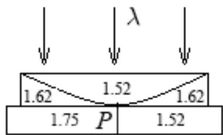
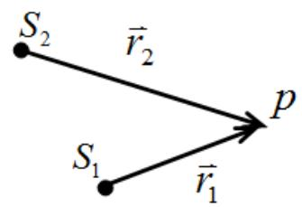
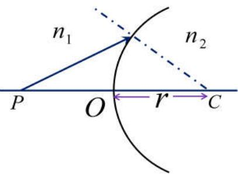
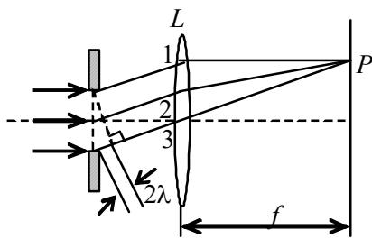
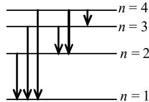
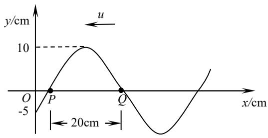

【题目来源】21221 大学物理1B A卷 T1
【教材溯源】第9章 振动 - 9.1 简谐振动
【题目正文】
1. 劲度系数为0.2N/m的轻弹簧，连接一个质量为8g的物体构成竖直方向的弹簧振子。在t=0时刻，将物体由平衡位置向下拉1cm后，给其以向上的初速度5cm/s。若选竖直向下为振动正方向，则弹簧振子的初相位为

A. $\pi/4$ .
B. $5\pi/4$ .
C. $\pi/2$ .
D. 0.
【答案】A
【AI解析】由 $\omega=\sqrt{k/m}=\sqrt{0.2/0.008}=5\ \mathrm{rad/s}$，取竖直向下为正。$t=0$ 时 $x_0=+1\ \mathrm{cm}$，$v_0=-5\ \mathrm{cm/s}$。由 $x_0=A\cos\varphi=1>0$ 与 $v_0=-A\omega\sin\varphi=-5<0$ 得 $\cos\varphi>0$、$\sin\varphi>0$。于是 $A\cos\varphi=1$、$A\omega\sin\varphi=5$，两式相除得 $\tan\varphi=1$。故 $\varphi=\frac{\pi}{4}$。易错点：初速度向上而正方向取向下，$v_0$ 必须取负号，取正号会得到第三象限的相位 $5\pi/4$。

【题目来源】21221 大学物理1B A卷 T2
【教材溯源】第10章 波动 - 10.2 波的能量、能流密度
【题目正文】
2. 当一列振幅为A的机械波在介质中传播时,某一介质元的最大形变发生

A. 介质元离开其平衡位置的最大位移处.
B. 介质元离开平衡位置 $\sqrt{2}A/2$ 处.
C. 介质元在其平衡位置处.
D. 介质元离开平衡位置 A/2 处.
【答案】C
【AI解析】介质元的形变即应变，与 $\frac{\partial y}{\partial x}$ 成正比。平面简谐波中 $\frac{\partial y}{\partial x}$ 与振动速度 $\frac{\partial y}{\partial t}$ 同步达到最大。介质元通过平衡位置时速度最大，故形变最大。在最大位移处介质元瞬时静止，形变为零。易错点：不要误以为位移最大处形变最大，那里介质元速度为零、无形变。

【题目来源】21221 大学物理1B A卷 T3
【教材溯源】第10章 波动 - 10.4 电磁波
【题目正文】
3. 真空中有一列一维平面电磁波，其电场强度沿 y 轴方向振动，波动表达式为 $E_{y}=E_{0}\cos\omega(t-\frac{x}{c})$ ， $\varepsilon_{0}$ 为真空介电常数， $\mu_{0}$ 为真空磁导率，则磁场强度矢量

A. 沿 z 轴方向振动，幅值为 $\sqrt{\frac{\varepsilon_{0}}{\mu_{0}}}E_{0}$ .
B. 沿 x 轴方向振动，幅值为 $\sqrt{\frac{\varepsilon_{0}}{\mu_{0}}}E_{0}$ .
C. 沿 z 轴方向振动，幅值为 $\sqrt{\frac{\mu_{0}}{\varepsilon_{0}}}E_{0}$ .
D. 沿 x 轴方向振动，幅值为 $\sqrt{\frac{\mu_{0}}{\varepsilon_{0}}}E_{0}$ .
【答案】A
【AI解析】该电磁波沿 $+x$ 方向传播，电场沿 $y$ 轴方向。由 $\vec{E}\times\vec{H}$ 指向传播方向，得磁场沿 $z$ 轴方向。真空中电磁波的幅值关系为 $H_0=\sqrt{\frac{\varepsilon_0}{\mu_0}}E_0$。故磁场强度矢量沿 z 轴方向振动，幅值为 $\sqrt{\frac{\varepsilon_0}{\mu_0}}E_0$。易错点：幅值写成 $\sqrt{\frac{\mu_0}{\varepsilon_0}}E_0$ 是把 $E_0=\sqrt{\frac{\mu_0}{\varepsilon_0}}H_0$ 与 $H_0$ 的表达式弄反了。

【题目来源】21221 大学物理1B A卷 T4
【教材溯源】第12章 波动光学 - 12.3 光的偏振
【题目正文】
4. 两平行放置的偏振片，其偏振化方向之间的夹角为 $\alpha$ 。现让自然光垂直入射并依次通过两个偏振片。当 $\alpha = 30^{\circ}$ 时，观测自然光 1；当 $\alpha = 60^{\circ}$ 时，观测自然光 2。两次测得透射光强度相等，则两自然光的光强度之比 $I_{1}: I_{2}$ 等于

A. $1:\sqrt{3}$ .
B. 1:3.
C. $\sqrt{3}:1$ .
D. 3:1.
【答案】B
【AI解析】自然光通过第一片偏振片后强度减半，通过第二片时按马吕斯定律再乘 $\cos^2\alpha$。两次透射强度相等，得 $\frac{I_1}{2}\cos^2 30^\circ=\frac{I_2}{2}\cos^2 60^\circ$。代入 $\cos^2 30^\circ=\frac{3}{4}$、$\cos^2 60^\circ=\frac{1}{4}$，得 $\frac{I_1}{I_2}=\frac{1}{4}\div\frac{3}{4}=\frac{1}{3}$。故 $I_1:I_2=1:3$。易错点：两自然光分别对应不同夹角，比值应取 $\cos^2 60^\circ$ 与 $\cos^2 30^\circ$ 之比，顺序颠倒会得 3:1。

【题目来源】21221 大学物理1B A卷 T5
【教材溯源】第12章 波动光学 - 12.1 光的干涉
【题目正文】
5. 在图示三种透明材料构成的牛顿环装置中，用单色光垂直照射，在透射光中看到干涉条纹，则在接触点 P 处形成的圆斑为

A. 全明.
B. 全暗.
C. 左半部暗，右半部明.
D. 左半部明，右半部暗.

【答案】C
【AI解析】透射光干涉中参与叠加的两束光，其中一束在透镜与平板的接触界面反射，另一束在透镜上表面反射。左半部平板折射率 1.75 大于透镜折射率 1.62，接触界面反射有半波损失，两束光相位差含 $\pi$，中心为暗。右半部平板折射率 1.52 小于透镜折射率 1.62，接触界面反射无半波损失，两束光相位差为零，中心为明。故接触点 P 处左半部暗、右半部明。易错点：半波损失要看反射界面两侧折射率的大小关系，不能一律认为透射光中心恒为明。

【题目来源】21221 大学物理1B A卷 T6
【教材溯源】第12章 波动光学 - 12.1 光的干涉
【题目正文】
6. 迈克尔逊干涉仪的一支光路中放入一厚度为4μm的透明介质薄片后，观察到干涉条纹产生了7.0条条纹的移动。若入射光波长为632.8nm，则透明介质片的折射率为

A. 1.107.
B. 1.554.
C. 2.107.
D. 2.554.
【答案】B
【AI解析】放入薄片后该光路的光程增加 $2(n-1)d$，因为光两次穿过薄片。条纹移动 7 条，有 $2(n-1)d=7\lambda$。解得 $n=1+\frac{7\lambda}{2d}=1+\frac{7\times632.8\ \mathrm{nm}}{2\times4000\ \mathrm{nm}}=1+0.554$。故折射率约为 1.554。易错点：光程差是 $2(n-1)d$ 而非 $(n-1)d$，漏掉因子 2 会算成 2.107。

【题目来源】21221 大学物理1B A卷 T7
【教材溯源】第14章 物质的波粒二象性 - 14.1 黑体辐射与能量子
【题目正文】
7. 某物体可视为绝对黑体，在 $\lambda_{m}=600nm$ 处辐射为最强，若黑体被加热到使其$\lambda_{m}=500nm$ ，则前后两种情况的辐射总能量之比约为

A. 1: 1.
B. 1: 2.
C. 1: 4.
D. 1: 3.
【答案】B
【AI解析】由维恩位移定律 $\lambda_m T=b$，得 $\frac{T_2}{T_1}=\frac{\lambda_{m1}}{\lambda_{m2}}=\frac{600}{500}=1.2$。由斯特藩-玻尔兹曼定律，辐射总能量正比于 $T^4$。故 $\frac{E_1}{E_2}=\left(\frac{T_1}{T_2}\right)^4=\left(\frac{1}{1.2}\right)^4\approx0.48$，约为 1:2。易错点：总能量与温度的四次方成正比，不能直接用波长之比代替能量之比。

【题目来源】21221 大学物理1B A卷 T8
【教材溯源】第14章 物质的波粒二象性 - 14.3 康普顿散射
【题目正文】
8. 光子能量为0.5MeV的X射线，入射到某种物质上而发生康普顿散射．若反冲电子的动能为0.1MeV，则散射光波长的改变量 $\Delta\lambda$ 与入射光波长 $\lambda_{0}$ 之比值为

A. 0.20.
B. 0.25.
C. 0.30.
D. 0.35.
【答案】B
【AI解析】由能量守恒，散射光子能量 $E'=0.5-0.1=0.4\ \mathrm{MeV}$。由 $E=\frac{hc}{\lambda}$，波长与能量成反比，得 $\frac{\lambda'}{\lambda_0}=\frac{E_0}{E'}=\frac{0.5}{0.4}=1.25$。故 $\frac{\Delta\lambda}{\lambda_0}=\frac{\lambda'-\lambda_0}{\lambda_0}=0.25$。易错点：不能用反冲电子动能直接除以入射光子能量，那样会错得 0.20。

【题目来源】21221 大学物理1B A卷 T9
【教材溯源】第15章 量子力学基础 - 15.1 物质波波函数的特性
【题目正文】
9. 关于不确定关系 $\Delta p_{x}\Delta x \geq h$ ，有以下几种理解：

(1) 粒子的动量不可能确定.
(2) 粒子的坐标不可能确定.
(3) 粒子的动量和坐标不可能同时准确地确定.
(4) 不确定关系不仅适用于电子和光子，也适用于其它粒子.
其中正确的是:

A. (1), (2).
B. (2), (4).
C. (3), (4).
D. (4), (1).
【答案】C
【AI解析】不确定关系只限制动量与坐标同时确定的精度，单独测量动量或坐标原则上可以任意精确。它是微观粒子具有波动性的普遍表现，适用于电子、光子及其它一切粒子。故 (3)、(4) 正确。易错点：(1)、(2) 把"不能同时确定"曲解为"不能确定"，是对不确定关系的常见误解。

【题目来源】21221 大学物理1B A卷 T10
【教材溯源】第15章 量子力学基础 - 15.5 电子的自旋 原子的壳层结构
【题目正文】
10. 在原子的 L 壳层中，电子可能具有的四个量子数 $(n,l,m_{l},m_{s})$ 是

(1) $(2,0,1,\frac{1}{2})$
(2) $(2,1,0,-\frac{1}{2})$
(3) $(2,1,1,\frac{1}{2})$
(4) $(2, 1, -1, -\frac{1}{2})$

以上四种取值中，哪些是正确的

A. 只有(1)、(2)是正确的.
B. 只有(2)、(3)是正确的.
C. 只有(2)、(3)、(4)是正确的.
D. 全部是正确的.
【答案】C
【AI解析】L 壳层对应主量子数 $n=2$，角量子数 $l$ 可取 0、1。量子数需满足 $l\le n-1$、$|m_l|\le l$、$m_s=\pm\frac{1}{2}$。(1) 中 $l=0$ 却取 $m_l=1$，违反 $|m_l|\le l$，不正确。其余 (2)、(3)、(4) 三组取值均满足量子数规则。故正确的是 (2)、(3)、(4)。易错点：$l=0$ 时 $m_l$ 只能取 0，先查 $l$ 与 $n$ 的关系再查 $m_l$ 的范围。

【题目来源】21221 大学物理1B A卷 T11
【教材溯源】第9章 振动 - 9.4 简谐振动的合成
【题目正文】
11. 三个简谐运动方程分别为 $x_{1}=A\cos(\frac{2\pi}{T}t+\frac{1}{2}\pi)$ ， $x_{2}=A\cos(\frac{2\pi}{T}t+\frac{7}{6}\pi)$ 和 $x_{3}=A\cos(\frac{2\pi}{T}t+\frac{11}{6}\pi)$ ，三个振动的叠加 $x_{1}+x_{2}+x_{3}=$ ____。
【答案】0
【AI解析】用旋转矢量法，三个矢量幅值均为 A，初相分别为 $\frac{\pi}{2}$、$\frac{7\pi}{6}$、$\frac{11\pi}{6}$。$x_2$ 与 $x_3$ 的合成矢量方向为 $\frac{3\pi}{2}$，大小为 $2A\cos\frac{\pi}{3}=A$。它与 $x_1$ 的矢量等幅反向，完全抵消。故三个振动的叠加为零。易错点：$x_2$、$x_3$ 夹角为 $\frac{2\pi}{3}$，合矢量为 A 而非 $2A$，若误算会得不到零。

【题目来源】21221 大学物理1B A卷 T12
【教材溯源】第10章 波动 - 10.6 波的干涉
【题目正文】
12. 如图所示， $S_{1}$ 、 $S_{2}$ 为两个相干横波波源， $\lambda=8.0m$ ， $r_{1}=12.0m$ ， $r_{2}=14.0m$ 。已知 $S_{2}$ 的相位比 $S_{1}$ 的相位超前 $\pi/4$ ，且 $S_{1}$ 和 $S_{2}$ 在 P 点引起的振动的振幅分别为 0.3m 和 0.2m，则 P 点的合振幅为 ____ m。

【答案】0.46 m
【AI解析】两列波在 P 点的相位差 $\Delta\varphi=(\varphi_2-\varphi_1)-\frac{2\pi}{\lambda}(r_2-r_1)=\frac{\pi}{4}-\frac{2\pi}{8}\times2=-\frac{\pi}{4}$。合振幅公式 $A=\sqrt{A_1^2+A_2^2+2A_1A_2\cos\Delta\varphi}$。代入 $A_1=0.3$、$A_2=0.2$、$\cos(-\frac{\pi}{4})=\frac{\sqrt{2}}{2}$，得 $A=\sqrt{0.09+0.04+2\times0.3\times0.2\times\frac{\sqrt{2}}{2}}$。计算结果约为 0.46 m。易错点：相位差要同时计入波源初相差与波程差引起的相位差，且 $\cos(-\frac{\pi}{4})=\cos\frac{\pi}{4}$ 取正值。

【题目来源】21221 大学物理1B A卷 T13
【教材溯源】第10章 波动 - 10.6 波的干涉
【题目正文】
13. 波动方程为 $y = A \cos[2\pi(\nu t + x / \lambda) + \frac{\pi}{3}]$ 的入射波在 x = 0 处的固定端发生反射，入射波和反射波干涉形成了驻波。该驻波的波腹位置坐标为 ____。
【答案】$x=(2n+1)\frac{\lambda}{4}$（$n=0,1,2,\cdots$）
【AI解析】固定端反射有半波损失，反射波为 $y_r=A\cos[2\pi(\nu t-\frac{x}{\lambda})+\frac{\pi}{3}+\pi]$。入射波与反射波叠加得驻波 $y=2A\cos(\frac{2\pi x}{\lambda}-\frac{\pi}{2})\cos(2\pi\nu t+\frac{5\pi}{6})$。波腹要求 $\left|\cos(\frac{2\pi x}{\lambda}-\frac{\pi}{2})\right|=1$，即 $\frac{2\pi x}{\lambda}-\frac{\pi}{2}=n\pi$。解得波腹坐标 $x=(2n+1)\frac{\lambda}{4}$，$n=0,1,2,\cdots$。易错点：漏掉固定端反射的半波损失，波腹与波节的位置会写反；驻波的振幅因子是 $\cos(\frac{2\pi x}{\lambda}-\frac{\pi}{2})$，空间相位不能漏掉因子 2，且 x=0 处为固定端波节，波腹必在 $\frac{\lambda}{4}$ 的奇数倍处。

【题目来源】21221 大学物理1B A卷 T14
【教材溯源】第11章 几何光学基础 - 11.2 单球面上的近轴成像
【题目正文】
14. 如图，一个折射球面的曲率半径为 $r = 10 \, cm$ ，物点 P 在凸面顶点前 $20 \, cm$ 处，凸面前的介质折射率 $n_{1} = 1.0$ ，凸面后的介质折射率 $n_{2} = 2.0$ ．则像到凸面顶点的距离是 ____ cm，所成的像是 ____ 像（实或虚）。

【答案】40 cm，实像
【AI解析】单球面折射成像公式 $\frac{n_1}{s}+\frac{n_2}{s'}=\frac{n_2-n_1}{r}$。物距 $s=20\ \mathrm{cm}$，凸面对入射光取 $r=+10\ \mathrm{cm}$。代入得 $\frac{1}{20}+\frac{2}{s'}=\frac{2-1}{10}$。解得像距 $s'=40\ \mathrm{cm}$。$s'>0$，像在凸面后方，由实际折射光线会聚而成，为实像。易错点：符号约定中凸面曲率半径取正，若取负会得出虚像的错误结论。

【题目来源】21221 大学物理1B A卷 T15
【教材溯源】第12章 波动光学 - 12.2 光的衍射
【题目正文】
15. 在单缝夫琅禾费衍射示意图中，所画出的各条正入射光线间距相等，那么光线 1 与 2 在幕上 P 点处相遇时的相位差为 ____，P 点应为 ____ 纹。

【答案】$2\pi$，暗纹
【AI解析】图中 3 条等间距平行光线经透镜会聚于 P 点，标注的总光程差为 $2\lambda$。相邻两条光线的光程差为 $\lambda$，故光线 1 与 2 的相位差 $\Delta\varphi=\frac{2\pi}{\lambda}\times\lambda=2\pi$。此时缝两端光线的光程差 $a\sin\theta=2\lambda$，缝面可分成 4 个半波带。偶数个半波带两两相消，P 点为暗纹。易错点：相位差换算要乘 $\frac{2\pi}{\lambda}$，半波带数为偶数对应暗纹、奇数对应明纹。

【题目来源】21221 大学物理1B A卷 T16
【教材溯源】第12章 波动光学 - 12.1 光的干涉
【题目正文】
16. 在双缝干涉实验中，波长 $\lambda = 550nm$ 的单色平行光垂直入射到缝间距 $a = 2 \times 10^{-4}m$ 的双缝上，屏到双缝的距离 D = 2m 。则，相邻明纹间距为 ____；若用一厚度为 $e = 6.6 \times 10^{-6}m$ 、折射率为 n = 1.58 的玻璃片覆盖一缝后，零级明纹将移到原来的第 ____ 级明纹处。
【答案】5.5 mm，7 级
【AI解析】相邻明纹间距 $\Delta x=\frac{D\lambda}{a}=\frac{2\times550\times10^{-9}}{2\times10^{-4}}=5.5\times10^{-3}\ \mathrm{m}=5.5\ \mathrm{mm}$。覆盖玻璃片后该缝光程增加 $(n-1)e=0.58\times6.6\times10^{-6}=3.83\times10^{-6}\ \mathrm{m}$。对应的级数 $k=\frac{(n-1)e}{\lambda}=\frac{3.83\times10^{-6}}{550\times10^{-9}}\approx7$。故零级明纹移到原来第 7 级明纹处。易错点：附加光程是 $(n-1)e$ 而非 $ne$，用 $ne$ 计算会偏离到 19 级。

【题目来源】21221 大学物理1B A卷 T17
【教材溯源】第12章 波动光学 - 12.3 光的偏振
【题目正文】
17. 一束自然光自空气射向透明介质 1 时，布儒斯特角为 $i_{B1}=60^{\circ}$ ；该自然光自空气射向透明介质 2 时，布儒斯特角为 $i_{B2}=53^{\circ}$ 。那么，光从介质 1 射向介质 2 时，布儒斯特角 $i_{B}=$ ____。
【答案】约 $37.5^{\circ}$
【AI解析】由布儒斯特定律 $\tan i_B=\frac{n_2}{n_1}$，自空气入射时 $n_1=\tan 60^\circ=\sqrt{3}\approx1.732$，$n_2=\tan 53^\circ\approx1.327$。光从介质 1 射向介质 2 时，$\tan i_B=\frac{n_2}{n_1}=\frac{1.327}{1.732}\approx0.766$。故布儒斯特角 $i_B\approx37.5^\circ$。易错点：光路方向反转后折射率比值要颠倒，两个布儒斯特角不能直接相减。

【题目来源】21221 大学物理1B A卷 T18
【教材溯源】第13章 狭义相对论 - 13.2 洛伦兹变换与狭义相对论的时空观
【题目正文】
18. 一飞船以速率 v 相对于地球匀速运动，在船中放有一根长度为 1m 的米尺，米尺顺着飞船的运动方向放置。若地球上观察者测得该米尺的长度为 0.5m，则 v= ____；在测量该米尺的密度时，地球上观察者的测量结果是飞船上宇航员测量结果的 ____ 倍。
【答案】$v=\frac{\sqrt{3}}{2}c\approx0.866c$，2 倍
【AI解析】由长度收缩公式 $L=L_0\sqrt{1-\frac{v^2}{c^2}}$，代入 $L_0=1\ \mathrm{m}$、$L=0.5\ \mathrm{m}$ 得 $\sqrt{1-\frac{v^2}{c^2}}=0.5$。解得 $\frac{v^2}{c^2}=\frac{3}{4}$，即 $v=\frac{\sqrt{3}}{2}c\approx0.866c$。密度 $\rho=\frac{m}{V}$，质量是洛伦兹不变量，只有沿运动方向的长度收缩为一半，体积也减半。故地球观察者测得的密度是宇航员测量结果的 2 倍。易错点：长度收缩只发生在运动方向，垂直方向尺寸不变，体积收缩因子与长度收缩因子相同。

【题目来源】21221 大学物理1B A卷 T19
【教材溯源】第13章 狭义相对论 - 13.3 相对论力学
【题目正文】
19. 一电子以 0.9c 的速率运动，则电子的总能量是 ____ J，电子的经典力学的动能与相对论动能之比等于 ____ 。
(电子静止质量为 $9.11\times10^{-31}$ kg，c 为真空中光速， $c=3\times10^{8}$ m/s)
【答案】$1.88\times10^{-13}$ J，0.31
【AI解析】洛伦兹因子 $\gamma=\frac{1}{\sqrt{1-0.9^2}}=2.294$，静能 $m_0c^2=9.11\times10^{-31}\times9\times10^{16}=8.20\times10^{-14}\ \mathrm{J}$。总能量 $E=\gamma m_0c^2=1.88\times10^{-13}\ \mathrm{J}$。经典动能 $E_{k0}=\frac{1}{2}m_0v^2=3.32\times10^{-14}\ \mathrm{J}$，相对论动能 $E_k=(\gamma-1)m_0c^2=1.06\times10^{-13}\ \mathrm{J}$。两者之比 $\frac{E_{k0}}{E_k}\approx0.31$。易错点：总能量是 $\gamma m_0c^2$，而相对论动能是 $(\gamma-1)m_0c^2$，不能把总能量当成动能。

【题目来源】21221 大学物理1B A卷 T20
【教材溯源】第14章 物质的波粒二象性 - 14.5 氢原子和玻尔的量子论
【题目正文】
20. 氢原子的部分能级跃迁示意如图。在这些能级跃迁中，
(1) 从 n=____ 的能级跃迁到 n=____ 的能级时所发射的光子的波长最短；
(2) 从 n=____ 的能级跃迁到 n=____ 的能级时所发射的光子的频率最小。

【答案】(1) 从 n=4 跃迁到 n=1；(2) 从 n=4 跃迁到 n=3
【AI解析】发射光子的能量 $h\nu=\frac{hc}{\lambda}$ 等于两能级的能量差。图中 4→1 的能级间隔最大，发射光子能量最大，由 $\lambda=\frac{hc}{\Delta E}$ 知波长最短。4→3 的能级间隔最小，发射光子能量最小，由 $\nu=\frac{\Delta E}{h}$ 知频率最小。故 (1) 填 4 与 1，(2) 填 4 与 3。易错点：波长与能量差成反比而频率与能量差成正比，两者不要张冠李戴。

【题目来源】21221 大学物理1B A卷 T21
【教材溯源】第10章 波动 - 10.1 波动方程、平面简谐波
【题目正文】
21. 已知有一列沿 x 轴负方向传播的平面余弦波，在 $t=\frac{1}{3}$ s 时的波形如图所示，且周期 T=0.2s。

(1) 写出 O 点的振动方程;
(2) 写出波动表达式;
(3) 写出 Q 点振动表达式。

【答案】(1) $y_O=0.10\cos(10\pi t)\ \mathrm{m}$；(2) $y=0.10\cos(10\pi t+5\pi x)\ \mathrm{m}$；(3) $y_Q=0.10\cos(10\pi t+\frac{7\pi}{6})\ \mathrm{m}$
【AI解析】由波形图得振幅 $A=0.10\ \mathrm{m}$，波长 $\lambda=2\times20\ \mathrm{cm}=0.40\ \mathrm{m}$，故 $\omega=\frac{2\pi}{T}=10\pi\ \mathrm{rad/s}$，$k=\frac{2\pi}{\lambda}=5\pi\ \mathrm{rad/m}$。$t=\frac{1}{3}\ \mathrm{s}$ 时 O 点 $y=-0.05\ \mathrm{m}$ 且向正方向运动，设 $y_O=A\cos(\omega t+\varphi)$。由 $\cos(\frac{10\pi}{3}+\varphi)=-\frac{1}{2}$ 且 $\sin(\frac{10\pi}{3}+\varphi)<0$ 解得 $\varphi=0$，故 $y_O=0.10\cos(10\pi t)\ \mathrm{m}$。波沿 x 轴负方向传播，波动表达式为 $y=0.10\cos(10\pi t+5\pi x)\ \mathrm{m}$。Q 点坐标 $x_Q=\frac{7}{30}\ \mathrm{m}$，代入得 $y_Q=0.10\cos(10\pi t+\frac{7\pi}{6})\ \mathrm{m}$。易错点：O 点初相位须同时满足位移与速度两个条件，只凭位移会得到两个候选值。

【题目来源】21221 大学物理1B A卷 T22
【教材溯源】第12章 波动光学 - 12.2 光的衍射
【题目正文】
22. 用一束具有两种波长的平行光垂直入射在光栅上， $\lambda_{1}=600nm$ 和 $\lambda_{2}=400nm$ ，发现距中央明纹 5cm 处 $\lambda_{1}$ 光的第 k 级主极大和 $\lambda_{2}$ 光的第 $(k+1)$ 级主极大相重合，放置在光栅与屏之间的透镜的焦距为 f=50cm，试问：

(1) 上述 k = ?
(2) 光栅常数 d = ?
(3) 若该光栅第 6 级主极大缺级，求狭缝的最小宽度 a=?
【答案】(1) $k=2$；(2) $d=1.2\times10^{-5}\ \mathrm{m}$；(3) $a=2\times10^{-6}\ \mathrm{m}$
【AI解析】两波长主极大重合，满足 $k\lambda_1=(k+1)\lambda_2$。代入数值 $600k=400(k+1)$，解得 $k=2$。该处 $\sin\theta\approx\tan\theta=\frac{x}{f}=\frac{5}{50}=0.1$，由光栅方程 $d\sin\theta=k\lambda_1=2\times600\ \mathrm{nm}$。解得 $d=\frac{1200\times10^{-9}}{0.1}=1.2\times10^{-5}\ \mathrm{m}$。第 6 级缺级要求 $\frac{d}{a}$ 为整数且能整除 6，狭缝最小时取 $\frac{d}{a}=6$。故 $a=\frac{d}{6}=2\times10^{-6}\ \mathrm{m}$。易错点：缺级条件 $\frac{d}{a}=6$ 时第 6 级恰好落入单缝衍射零点，狭缝更窄则第 6 级不再缺级。

【题目来源】21221 大学物理1B A卷 T23
【教材溯源】第14章 物质的波粒二象性 - 14.2 光电效应与光子
【题目正文】
23. 光电管的阴极用逸出功为 $W = 2.2\mathrm{eV}$ 的金属制成，今用一单色光照射此光电管，阴极发射出光电子，测得遏止电势差为 $\left|U_{0}\right| = 5.0\mathrm{V}$ 。

求：(1)光电管阴极金属的光电效应红限波长；
(2)入射光波长;
(3) 不考虑相对论效应，从金属表面逸出的光电子的最小德布罗意波长。
(普朗克常量 $h = 6.626 \times 10^{-34} \, J \cdot s$ ，真空中光速 $c = 3 \times 10^{8} \, m/s$ ，电子静止质量 $m_{e} = 9.11 \times 10^{-31} \, kg$ )
【答案】(1) $\lambda_0=5.64\times10^{-7}\ \mathrm{m}$（约 564 nm）；(2) $\lambda=1.72\times10^{-7}\ \mathrm{m}$（约 172 nm）；(3) $\lambda_{\min}=5.5\times10^{-10}\ \mathrm{m}$（约 0.55 nm）
【AI解析】红限频率 $
u_0=\frac{W}{h}=\frac{2.2\times1.6\times10^{-19}}{6.626\times10^{-34}}=5.31\times10^{14}\ \mathrm{Hz}$，红限波长 $\lambda_0=\frac{c}{
u_0}=5.64\times10^{-7}\ \mathrm{m}$。由爱因斯坦方程 $h
u=W+e|U_0|$，光子能量 $h
u=(2.2+5.0)\ \mathrm{eV}=7.2\ \mathrm{eV}$。入射光波长 $\lambda=\frac{hc}{h
u}=\frac{1240\ \mathrm{nm\cdot eV}}{7.2}\approx172\ \mathrm{nm}$。光电子的最大动能 $E_{k\max}=e|U_0|=5.0\ \mathrm{eV}$，最小德布罗意波长 $\lambda_{\min}=\frac{h}{\sqrt{2m_eE_{k\max}}}=5.5\times10^{-10}\ \mathrm{m}$。易错点：红限对应逸出功而不是遏止电势差，德布罗意波长要取最大动能对应的最小值。

【题目来源】21221 大学物理1B A卷 T24
【教材溯源】第15章 量子力学基础 - 15.3 一维定态系统
【题目正文】
24. 一质量为 m 的粒子被限制在宽度为 L 的一维有限深方势阱（在 $|x| < L/2$ 范围内，势能函数 $E_{p} = 0$ ）中，已知该粒子的某定态波函数为

$$
\varphi (x) = \left\{ \begin{array}{l l} A e ^ {\frac {\pi (x + L / 2)}{2 L}} & x <   - L / 2 \\ B \cos \frac {\pi x}{2 L} & | x | \leq L / 2 \\ C e ^ {- \frac {\pi (x - L / 2)}{2 L}} & x > L / 2 \end{array} \right.
$$

求常数 A、B 和 C。（提示：利用波函数的连续和归一化条件）
【答案】$A=C=\sqrt{\frac{\pi}{L(\pi+4)}}$，$B=\sqrt{\frac{2\pi}{L(\pi+4)}}$
【AI解析】由波函数在 $x=\pm\frac{L}{2}$ 处连续，得 $A=B\cos\frac{\pi}{4}=\frac{\sqrt{2}}{2}B$，$C=B\cos\frac{\pi}{4}=\frac{\sqrt{2}}{2}B$。于是 $A=C=\frac{\sqrt{2}}{2}B$。三段区域的积分分别为 $\int_{-\infty}^{-\frac{L}{2}}A^2e^{\frac{\pi(x+L/2)}{L}}dx=A^2\frac{L}{\pi}$、$\int_{-\frac{L}{2}}^{\frac{L}{2}}B^2\cos^2\frac{\pi x}{2L}dx=B^2L(\frac{1}{2}+\frac{1}{\pi})$、$\int_{\frac{L}{2}}^{\infty}C^2e^{-\frac{\pi(x-L/2)}{L}}dx=C^2\frac{L}{\pi}$。由归一化条件 $\int_{-\infty}^{+\infty}|\varphi|^2dx=1$，代入 $A=C=\frac{\sqrt{2}}{2}B$ 得 $B^2L(\frac{1}{2}+\frac{2}{\pi})=1$。解得 $B=\sqrt{\frac{2\pi}{L(\pi+4)}}$，$A=C=\sqrt{\frac{\pi}{L(\pi+4)}}$。易错点：指数衰减段积分到无穷远而非 $\frac{L}{2}$，中间段积分为 $L(\frac{1}{2}+\frac{1}{\pi})$ 不是 $\frac{L}{2}$。

