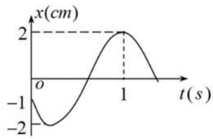
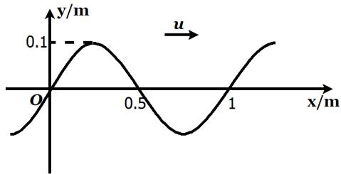
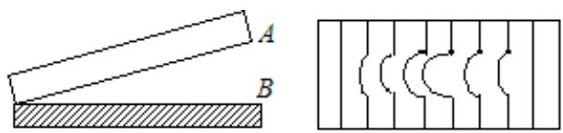
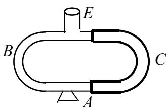
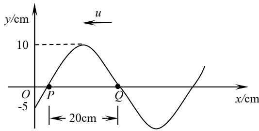

【题目来源】21221 大学物理2B A卷 T1
【教材溯源】第9章 振动 - 9.1 简谐振动
【题目正文】
1. 已知某简谐运动的振动曲线如图所示，则此简谐运动的振动表达式为（x 的单位为 cm，t 的单位为 s）为:

A. $x = 2 \cos \left( \frac{2}{3} \pi t - \frac{2}{3} \pi \right).$
B. $x = 2 \cos \left( \frac{2}{3} \pi t + \frac{2}{3} \pi \right)$ .
C. $x = 2 \cos \left( \frac{4}{3} \pi t - \frac{2}{3} \pi \right)$ .
D. $x = 2 \cos \left( \frac{4}{3} \pi t + \frac{2}{3} \pi \right).$

【答案】A
【AI解析】由曲线得振幅 $A=2\ \mathrm{cm}$，$t=0$ 时 $x=-1\ \mathrm{cm}$ 且向正方向运动。设 $x=2\cos(\omega t+\varphi)$，由 $2\cos\varphi=-1$ 得 $\cos\varphi=-\frac{1}{2}$。$t=1\ \mathrm{s}$ 时到达正最大位移，即 $\cos(\omega+\varphi)=1$，故 $\omega+\varphi=0$。联立解得 $\varphi=-\frac{2\pi}{3}$、$\omega=\frac{2\pi}{3}$。故振动表达式为 $x=2\cos(\frac{2}{3}\pi t-\frac{2}{3}\pi)$。易错点：只代入 $t=0$ 的位移会得到两个相位，必须再结合 $t=1\ \mathrm{s}$ 的峰值或初速度方向才能确定。

【题目来源】21221 大学物理2B A卷 T2
【教材溯源】第10章 波动 - 10.1 波动方程、平面简谐波
【题目正文】
2. 一沿 x 轴正方向传播的平面简谐波在 t=0s 时刻的波形图如下，传播速度为 $u=1.5 \, m/s$ ，则 O 处质点的振动速度表达式为

A. $v = -0.3\pi \sin(3\pi t - \frac{\pi}{2})$ .
B. $v = -0.1\pi \sin(\pi t - \frac{\pi}{2})$ .
C. $v = -0.3\pi \sin(3\pi t + \frac{\pi}{2})$ .
D. $v = -0.1\pi \sin(\pi t + \frac{\pi}{2})$ .
【答案】C
【AI解析】由波形图得振幅 $A=0.1\ \mathrm{m}$，波长 $\lambda=1\ \mathrm{m}$。由 $\omega=\frac{2\pi u}{\lambda}=3\pi\ \mathrm{rad/s}$，$v_m=A\omega=0.3\pi\ \mathrm{m/s}$。$t=0$ 时 O 点 $y=0$，且波形在 O 点处随 x 增大而上升，波沿 $+x$ 传播，故 O 点振动速度向下、为负。$y_O=0.1\cos(3\pi t+\frac{\pi}{2})$ 满足初始位移为零，其速度 $v=-0.3\pi\sin(3\pi t+\frac{\pi}{2})$ 在 $t=0$ 时为 $-0.3\pi$。故答案为 C。易错点：A、C 两式的初速度一正一负，需用波形斜率与传播方向判断 O 点的运动方向。

【题目来源】21221 大学物理2B A卷 T3
【教材溯源】第12章 波动光学 - 12.1 光的干涉
【题目正文】
3. 在迈克尔逊干涉仪的一支光路中放入一厚度为 $4\mu \mathrm{m}$ 的透明介质薄片后，观察到干涉条纹产生了7.0条条纹的移动。如果入射光波长为 $632.8\mathrm{nm}$ ，则透明介质片的折射率为

A. 1.107
B. 1.554
C. 2.107
D. 2.554
【答案】B
【AI解析】光两次穿过薄片，该支光路的光程增加 $2(n-1)d$。条纹移动 7.0 条，即 $2(n-1)d=7\lambda$。解得 $n=1+\frac{7\lambda}{2d}=1+\frac{7\times632.8\ \mathrm{nm}}{2\times4000\ \mathrm{nm}}$。计算得 $n=1+0.554=1.554$。易错点：光程差须取 $2(n-1)d$，漏掉往返因子 2 会得到 2.107。

【题目来源】21221 大学物理2B A卷 T4
【教材溯源】第12章 波动光学 - 12.1 光的干涉
【题目正文】
4. 如图所示，一光学平板玻璃 A 与待测工件 B 之间形成空气劈尖，用波长 $\lambda = 600 ~nm$ 的单色光垂直照射。反射光的干涉条纹如图，弯曲幅度最大的条纹的顶点恰好与其左边条纹的直线部分的连线相切，则工件的上表面缺陷是

A. 不平处为凸起纹，最大高度为 $600 \, nm$ .
B. 不平处为凸起纹，最大高度为 300 nm.
C. 不平处为凹槽，最大深度为 600 nm.
D. 不平处为凹槽，最大深度为 300 nm.

【答案】D
【AI解析】劈尖干涉条纹为等厚线，条纹向劈棱方向弯曲，说明该处空气膜厚度增大，工件上表面为凹槽。弯曲幅度最大的条纹顶点恰好与左边相邻条纹的直线部分相切，即条纹偏移了整整一个条纹间距。相邻条纹对应空气膜厚度差 $\frac{\lambda}{2}=300\ \mathrm{nm}$。故缺陷为凹槽，最大深度为 300 nm。易错点：一个条纹间距对应厚度变化 $\lambda/2$ 而非 $\lambda$，凸起与凹槽的判定要看条纹弯曲方向。

【题目来源】21221 大学物理2B A卷 T5
【教材溯源】第10章 波动 - 10.2 波的能量、能流密度
【题目正文】
5. 当机械波在介质中传播时, 某一介质元的最大形变发生在(其中 A 是振幅)

A. 介质元离开其平衡位置的最大位移处.
B. 介质元离开平衡位置 $\frac{\sqrt{2}}{2} A$ 处.
C. 介质元在其平衡位置处.
D. 介质元离开平衡位置 $\frac{1}{2}A$ 处.
【答案】C
【AI解析】介质元的形变即应变，正比于 $\frac{\partial y}{\partial x}$。在平面简谐波中，$\frac{\partial y}{\partial x}$ 与振动速度 $\frac{\partial y}{\partial t}$ 同步变化。介质元通过平衡位置时振动速度最大，故形变最大。在最大位移处介质元瞬时静止，形变为零。易错点：不要凭直觉认为位移最大处形变最大。

【题目来源】21221 大学物理2B A卷 T6
【教材溯源】第10章 波动 - 10.6 波的干涉
【题目正文】
6. 沿着相反方向传播的两列相干波，其波动方程为 $y_{1}=A\cos(\omega t-\frac{2\pi}{\lambda}x)$ 和 $y_{2}=A\cos(\omega t+\frac{2\pi}{\lambda}x)$ 。叠加后形成的驻波中，其波节的位置坐标为

A. $x = \pm k \lambda$ .
B. $x=\pm\frac{1}{2}k\lambda$ .
C. $x=\pm\frac{1}{2}(2k+1)\lambda$ .
D. $x=\pm(2k+1)\lambda/4$ ． 其中的 $k=0,1,2,3,\cdots$
【答案】D
【AI解析】两列波叠加得 $y=y_1+y_2=2A\cos\frac{2\pi x}{\lambda}\cos\omega t$。波节处振幅为零，要求 $\cos\frac{2\pi x}{\lambda}=0$。解得 $\frac{2\pi x}{\lambda}=(2k+1)\frac{\pi}{2}$，即 $x=\pm(2k+1)\frac{\lambda}{4}$。易错点：波节条件为 $x=(2k+1)\frac{\lambda}{4}$，与波腹条件 $x=k\frac{\lambda}{2}$ 相差 $\frac{\lambda}{4}$。

【题目来源】21221 大学物理2B A卷 T7
【教材溯源】第12章 波动光学 - 12.3 光的偏振
【题目正文】
7. 三个偏振片 $P_{1}$ ， $P_{2}$ 与 $P_{3}$ 堆叠在一起， $P_{1}$ 与 $P_{3}$ 的偏振化方向相互垂直， $P_{2}$ 与 $P_{1}$ 的偏振化方向间的夹角为 $45^{\circ}$ 。强度为 $I_{0}$ 的自然光垂直入射于偏振片 $P_{1}$ ，并依次透过偏振片 $P_{1}$ 、 $P_{2}$ 与 $P_{3}$ ，则通过三个偏振片后的光强 I 为:

A. $0.125I_{0}$
B. $0.25I_{0}$
C. $0.15I_{0}$
D. $0.5I_{0}$
【答案】A
【AI解析】自然光通过 $P_1$ 后强度为 $\frac{I_0}{2}$。通过 $P_2$ 时按马吕斯定律乘 $\cos^2 45^\circ=\frac{1}{2}$。$P_3$ 与 $P_2$ 的夹角也是 $45^\circ$，再乘 $\cos^2 45^\circ=\frac{1}{2}$。故 $I=\frac{I_0}{2}\times\frac{1}{2}\times\frac{1}{2}=\frac{I_0}{8}=0.125I_0$。易错点：虽然 $P_1$ 与 $P_3$ 正交，但中间插入 $P_2$ 后光不能看成直接为零，须逐片应用马吕斯定律。

【题目来源】21221 大学物理2B A卷 T8
【教材溯源】第14章 物质的波粒二象性 - 14.1 黑体辐射与能量子
【题目正文】
8. 下述几种有关黑体的说法中，正确的是

A. 黑体不辐射可见光
B. 黑体不辐射任何波长的光
C. 黑体不反射可见光
D. 黑体不反射任何波长的光
【答案】D
【AI解析】黑体是对任何波长的入射辐射都全部吸收、毫不反射的理想物体。黑体本身温度不为零时，仍按普朗克公式辐射各种波长的电磁波，温度高时可发出可见光。故只有"不反射任何波长的光"正确。易错点：黑体"全吸收"不等于"不辐射"，辐射本领与吸收本领都最强的才是黑体。

【题目来源】21221 大学物理2B A卷 T9
【教材溯源】第14章 物质的波粒二象性 - 14.2 光电效应与光子
【题目正文】
9. 已知某单色光照射到一金属表面产生了光电效应，若此金属的逸出电势是 $U_{0}$ （使电子从金属逸出需作功 $eU_{0}$ ），则此单色光的波长 $\lambda$ 必须满足

A. $\lambda \leq hc / (eU_{0})$ .
B. $\lambda \geq hc / (eU_{0})$ .
C. $\lambda \leq eU_{0} / (hc)$ .
D. $\lambda \geq eU_{0} / (hc)$ .
【答案】A
【AI解析】产生光电效应的条件为光子能量不小于逸出功，即 $\frac{hc}{\lambda}\geq eU_0$。变形得 $\lambda\leq\frac{hc}{eU_0}$。故单色光波长必须满足选项 A。易错点：不等式方向不要取反，波长越短光子能量越大，波长必须小于红限波长才能发生光电效应。

【题目来源】21221 大学物理2B A卷 T10
【教材溯源】第15章 量子力学基础 - 15.5 电子的自旋 原子的壳层结构
【题目正文】
10. 在原子的 L 壳层中，电子可能具有的四个量子数 $(n,l,m_{l},m_{s})$ 是

(1) $(2,0,1,\frac{1}{2})$
(2) $(2,1,0,-\frac{1}{2})$
(3) $(2,1,1,\frac{1}{2})$
(4) $(2, 1, -1, -\frac{1}{2})$

以上四种取值中,哪些是正确的

A. 只有(1)、(2)是正确的.
B. 只有(2)、(3)是正确的.
C. 只有(2)、(3)、(4)是正确的.
D. 全部是正确的.
【答案】C
【AI解析】L 壳层对应 $n=2$，$l$ 可取 0、1，且须满足 $|m_l|\le l$、$m_s=\pm\frac{1}{2}$。(1) 中 $l=0$ 却取 $m_l=1$，违反 $|m_l|\le l$，不正确。其余 (2)、(3)、(4) 均满足各量子数的取值规则。故正确的是 (2)、(3)、(4)。易错点：$l=0$ 时 $m_l$ 只能取 0，不能取非零值。

【题目来源】21221 大学物理2B A卷 T11
【教材溯源】第9章 振动 - 9.1 简谐振动
【题目正文】
11. 以 T 为周期作简谐运动的质点，当其由平衡位置向 x 轴正方向运动时，从该位置到正二分之一最大位移这段路程所需要的最短时间为 ____。
【答案】$\frac{T}{12}$
【AI解析】取平衡位置为原点，设 $x=A\cos(\omega t+\varphi)$。由平衡位置向正方向运动时相位为 $-\frac{\pi}{2}$。到达正二分之一最大位移处时 $A\cos\varphi'=\frac{A}{2}$，取最短时间对应的相位 $\varphi'=-\frac{\pi}{3}$。相位增量为 $\Delta\varphi=-\frac{\pi}{3}-(-\frac{\pi}{2})=\frac{\pi}{6}$。由 $\Delta t=\frac{\Delta\varphi}{\omega}=\frac{\pi/6}{2\pi/T}=\frac{T}{12}$。易错点：相位从 $-\frac{\pi}{2}$ 变到 $-\frac{\pi}{3}$ 是增大过程，两个相位不要相减反号。

【题目来源】21221 大学物理2B A卷 T12
【教材溯源】第9章 振动 - 9.4 简谐振动的合成
【题目正文】
12. 两个同方向、同频率的简谐振动，其合振动的振幅为 2m，合振动的位相与第一个简谐振动的相位差为 $\pi/6$ ，若第一个简谐振动的振幅为 $\sqrt{3}$ m，则第二个简谐振动的振幅为 ____，两个简谐振动的相位差为 ____。
【答案】1 m，$\frac{\pi}{2}$
【AI解析】用旋转矢量法，取第一个振动的相位为 0，则合矢量大小为 2 m、方向为 $\frac{\pi}{6}$。由 $\vec{A}_2=\vec{A}-\vec{A}_1$，其分量为 $A_{2x}=2\cos\frac{\pi}{6}-\sqrt{3}=0$，$A_{2y}=2\sin\frac{\pi}{6}=1$。故第二个振动的振幅 $A_2=1\ \mathrm{m}$，相位为 $\frac{\pi}{2}$。两振动的相位差为 $\frac{\pi}{2}$。易错点：矢量减法要按分量进行，不能直接用标量相减。

【题目来源】21221 大学物理2B A卷 T13
【教材溯源】第10章 波动 - 10.6 波的干涉
【题目正文】
13. 图为一种声波干涉仪，声波从入口 E 进入仪器，分 B、C 两路在管中传播，然后到达喇叭口 A 后汇合传出，弯管 C 可以移动以改变管路长度，当它渐渐移动时从喇叭口发出的声音周期性地增强或减弱，设 C 管每移动 6 cm，由 A 口发出的声音就减弱一次，则该声波的频率为（空气中声速为 340 m/s）____。

【答案】约 2833 Hz
【AI解析】弯管 C 为 U 形滑动管，移动 $\Delta x$ 时该支路声程改变 $2\Delta x$。声音从一次减弱到相邻下一次减弱，两路声程差改变一个波长。故 $\lambda=2\times6\ \mathrm{cm}=12\ \mathrm{cm}=0.12\ \mathrm{m}$。由 $\nu=\frac{u}{\lambda}=\frac{340}{0.12}$。得频率约为 2833 Hz。易错点：声程变化是 $2\Delta x$ 而非 $\Delta x$，漏掉因子 2 会使频率减半。

【题目来源】21221 大学物理2B A卷 T14
【教材溯源】第12章 波动光学 - 12.1 光的干涉
【题目正文】
14. 在双缝干涉实验中，所用光波波长 $\lambda = 546.1 ~nm$ ，双缝与屏间的距离 $D = 30 ~cm$ ，双缝间距为 $d = 1.34 \times 10^{-4} ~m$ ，则中央明条纹两侧的两个第三级明条纹之间的距离为 ____。
【答案】7.34 mm
【AI解析】相邻明纹间距 $\Delta x=\frac{D\lambda}{d}=\frac{0.30\times546.1\times10^{-9}}{1.34\times10^{-4}}=1.22\times10^{-3}\ \mathrm{m}$。中央两侧的 $+3$ 级与 $-3$ 级明纹之间共隔 6 个条纹间距。故距离为 $6\Delta x=7.34\times10^{-3}\ \mathrm{m}=7.34\ \mathrm{mm}$。易错点：两侧第 3 级之间相隔 6 个间距而不是 3 个。

【题目来源】21221 大学物理2B A卷 T15
【教材溯源】第12章 波动光学 - 12.2 光的衍射
【题目正文】
15. 在单缝夫琅禾费衍射实验中，设第一级暗纹的衍射角很小，若钠黄光 $(\lambda_{1}=589\mathrm{nm})$ 中央明纹宽度为4.0 mm，则 $\lambda_{2}=442nm$ 的蓝紫色光的中央明纹宽度为____。
【答案】3.0 mm
【AI解析】单缝衍射中央明纹宽度 $\Delta x=\frac{2\lambda f}{a}$，与波长成正比。衍射角很小时同一装置下 $f$、$a$ 相同。故 $\frac{\Delta x_2}{\Delta x_1}=\frac{\lambda_2}{\lambda_1}=\frac{442}{589}=0.75$。蓝紫色光中央明纹宽度 $\Delta x_2=4.0\times0.75=3.0\ \mathrm{mm}$。易错点：中央明纹宽度指 $\pm1$ 级暗纹之间的范围，共包含 $2\lambda f/a$，但本题只需用正比关系。

【题目来源】21221 大学物理2B A卷 T16
【教材溯源】第12章 波动光学 - 12.3 光的偏振
【题目正文】
16. 一束自然光自空气射向透明介质 1，布儒斯特角为 $i_{B1}=60^{\circ}$ ，若该自然光自空气射向透明介质 2，布儒斯特角为 $i_{B2}=53^{\circ}$ ，则若光从介质 1 向介质 2 入射时，布儒斯特角 $i_{B}=$ ____。
【答案】约 $37.5^{\circ}$
【AI解析】由布儒斯特定律 $\tan i_B=\frac{n_2}{n_1}$，得 $n_1=\tan 60^\circ=\sqrt{3}\approx1.732$，$n_2=\tan 53^\circ\approx1.327$。光从介质 1 射向介质 2 时，$\tan i_B=\frac{n_2}{n_1}=\frac{1.327}{1.732}\approx0.766$。故 $i_B\approx37.5^\circ$。易错点：入射方向反转后比值要取 $\frac{n_2}{n_1}$，两个已知角不能直接相减。

【题目来源】21221 大学物理2B A卷 T17
【教材溯源】第13章 狭义相对论 - 13.2 洛伦兹变换与狭义相对论的时空观
【题目正文】
17. 一飞船以速率 v 相对于地球匀速运动，在船中放有一根长度为 1m 的米尺，米尺顺着飞船的运动方向放置。若地球上观察者测得该米尺的长度为 0.5m，则 v= ____；在测量该米尺的密度时，地球上观察者的测量结果是飞船上宇航员测量结果的 ____ 倍。
【答案】$v=\frac{\sqrt{3}}{2}c\approx0.866c$，2 倍
【AI解析】由长度收缩公式 $L=L_0\sqrt{1-\frac{v^2}{c^2}}$，代入 $L_0=1\ \mathrm{m}$、$L=0.5\ \mathrm{m}$ 得 $\sqrt{1-\frac{v^2}{c^2}}=0.5$。解得 $v=\frac{\sqrt{3}}{2}c\approx0.866c$。密度 $\rho=\frac{m}{V}$，质量是洛伦兹不变量，沿运动方向的长度收缩为一半，体积也减半。故地球观察者测得的密度为宇航员测量结果的 2 倍。易错点：只有运动方向的尺寸收缩，垂直方向不变，密度增大倍数等于收缩因子的倒数。

【题目来源】21221 大学物理2B A卷 T18
【教材溯源】第13章 狭义相对论 - 13.3 相对论力学
【题目正文】
18. 一电子以 0.9c 的速率运动，则电子的总能量是 ____ J，电子的经典力学的动能与相对论动能之比等于 ____。（电子静止质量为 $9.11 \times 10^{-31}$ kg）
【答案】$1.88\times10^{-13}$ J，0.31
【AI解析】洛伦兹因子 $\gamma=\frac{1}{\sqrt{1-0.9^2}}=2.294$，静能 $m_0c^2=9.11\times10^{-31}\times9\times10^{16}=8.20\times10^{-14}\ \mathrm{J}$。总能量 $E=\gamma m_0c^2=1.88\times10^{-13}\ \mathrm{J}$。经典动能 $E_{k0}=\frac{1}{2}m_0v^2=3.32\times10^{-14}\ \mathrm{J}$，相对论动能 $E_k=(\gamma-1)m_0c^2=1.06\times10^{-13}\ \mathrm{J}$。两者之比 $\frac{E_{k0}}{E_k}\approx0.31$。易错点：总能量为 $\gamma m_0c^2$，相对论动能为 $(\gamma-1)m_0c^2$，二者不能混淆。

【题目来源】21221 大学物理2B A卷 T19
【教材溯源】第14章 物质的波粒二象性 - 14.5 氢原子和玻尔的量子论
【题目正文】
19. 已知基态氢原子的能量为-13.6eV，当基态氢原子被能量为 12.09eV 的光子激发后，其主量子数 n 将由 ____ 变为 ____。
【答案】由 1 变为 3
【AI解析】氢原子能级 $E_n=-\frac{13.6}{n^2}\ \mathrm{eV}$，基态 $n=1$、$E_1=-13.6\ \mathrm{eV}$。吸收光子后能量 $E_n=-13.6+12.09=-1.51\ \mathrm{eV}$。由 $-\frac{13.6}{n^2}=-1.51$ 得 $n^2=\frac{13.6}{1.51}=9$。故主量子数由 1 变为 3。易错点：吸收光子后能量仍为负的束缚态能级，$n$ 取整数 3 而非 2。

【题目来源】21221 大学物理2B A卷 T20
【教材溯源】第14章 物质的波粒二象性 - 14.4 物质波与德布罗意关系
【题目正文】
20. 在 $B = 1.25 \times 10^{-2} T$ 的均匀磁场中沿半径为 $R = 1.66 \, cm$ 的圆轨道运动的 $\alpha$ 粒子的德布罗意波长是 ____ 。 (普朗克常量 $h = 6.63 \times 10^{-34} J \cdot s$ ， $\alpha$ 粒子所带电量为 $3.2 \times 10^{-19} C$ )
【答案】约 $1.0\times10^{-11}$ m
【AI解析】带电粒子在磁场中做圆周运动，满足 $qvB=m\frac{v^2}{R}$，即动量 $p=mv=qBR$。由德布罗意关系 $\lambda=\frac{h}{p}=\frac{h}{qBR}$。代入 $h=6.63\times10^{-34}\ \mathrm{J\cdot s}$、$q=3.2\times10^{-19}\ \mathrm{C}$、$B=1.25\times10^{-2}\ \mathrm{T}$、$R=1.66\times10^{-2}\ \mathrm{m}$。得 $\lambda=\frac{6.63\times10^{-34}}{6.64\times10^{-23}}\approx1.0\times10^{-11}\ \mathrm{m}$。易错点：要先由洛伦兹力提供向心力求出动量，再代入德布罗意公式，单位须统一为国际单位制。

【题目来源】21221 大学物理2B A卷 T21
【教材溯源】第10章 波动 - 10.1 波动方程、平面简谐波
【题目正文】
21. 已知有一沿 x 轴负方向传播的平面余弦波，在 $t=\frac{1}{3}$ s 时的波形如图所示，且周期 T=0.2s。

(1) 写出 O 点的振动方程;
(2) 写出波动表达式;
(3) 写出 Q 点振动表达式。

【答案】(1) $y_O=0.10\cos(10\pi t)\ \mathrm{m}$；(2) $y=0.10\cos(10\pi t+5\pi x)\ \mathrm{m}$；(3) $y_Q=0.10\cos(10\pi t+\frac{7\pi}{6})\ \mathrm{m}$
【AI解析】由波形图得振幅 $A=0.10\ \mathrm{m}$，波长 $\lambda=2\times20\ \mathrm{cm}=0.40\ \mathrm{m}$，故 $\omega=\frac{2\pi}{T}=10\pi\ \mathrm{rad/s}$，$k=\frac{2\pi}{\lambda}=5\pi\ \mathrm{rad/m}$。$t=\frac{1}{3}\ \mathrm{s}$ 时 O 点 $y=-0.05\ \mathrm{m}$ 且向正方向运动，设 $y_O=A\cos(\omega t+\varphi)$。由 $\cos(\frac{10\pi}{3}+\varphi)=-\frac{1}{2}$ 且 $\sin(\frac{10\pi}{3}+\varphi)<0$ 解得 $\varphi=0$，故 $y_O=0.10\cos(10\pi t)\ \mathrm{m}$。波沿 x 轴负方向传播，波动表达式为 $y=0.10\cos(10\pi t+5\pi x)\ \mathrm{m}$。Q 点坐标 $x_Q=\frac{7}{30}\ \mathrm{m}$，代入得 $y_Q=0.10\cos(10\pi t+\frac{7\pi}{6})\ \mathrm{m}$。易错点：O 点初相位须同时满足位移与速度两个条件，只凭位移会得到两个候选值。

【题目来源】21221 大学物理2B A卷 T22
【教材溯源】第12章 波动光学 - 12.2 光的衍射
【题目正文】
22. 用一束具有两种波长的平行光垂直入射在光栅上， $\lambda_{1}=600nm$ 和 $\lambda_{2}=400nm$ ，发现距中央明纹 5cm 处 $\lambda_{1}$ 光的第 k 级主极大和 $\lambda_{2}$ 光的第 $(k+1)$ 级主极大相重合，放置在光栅与屏之间的透镜的焦距为 $f=50cm$ ，试问：

(1) 上述 k=?
(2) 光栅常数 d = ?
(3) 若该光栅第六级缺级，求光栅狭缝的最小宽度 a = ?
【答案】(1) $k=2$；(2) $d=1.2\times10^{-5}\ \mathrm{m}$；(3) $a=2\times10^{-6}\ \mathrm{m}$
【AI解析】两波长主极大重合，满足 $k\lambda_1=(k+1)\lambda_2$。代入数值 $600k=400(k+1)$，解得 $k=2$。该处 $\sin\theta\approx\tan\theta=\frac{x}{f}=\frac{5}{50}=0.1$，由光栅方程 $d\sin\theta=k\lambda_1=2\times600\ \mathrm{nm}$。解得 $d=\frac{1200\times10^{-9}}{0.1}=1.2\times10^{-5}\ \mathrm{m}$。第 6 级缺级要求 $\frac{d}{a}$ 为能整除 6 的整数，狭缝最小时取 $\frac{d}{a}=6$。故 $a=\frac{d}{6}=2\times10^{-6}\ \mathrm{m}$。易错点：缺级条件中取 $\frac{d}{a}=6$ 对应狭缝最小宽度，若取 2 或 3 则狭缝更宽。

【题目来源】21221 大学物理2B A卷 T23
【教材溯源】第14章 物质的波粒二象性 - 14.3 康普顿散射
【题目正文】
23. 已知 X 射线光子的能量为 0.60 MeV，若在康普顿散射中散射光子的波长为入射光子的 1.2 倍，试求反冲电子的动能。
【答案】0.10 MeV
【AI解析】光子能量与波长成反比，$\frac{E'}{E_0}=\frac{\lambda_0}{\lambda'}=\frac{1}{1.2}$。散射光子能量 $E'=0.60\times\frac{1}{1.2}=0.50\ \mathrm{MeV}$。由能量守恒，反冲电子动能 $E_k=E_0-E'=0.60-0.50=0.10\ \mathrm{MeV}$。易错点：波长之比为 1.2 倍时能量之比要取倒数，不能直接用 $0.60\times1.2$。

【题目来源】21221 大学物理2B A卷 T24
【教材溯源】第15章 量子力学基础 - 15.3 一维定态系统
【题目正文】
24. 一质量为 m 的粒子被限制在宽度为 L 的一维有限深方势阱（在 $|x| < L/2$ 范围内，势能函数 $E_{p} = 0$ ）中，已知该粒子的某定态波函数为

$$
\varphi (x) = \left\{ \begin{array}{l l} A e ^ {\frac {\pi (x + L / 2)}{2 L}} & x <   - L / 2 \\ B \cos \frac {\pi x}{2 L} & | x | \leq L / 2 \\ C e ^ {- \frac {\pi (x - L / 2)}{2 L}} & x > L / 2 \end{array} \right.
$$

求常数 A、B 和 C。（提示：利用波函数的连续与归一化条件。）
【答案】$A=C=\sqrt{\frac{\pi}{L(\pi+4)}}$，$B=\sqrt{\frac{2\pi}{L(\pi+4)}}$
【AI解析】由波函数在 $x=\pm\frac{L}{2}$ 处连续，得 $A=B\cos\frac{\pi}{4}=\frac{\sqrt{2}}{2}B$，$C=B\cos\frac{\pi}{4}=\frac{\sqrt{2}}{2}B$。于是 $A=C=\frac{\sqrt{2}}{2}B$。三段区域的积分分别为 $\int_{-\infty}^{-\frac{L}{2}}A^2e^{\frac{\pi(x+L/2)}{L}}dx=A^2\frac{L}{\pi}$、$\int_{-\frac{L}{2}}^{\frac{L}{2}}B^2\cos^2\frac{\pi x}{2L}dx=B^2L(\frac{1}{2}+\frac{1}{\pi})$、$\int_{\frac{L}{2}}^{\infty}C^2e^{-\frac{\pi(x-L/2)}{L}}dx=C^2\frac{L}{\pi}$。由归一化条件 $\int_{-\infty}^{+\infty}|\varphi|^2dx=1$，代入 $A=C=\frac{\sqrt{2}}{2}B$ 得 $B^2L(\frac{1}{2}+\frac{2}{\pi})=1$。解得 $B=\sqrt{\frac{2\pi}{L(\pi+4)}}$，$A=C=\sqrt{\frac{\pi}{L(\pi+4)}}$。易错点：指数衰减段积分到无穷远，中间段积分为 $L(\frac{1}{2}+\frac{1}{\pi})$ 不是 $\frac{L}{2}$。

