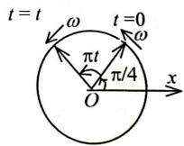
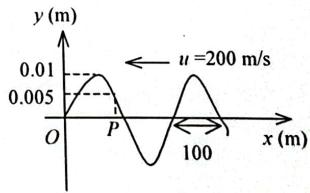
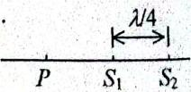
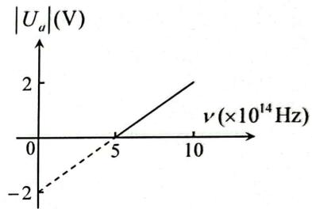
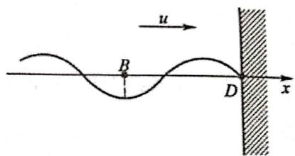
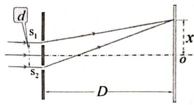

【题目来源】22231 大学物理1B A卷 T1
【教材溯源】第9章 振动 - 9.1 简谐振动
【题目正文】
1. 一简谐振动的旋转矢量图如图所示，设图中圆的半径为 R，则该简谐振动的振动方程为

A. $x = R \cos \left( \pi t + \frac{\pi}{4} \right)$ .
B. $x = R \sin \left( \pi t + \frac{\pi}{4} \right)$ .
C. $x = R \cos \left( \pi t - \frac{\pi}{4} \right)$ .
D. $x = R \cos \left( \frac{\pi}{2} t + \frac{\pi}{4} \right).$
【答案】A
【AI解析】旋转矢量以角速度 $\omega$ 逆时针转动，$t$ 时刻转过的角度为 $\omega t$。图中 $t=0$ 时矢量与 x 轴夹角为 $\frac{\pi}{4}$，即初相 $\varphi=\frac{\pi}{4}$。图中标注的扫过角度为 $\pi t$，故 $\omega=\pi\ \mathrm{rad/s}$。振动方程 $x=R\cos(\omega t+\varphi)=R\cos(\pi t+\frac{\pi}{4})$。易错点：振动方程用余弦表示时初相直接取 $t=0$ 时矢量与 x 轴的夹角，不能用正弦函数表示。

【题目来源】22231 大学物理1B A卷 T2
【教材溯源】第10章 波动 - 10.1 波动方程、平面简谐波
【题目正文】
2. 图中画出一平面简谐波在 t=2 s 时刻的波形图，则 P 点处媒质元的振动方程是

A. $y_{P}=0.01\cos\left[\pi(t-2)+\frac{\pi}{3}\right]$ (SI).
B. $y_{P}=0.01\cos\left[\pi(t+2)+\frac{\pi}{3}\right]$ (SI).
C. $y_{p}=0.01\cos\left[2\pi(t-2)+\frac{\pi}{3}\right]$ (SI).
D. $y_{p}=0.01\cos\left[2\pi(t-2)-\frac{\pi}{3}\right]$ (SI).

【答案】C
【AI解析】由波形图得振幅 $A=0.01\ \mathrm{m}$，周期 $T=1\ \mathrm{s}$，故 $\omega=2\pi\ \mathrm{rad/s}$。$t=2\ \mathrm{s}$ 时 P 点位于 $y=\frac{A}{2}=0.005\ \mathrm{m}$ 处且向负方向运动。设 $y_P=0.01\cos[\omega(t-2)+\varphi]$，由 $\cos\varphi=\frac{1}{2}$ 且速度 $v=-A\omega\sin\varphi<0$ 得 $\varphi=\frac{\pi}{3}$。故 P 点振动方程为 $y_P=0.01\cos[2\pi(t-2)+\frac{\pi}{3}]$。易错点：相位须同时满足位移与速度方向两个条件，$\varphi=-\frac{\pi}{3}$ 时速度方向相反。

【题目来源】22231 大学物理1B A卷 T3
【教材溯源】第10章 波动 - 10.6 波的干涉
【题目正文】
3. 两相干波源 $S_{1}$ 和 $S_{2}$ 相距 $\lambda/4$ （ $\lambda$ 为波长）， $S_{1}$ 的相位比 $S_{2}$ 的相位超前 $\frac{\pi}{2}$ ，在 $S_{1}$ 、 $S_{2}$ 的连线上， $S_{1}$ 外侧各点（例如 P 点）由两波引起的两谐振动的相位差是：

A. 0.
B. $\frac{\pi}{2}.$
C. $\pi$ .
D. $\frac{3\pi}{2}$ .

【答案】C
【AI解析】P 点在 $S_1$ 外侧，$r_1-r_2=-\frac{\lambda}{4}$，波程差对应的相位差为 $\frac{2\pi}{\lambda}(r_1-r_2)=-\frac{\pi}{2}$。两波源本身有初相差 $\varphi_1-\varphi_2=\frac{\pi}{2}$。总相位差 $\Delta\varphi=\frac{\pi}{2}-\left(-\frac{\pi}{2}\right)$。按 $\Delta\varphi=(\varphi_1-\varphi_2)-\frac{2\pi}{\lambda}(r_1-r_2)$ 计算得 $\Delta\varphi=\frac{\pi}{2}+\frac{\pi}{2}=\pi$。易错点：$r_1<r_2$，波程差为负，符号取反会得到相位差为零。

【题目来源】22231 大学物理1B A卷 T4
【教材溯源】第11章 几何光学基础 - 11.1 几何光学的基本实验定律和基本原理
【题目正文】
4. 在相同的时间内，一束波长为 $\lambda$ 的单色光在空气中和在玻璃中

A. 传播的路程相等，走过的光程相等.
B. 传播的路程相等，走过的光程不相等.
C. 传播的路程不相等，走过的光程相等.
D. 传播的路程不相等，走过的光程不相等.
【答案】C
【AI解析】光在玻璃中的速度 $v=\frac{c}{n}$ 小于空气中的速度，相同时间内传播的几何路程较短。光程定义为 $n$ 与几何路程的乘积，等于真空中的等效路程。相同时间内光在不同介质中传播的光程相等，均为 $ct$。故路程不相等而光程相等。易错点：光程相同是干涉计算的基础，几何路程之比等于折射率的反比。

【题目来源】22231 大学物理1B A卷 T5
【教材溯源】第12章 波动光学 - 12.1 光的干涉
【题目正文】
5. 把一平凸透镜放在平玻璃上，构成牛顿环装置。当平凸透镜慢慢地向上平移时，由反射光形成的牛顿环 [ ]

A. 向中心收缩，条纹间隔变小.
B. 向中心收缩，环心呈明暗交替变化.
C. 向外扩张，环心呈明暗交替变化.
D. 向外扩张，条纹间隔变大.
【答案】B
【AI解析】牛顿环条纹是等厚线，透镜上移使各处空气膜厚度均匀增大。同一条纹对应固定厚度，故该厚度对应的圆环半径减小，条纹向中心收缩。透镜平移过程中中心处膜厚周期性地通过半波长的整数倍与半整数倍，环心处光强明暗交替变化。易错点：条纹收缩与环心明暗交替是同时发生的现象，不要只选其一。

【题目来源】22231 大学物理1B A卷 T6
【教材溯源】第12章 波动光学 - 12.1 光的干涉
【题目正文】
6. 在迈克耳孙干涉仪的一支光路中，放入一片折射率为 n 的透明介质薄膜后，测出两束光的光程差的改变量为一个波长 $\lambda$ ，则薄膜的厚度是 [ ]

A. $\frac{\lambda}{2}$ .
B. $\frac{\lambda}{2n}.$
C. $\frac{\lambda}{n-1}$ .
D. $\frac{\lambda}{2(n-1)}$ .
【答案】D
【AI解析】放入薄膜后，该支光路的光程改变为 $2(n-1)d$，其中因子 2 来自光两次穿过薄膜。由题意 $2(n-1)d=\lambda$。解得薄膜厚度 $d=\frac{\lambda}{2(n-1)}$。易错点：光程改变量既含因子 2 又含 $n-1$，只计其一都会出错。

【题目来源】22231 大学物理1B A卷 T7
【教材溯源】第13章 狭义相对论 - 13.2 洛伦兹变换与狭义相对论的时空观
【题目正文】
7. 在狭义相对论中，下列说法中哪些是正确的？

(1) 一切运动物体相对于观察者的速度都不能大于真空中的光速。
(2) 质量、长度、时间的测量结果都是随物体与观察者的相对运动状态而改变的。
(3) 在一惯性系中发生于同一时刻，不同地点的两个事件在其他一切惯性系中也是同时发生的。
(4)惯性系中的观察者观察一个与他作匀速相对运动的时钟时，会看到这时钟比与他相对静止的相同的时钟走得慢些。

A. (1), (3), (4).
B. (1)，(2)，(4).
C. (1)，(2)，(3).
D. (2), (3), (4).
【答案】B
【AI解析】光速是极限速度，任何实物粒子速度不能超过真空光速，(1) 正确。长度、时间、质量均与相对运动状态有关，(2) 正确。同时性是相对的，不同地点同时发生的两事件在其他惯性系中一般不同时，(3) 错误。动钟变慢，运动时钟比静止时钟走得慢，(4) 正确。易错点：同时的相对性只对不同地点的事件成立，同地同时的事件仍同时。

【题目来源】22231 大学物理1B A卷 T8
【教材溯源】第13章 狭义相对论 - 13.2 洛伦兹变换与狭义相对论的时空观
【题目正文】
8. K 系与 K' 系是坐标轴相互平行的两个惯性系，K' 系相对于 K 系沿 Ox 轴正方向匀速运动。一根刚性尺静止在 K' 系中，与 O'x' 轴成 30° 角。今在 K 系中观测得该尺与 Ox 轴成 45° 角，则 K' 系相对于 K 系的速度是：

A. $(2/3)c$ .
B. $(1/3)c.$
C. $(2/3)^{1/2}c.$
D. $(1/3)^{1/2}c.$
【答案】C
【AI解析】尺在 K' 系中的分量 $L_x'=L_0\cos30^\circ$，$L_y'=L_0\sin30^\circ$。垂直方向长度不变，$L_y=L_y'$。沿运动方向收缩，$L_x=L_x'\sqrt{1-\beta^2}$。K 系中 $\tan45^\circ=\frac{L_y}{L_x}=1$，即 $L_0\sin30^\circ=L_0\cos30^\circ\sqrt{1-\beta^2}$。解得 $\sqrt{1-\beta^2}=\frac{\sin30^\circ}{\cos30^\circ}=\frac{1}{\sqrt{3}}$。故 $\beta=\sqrt{\frac{2}{3}}$，即 $v=(2/3)^{1/2}c$。易错点：只有沿运动方向的分量发生收缩，垂直分量不变。

【题目来源】22231 大学物理1B A卷 T9
【教材溯源】第14章 物质的波粒二象性 - 14.1 黑体辐射与能量子
【题目正文】
9. 在加热黑体过程中，其最大单色辐出度（单色辐射本领）对应的波长由 $0.6 \mu m$ 变到 $0.3 \mu m$ ，则其辐射出射度（总辐射本领）增大为原来的

A. 2 倍.
B. 4 倍.
C. 8 倍.
D. 16 倍.
【答案】D
【AI解析】由维恩位移定律 $\lambda_m T=b$，波长减半说明热力学温度加倍。由斯特藩-玻尔兹曼定律，辐射出射度 $M=\sigma T^4$。温度加倍时 $M$ 变为原来的 $2^4=16$ 倍。易错点：辐射出射度与温度的四次方成正比，不是平方关系。

【题目来源】22231 大学物理1B A卷 T10
【教材溯源】第15章 量子力学基础 - 15.4 氢原子
【题目正文】
10. 量子力学中，氢原子中电子绕核运动的角动量是量子化的，其数值大小为 $L=\sqrt{l(l+1)}h$ 。当主量子数为 3 时，对应的角动量不可能的取值为

A. 0.
B. $\sqrt{2}\hbar$
C. $\sqrt{3}h$ .
D. $\sqrt{6}\hbar$ .
【答案】C
【AI解析】角量子数满足 $l=0,1,2,\cdots,n-1$。主量子数 $n=3$ 时 $l$ 可取 0、1、2。对应角动量 $L=\sqrt{l(l+1)}\hbar$，取值分别为 $0$、$\sqrt{2}\hbar$、$\sqrt{6}\hbar$。$\sqrt{3}\hbar$ 要求 $l(l+1)=3$，无整数解。故 $\sqrt{3}h$ 不可能。易错点：$l$ 的最大取值为 $n-1$，且 $l$ 只能取整数。

【题目来源】22231 大学物理1B A卷 T11
【教材溯源】第9章 振动 - 9.4 简谐振动的合成
【题目正文】
11. 已知有两个在水平方向上的同频率的简谐运动，其运动方程分别为： $x_{1}=0.03\cos(5t+0.75\pi)(m)$ 和 $x_{2}=0.04\cos(5t+0.25\pi)(m)$ 。则其合振动的振幅为 ____，初相为 ____。
【答案】0.05 m，$\arctan 7\approx1.43\ \mathrm{rad}$（约 $0.455\pi$）
【AI解析】两振动的相位差 $\Delta\varphi=0.75\pi-0.25\pi=\frac{\pi}{2}$，两旋转矢量正交。合振幅 $A=\sqrt{A_1^2+A_2^2}=\sqrt{0.03^2+0.04^2}=0.05\ \mathrm{m}$。合矢量分量为 $A_x=0.03\cos0.75\pi+0.04\cos0.25\pi=0.00707$，$A_y=0.03\sin0.75\pi+0.04\sin0.25\pi=0.0495$。初相 $\varphi=\arctan\frac{0.0495}{0.00707}=\arctan 7\approx1.43\ \mathrm{rad}$。易错点：合振幅用勾股关系的前提是两振动相位差为 $\frac{\pi}{2}$，初相要用矢量合成的分量比求出。

【题目来源】22231 大学物理1B A卷 T12
【教材溯源】第12章 波动光学 - 12.2 光的衍射
【题目正文】
12. 在单缝夫琅禾费衍射实验中，波长为 $\lambda$ 的单色光垂直入射在宽度 $a = 5\lambda$ 的单缝上。对应于衍射角 $\varphi$ 的方向上若单缝处波面恰好可分成 5 个半波带，则衍射角 $\varphi =$ ____。
【答案】$30^{\circ}$（即 $\frac{\pi}{6}$）
【AI解析】分成 5 个半波带时，缝两端光线的光程差为 5 个半波长。即 $a\sin\varphi=5\times\frac{\lambda}{2}$。代入 $a=5\lambda$，得 $5\lambda\sin\varphi=\frac{5\lambda}{2}$。解得 $\sin\varphi=\frac{1}{2}$，故 $\varphi=30^\circ$。易错点：半波带数为 N 时光程差为 $N\frac{\lambda}{2}$，而不是 $N\lambda$。

【题目来源】22231 大学物理1B A卷 T13
【教材溯源】第12章 波动光学 - 12.3 光的偏振
【题目正文】
13. 一束光强为 $I_{0}$ 的自然光垂直穿过两个偏振片，且两偏振片的偏振化方向夹角为 $45^{\circ}$ ，若不考虑偏振片的反射和吸收，则穿过两个偏振片后的光强为 ____。
【答案】$\frac{I_0}{4}$
【AI解析】自然光通过第一片偏振片后光强减半，为 $\frac{I_0}{2}$，且成为线偏振光。通过第二片时按马吕斯定律 $I_2=I_1\cos^2 45^\circ$。代入 $I_1=\frac{I_0}{2}$、$\cos^2 45^\circ=\frac{1}{2}$，得 $I_2=\frac{I_0}{4}$。易错点：自然光过第一片必须减半，不能把 $I_0$ 直接乘 $\cos^2 45^\circ$。

【题目来源】22231 大学物理1B A卷 T14
【教材溯源】第10章 波动 - 10.4 电磁波
【题目正文】
14. 在真空中沿着 z 轴负方向传播的平面电磁波，其磁场强度波的表达式为 $H_{x} = -H_{0} \cos \omega \left( t + \frac{z}{c} \right)$ (SI)，则它的电场强度波的表达式为 ____.
【答案】$E_{y}=-\sqrt{\frac{\mu_{0}}{\varepsilon_{0}}}H_{0}\cos\omega\left(t+\frac{z}{c}\right)$
【AI解析】真空中电磁波 $E$、$H$ 与传播方向构成右手螺旋关系，$\vec{E}\times\vec{H}$ 指向传播方向。传播方向沿 $-z$，磁场沿 $x$ 方向。由 $\vec{E}\times\hat{x}=-\hat{z}$ 得电场沿 $-y$ 方向。真空中 $E$、$H$ 同相位，幅值关系 $E_0=\sqrt{\frac{\mu_0}{\varepsilon_0}}H_0$。故 $E_y=-\sqrt{\frac{\mu_0}{\varepsilon_0}}H_0\cos\omega(t+\frac{z}{c})$。易错点：传播方向为负时叉乘结果带负号，电场方向也要取负。

【题目来源】22231 大学物理1B A卷 T15
【教材溯源】第11章 几何光学基础 - 11.1 几何光学的基本实验定律和基本原理
【题目正文】
15. 费马原理指出，当光线在空间中由 A 点传到 B 点时，会选择____的路径进行传播。
【答案】光程取极值（通常为最短光程）
【AI解析】费马原理表述为：光从一点传播到另一点时，沿光程为极值的路径行进。在均匀介质等常见情形下，该极值通常为最小值，即光沿最短光程传播。该原理统一解释了直线传播、反射定律与折射定律。易错点：严格说法是光程取"极值"，一般情形下才是最小光程。

【题目来源】22231 大学物理1B A卷 T16
【教材溯源】第14章 物质的波粒二象性 - 14.5 氢原子和玻尔的量子论
【题目正文】
16. 已知氢原子从基态激发到某一定态所需能量为 10.20 eV，当氢原子从能量为 -0.85 eV 的状态跃迁到上述定态时，所发射的光子的能量为 ____ eV。
【答案】2.55 eV
【AI解析】基态能量 $E_1=-13.6\ \mathrm{eV}$，激发后的定态能量 $E_n=-13.6+10.20=-3.40\ \mathrm{eV}$。由 $-\frac{13.6}{n^2}=-3.40$ 得 $n=2$。从 $-0.85\ \mathrm{eV}$ 的状态跃迁到该定态时，光子能量等于两能级能量差。$\varepsilon=-0.85-(-3.40)=2.55\ \mathrm{eV}$。易错点：光子能量等于初态能量减末态能量，取负号会得到 $-2.55\ \mathrm{eV}$。

【题目来源】22231 大学物理1B A卷 T17
【教材溯源】第14章 物质的波粒二象性 - 14.3 康普顿散射
【题目正文】
17. 在康普顿效应实验中，若散射光波长是入射光波长的 1.2 倍，则散射光光子能量 $\varepsilon$ 与反冲电子动能 $E_{K}$ 之比 $\varepsilon / E_{K}$ 为 ____。
【答案】5
【AI解析】光子能量与波长成反比，散射光子能量 $\varepsilon'=\frac{\lambda_0}{\lambda'}\varepsilon=\frac{1}{1.2}\varepsilon$。由能量守恒，反冲电子动能 $E_K=\varepsilon-\varepsilon'=\varepsilon(1-\frac{1}{1.2})=\frac{\varepsilon}{6}$。两者之比 $\frac{\varepsilon'}{E_K}=\frac{\varepsilon/1.2}{\varepsilon/6}=5$。易错点：反冲动能是入射与散射光子能量之差，不是散射光子能量本身。

【题目来源】22231 大学物理1B A卷 T18
【教材溯源】第14章 物质的波粒二象性 - 14.2 光电效应与光子
【题目正文】
18. 在光电效应实验中，测得某金属的遏止电压 $|U_{\alpha}|$ 与入射光频率 $\nu$ 的关系曲线如图所示，由此可知该金属的红限频率 $\nu_{0}=$ ____Hz，逸出功 $W=$ ____eV。

(电子电量 $e=1.6\times10^{-19}C$ ，普朗克常量 $h=6.626\times10^{-34}J\cdot s$ )
【答案】$\nu_0=5\times10^{14}$ Hz，$W=2$ eV
【AI解析】光电效应方程 $e|U_a|=h
u-W$，$|U_a|$ 与 $
u$ 成线性关系。直线与横轴的交点即 $|U_a|=0$ 处，对应红限频率 $
u_0=5\times10^{14}\ \mathrm{Hz}$。直线在纵轴上的截距为 $-2\ \mathrm{V}$，对应 $
u=0$ 时 $-W/e=-2\ \mathrm{V}$。故逸出功 $W=2\ \mathrm{eV}$。易错点：纵轴截距的绝对值对应 $W/e$，须再乘 $e$ 才是逸出功。

【题目来源】22231 大学物理1B A卷 T19
【教材溯源】第15章 量子力学基础 - 15.1 物质波波函数的特性
【题目正文】
19. 如果电子被限制在边界 x 与 $x + \Delta x$ 之间， $\Delta x = 0.05nm$ ，则电子动量 x 分量的不确定量近似为 ____ kg·m/s。

(不确定关系式 $\Delta x\Delta p_{x}\geq h$ ，普朗克常量 $h=6.626\times10^{-34}J\cdot s$ )
【答案】$1.33\times10^{-23}$ kg·m/s
【AI解析】由不确定关系 $\Delta x\Delta p_x\geq h$，动量不确定量下限为 $\Delta p_x=\frac{h}{\Delta x}$。代入 $h=6.626\times10^{-34}\ \mathrm{J\cdot s}$、$\Delta x=0.05\times10^{-9}\ \mathrm{m}$。得 $\Delta p_x=\frac{6.626\times10^{-34}}{5\times10^{-11}}\approx1.33\times10^{-23}\ \mathrm{kg\cdot m/s}$。易错点：$\Delta x$ 的单位要换算成米，0.05 nm 是 $5\times10^{-11}\ \mathrm{m}$。

【题目来源】22231 大学物理1B A卷 T20
【教材溯源】第13章 狭义相对论 - 13.3 相对论力学
【题目正文】
20. 已知一静止质量为 $m_{0}$ 的粒子，其固有寿命为实验室测量到的寿命的 1/n，则此粒子的动能是 ____。
【答案】$(n-1)m_0c^2$
【AI解析】固有寿命 $\tau_0$ 与测量寿命 $\tau$ 满足 $\tau=\gamma\tau_0$，由题意 $\tau_0=\frac{1}{n}\tau$。故 $\gamma=n$。相对论动能 $E_k=(\gamma-1)m_0c^2$。代入 $\gamma=n$，得 $E_k=(n-1)m_0c^2$。易错点：$\gamma m_0c^2$ 是总能量，动能必须减去静能 $m_0c^2$。

【题目来源】22231 大学物理1B A卷 T21
【教材溯源】第10章 波动 - 10.6 波的干涉
【题目正文】
21. 一平面简谐波某时刻的波形图如图所示, 以波速 u 沿 x 轴正向传播, 其振幅为 A, 频率为 v。以图中 B 点为 x 轴的坐标原点, 并以此刻为 t = 0 时刻,

(1) 写出此波的波函数;
(2) 图中 D 为反射点，且为一节点。写出此反射波的波函数、合成驻波的波函数，并确定波腹和波节的坐标位置。

【答案】(1) 入射波 $y_1=A\cos\left[2\pi\left(\nu t-\frac{x}{\lambda}\right)+\pi\right]$；(2) 反射波 $y_2=A\cos\left[2\pi\left(\nu t+\frac{x}{\lambda}\right)+\pi\right]$，驻波 $y=-2A\cos\frac{2\pi x}{\lambda}\cos 2\pi\nu t$；波腹 $x=n\frac{\lambda}{2}$，波节 $x=(2n+1)\frac{\lambda}{4}$（$n=0,\pm1,\pm2,\cdots$）
【AI解析】$t=0$ 时 B 点位于负最大位移处，故 B 点初相为 $\pi$，入射波函数 $y_1=A\cos[2\pi(\nu t-\frac{x}{\lambda})+\pi]$。D 点为零点且为波节，其坐标 $x_D=\frac{3\lambda}{4}$，反射波在 D 处与入射波反相。反射波 $y_2=A\cos[2\pi(\nu t+\frac{x}{\lambda})+\pi]$，在 D 处两波相位差恰为 $\pi$。叠加得驻波 $y=y_1+y_2=-2A\cos\frac{2\pi x}{\lambda}\cos 2\pi\nu t$。振幅因子 $\left|\cos\frac{2\pi x}{\lambda}\right|=1$ 处为波腹，$x=n\frac{\lambda}{2}$；振幅因子为零处为波节，$x=(2n+1)\frac{\lambda}{4}$。易错点：固定端反射有半波损失，反射波与入射波在波节处反相，漏掉相位 $\pi$ 会把波腹波节位置写反。

【题目来源】22231 大学物理1B A卷 T22
【教材溯源】第12章 波动光学 - 12.1 光的干涉
【题目正文】
22. 在双缝实验中，双缝到屏的距离 D 为 50 cm，双缝中心间距 d 为 40.0μm。现用一束平面单色光垂直照射双缝，发现第二级明条纹中心出现在 x = 1.5cm 处。

(1) 求单色光的波长;
(2) 假设用电子束取代平面单色光来重复上述实验，要使第二级主极大中心仍然出现在同一位置，不考虑相对论效应，求电子的动能为多少电子伏特？
(电子静止质量 $m_{c}=9.11\times10^{-31}kg$ ，电子电量 $e=1.6\times10^{-19}C$ ，普朗克常量 $h=6.626\times10^{-34}J\cdot s$ )

【答案】(1) $6.0\times10^{-7}$ m（600 nm）；(2) $4.2\times10^{-6}$ eV
【AI解析】明纹位置满足 $d\sin\theta\approx d\frac{x}{D}=k\lambda$。第二级时 $k=2$，代入得 $\lambda=\frac{dx}{2D}=\frac{40\times10^{-6}\times1.5\times10^{-2}}{2\times0.50}=6.0\times10^{-7}\ \mathrm{m}$。电子束要在同一位置形成第二级主极大，其德布罗意波长必须同为 $\lambda=600\ \mathrm{nm}$。动量 $p=\frac{h}{\lambda}=\frac{6.626\times10^{-34}}{6.0\times10^{-7}}=1.10\times10^{-27}\ \mathrm{kg\cdot m/s}$。动能 $E_k=\frac{p^2}{2m_e}=6.7\times10^{-25}\ \mathrm{J}$。换算为电子伏特，$E_k=\frac{6.7\times10^{-25}}{1.6\times10^{-19}}\approx4.2\times10^{-6}\ \mathrm{eV}$。易错点：电子动能要用 $p^2/(2m)$ 计算，电子波长与光波波长相同时干涉条纹位置相同。

【题目来源】22231 大学物理1B A卷 T23
【教材溯源】第12章 波动光学 - 12.2 光的衍射
【题目正文】
23. 一衍射光栅，每厘米 200 条透光缝，每条透光缝宽为 $a=2\times10^{-3}$ cm，在光栅后放一焦距 f=1 m 的凸透镜，现以 $\lambda=600$ nm ( $1 \, nm=10^{-9}$ m) 的单色平行光垂直照射光栅，求：

(1) 透光缝 a 的单缝衍射中央明条纹宽度为多少?
(2) 在该宽度内，有几个光栅衍射主极大？
【答案】(1) 6 cm；(2) 5 个
【AI解析】光栅常数 $d=\frac{1}{200}\ \mathrm{cm}=5\times10^{-5}\ \mathrm{m}$，缝宽 $a=2\times10^{-5}\ \mathrm{m}$。单缝衍射中央明纹半角宽满足 $a\sin\theta_0=\lambda$，宽度 $\Delta x=\frac{2f\lambda}{a}$。代入得 $\Delta x=\frac{2\times1\times600\times10^{-9}}{2\times10^{-5}}=0.06\ \mathrm{m}=6\ \mathrm{cm}$。中央明纹范围内 $\sin\theta\le\frac{\lambda}{a}=0.03$，光栅主极大满足 $d\sin\theta=k\lambda$，故 $|k|\le\frac{d}{a}=2.5$。故主极大级次为 $k=0,\pm1,\pm2$，共 5 个。易错点：$k\le\frac{d}{a}$ 取整数，$|k|<2.5$ 时最大级次是 2。

【题目来源】22231 大学物理1B A卷 T24
【教材溯源】第15章 量子力学基础 - 15.3 一维定态系统
【题目正文】
24. 一维无限深势阱中运动的粒子，被限制在 x=0 和 x=a 两个不可穿透的势垒之间，描写粒子的波函数为： $\psi(x)=Ax(x-a)$ ，式中 A 为常量。求：

(1) 归一化常数 A;
(2) 粒子位置在 $x=\frac{a}{2}$ 时的概率密度;
(3) 在 $0 \sim \frac{a}{3}$ 区间内发现粒子的概率。
【答案】(1) $A=\sqrt{\frac{30}{a^5}}$；(2) $\frac{15}{8a}$；(3) $\frac{17}{81}$
【AI解析】由归一化条件 $\int_0^a A^2x^2(x-a)^2dx=1$。积分 $\int_0^a x^2(x-a)^2dx=\int_0^a(x^4-2ax^3+a^2x^2)dx=\frac{a^5}{30}$。故 $A^2\frac{a^5}{30}=1$，解得 $A=\sqrt{\frac{30}{a^5}}$。概率密度 $\rho(\frac{a}{2})=|\psi(\frac{a}{2})|^2=A^2(\frac{a}{2})^2(\frac{a}{2}-a)^2=\frac{30}{a^5}\times\frac{a^4}{16}=\frac{15}{8a}$。区间概率 $P=\int_0^{a/3}A^2x^2(x-a)^2dx=\frac{30}{a^5}\left[\frac{x^5}{5}-\frac{ax^4}{2}+\frac{a^2x^3}{3}\right]_0^{a/3}$。代入上限计算得 $P=\frac{30}{a^5}\times\frac{17a^5}{2430}=\frac{17}{81}$。易错点：概率密度是 $|\psi|^2$，求区间概率必须对 $|\psi|^2$ 积分而不是对 $\psi$ 积分。

