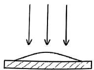
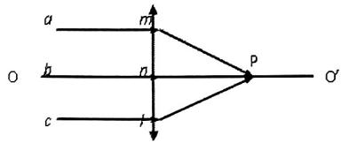
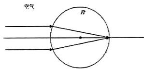
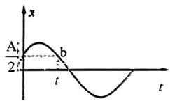
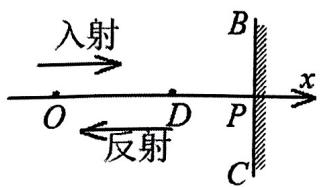
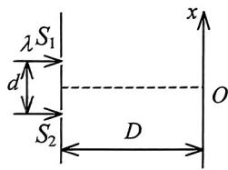

【题目来源】23241 大学物理1B B卷 T1
【教材溯源】第12章 波动光学 - 12.3 光的偏振
【题目正文】
1. 一束光强为 $I_{0}$ 的自然光，相继通过三个偏振片 $P_{1}$ 、 $P_{2}$ 、 $P_{3}$ 后，出射光的光强为 $I = I_{0} / 16$ 。已知 $P_{1}$ 和 $P_{3}$ 的偏振化方向相互垂直，若以入射光线为轴，旋转 $P_{2}$ ，要使出射光的光强为零， $P_{2}$ 最少要转过的角度是

A. $15^{\circ}$ .
B. $22.5^{\circ}$
C. $30^{\circ}$ .
D. $45^{\circ}$ .
【答案】B
【AI解析】设 $P_2$ 与 $P_1$ 偏振化方向的夹角为 $\theta$，则 $P_2$ 与 $P_3$ 的夹角为 $90^\circ-\theta$。自然光依次通过三片后，出射光强 $I=\frac{I_0}{2}\cos^2\theta\cos^2(90^\circ-\theta)=\frac{I_0}{2}\cos^2\theta\sin^2\theta$。由 $I=\frac{I_0}{16}$ 得 $\sin^2 2\theta=\frac{1}{2}$，解得 $\theta=22.5^\circ$ 或 $67.5^\circ$。要使出射光强为零，$P_2$ 须与 $P_1$ 平行或与 $P_3$ 平行，即 $\theta=0^\circ$ 或 $90^\circ$。故最少需转过 $22.5^\circ$。易错点：出射光强公式中两次 $\cos^2$ 的夹角互补，解出 $\theta$ 有两个值，应选离 $0^\circ$ 或 $90^\circ$ 最近的那个。

【题目来源】23241 大学物理1B B卷 T2
【教材溯源】第13章 狭义相对论 - 13.2 洛伦兹变换与狭义相对论的时空观
【题目正文】
2. 某星球到地球的距离为 4 光年，一宇宙飞船从地球出发，以速率 v 匀速飞行，耗时 3 年（飞船上的钟指示的时间）到达该星球，则有

A. v=0.8c.
B. v = 0.6c.
C. v = 4c/3.
D. $v=\sqrt{7}c/4$
【答案】A
【AI解析】飞船上的钟测得的时间 3 年是原时 $\Delta t_0$，地球上测得的时间 $\Delta t=\frac{L}{v}=\frac{4c}{v}$。由时间膨胀公式 $\Delta t=\gamma\Delta t_0$，得 $\frac{4c}{v}=\frac{3}{\sqrt{1-\frac{v^2}{c^2}}}$。两边平方得 $25v^2=16c^2$，解得 $v=0.8c$。易错点：地球系中的时间不是原时，4 光年的距离是在地球系中测量的，飞船中时间与距离的换算要经由洛伦兹变换。

【题目来源】23241 大学物理1B B卷 T3
【教材溯源】第14章 物质的波粒二象性 - 14.3 康普顿散射
【题目正文】
3. 光子能量为0.5MeV的X射线，入射到某种物质上而发生康普顿散射．若反冲电子的动能为0.1MeV，则散射光波长的改变量 $\Delta\lambda$ 与入射光波长 $\lambda_{0}$ 之比值为

A. 0.20 .
B. 0.25 .
C. 0.30 .
D. 0.35 .
【答案】B
【AI解析】由能量守恒，散射光子的能量为 $E'=0.5-0.1=0.4\ \mathrm{MeV}$。光子能量与波长成反比 $E=\frac{hc}{\lambda}$，故 $\frac{\lambda}{\lambda_0}=\frac{E_0}{E'}=\frac{0.5}{0.4}=1.25$。波长的相对改变量 $\frac{\Delta\lambda}{\lambda_0}=\frac{\lambda-\lambda_0}{\lambda_0}=0.25$。易错点：波长与能量成反比，能量减小对应波长增大，不能直接用能量差之比代替波长改变量之比。

【题目来源】23241 大学物理1B B卷 T4
【教材溯源】第12章 波动光学 - 12.1 光的干涉
【题目正文】
4. 图中所示为一平板玻璃 $(n_{1}=1.60)$ ，板上有一油滴 $(n_{2}=1.35)$ 展成中央稍高的球冠形薄膜。设冠高为 $1\mu m$ ，当用 $\lambda=600nm$ 的单色光垂直照射时，则反射方向看到的干涉条将是

A. 边缘为明纹，中央为暗纹.
B. 边缘为暗纹，中央为明纹.
C. 边缘为暗纹，中央为暗纹.
D. 边缘为明纹，中央为明纹.

【答案】A
【AI解析】反射光干涉的两束光分别来自油膜上、下表面。空气到油 $(n_2>1)$ 的反射有半波损失，油到玻璃 $(n_1>n_2)$ 的反射也有半波损失，两次半波损失相互抵消。故反射光的光程差为 $\delta=2n_2d$，无附加项。边缘处膜厚 $d=0$，$\delta=0$ 为明纹。中央处 $\delta=2\times1.35\times1\ \mu m=2.7\ \mu m$，与波长之比为 $\frac{2700}{600}=4.5$，是半波长的奇数倍，为暗纹。易错点：本题两束反射光都有半波损失，恰好抵消，光程差不需要再加 $\frac{\lambda}{2}$。

【题目来源】23241 大学物理1B B卷 T5
【教材溯源】第11章 几何光学基础 - 11.1 几何光学的基本实验定律和基本原理
【题目正文】
5. 一束平行于凸透镜主轴 OO' 的光线经凸透镜汇聚于一点，如图所示，abc 是同一波面上的三点，下列说法正确的是

A. 光线 amp、bnp、clp 的光程相等.
B. 光线 amp 的光程大于 bnp 的光程.
C. 光线 amp、bnp、clp 的光程互不相等.
D. 放入透镜前后 bnp 的光程不变.

【答案】A
【AI解析】物像之间的等光程性是几何光学的基本原理，平行光经凸透镜会聚于焦点 P 时，从同一波面 abc 上的各点到像点 P 的各条光线光程相等。透镜的作用正是以不同厚度的玻璃补偿几何路程之差，使各光线同时到达像点。若光程不等，各光线到达 P 点时相位不同，无法相干相长成像。易错点：边缘光线 amp 的几何路程更长，但透镜边缘较薄、中间较厚，光程补偿后各光线光程相等。

【题目来源】23241 大学物理1B B卷 T6
【教材溯源】第14章 物质的波粒二象性 - 14.2 光电效应与光子
【题目正文】
6. 当照射光的波长从 400nm 变到 300nm 时，对同一金属，在光电效应实验中测得的遏止电势差将（普朗克常量 $h=6.63\times10^{-34}J\cdot s$ ）

A. 减小 0.56 V.
B. 减小 0.34 V.
C. 增大 0.165 V.
D. 增大 1.035 V.
【答案】D
【AI解析】由爱因斯坦方程 $eU_a=h\nu-W=\frac{hc}{\lambda}-W$，遏止电势差的变化 $\Delta U_a=\frac{hc}{e}\left(\frac{1}{\lambda_2}-\frac{1}{\lambda_1}\right)$。其中 $\frac{hc}{e}=\frac{6.63\times10^{-34}\times3\times10^{8}}{1.6\times10^{-19}}\approx1243\ \mathrm{eV\cdot nm}$。代入得 $\Delta U_a=1243\times\left(\frac{1}{300}-\frac{1}{400}\right)=1243\times\frac{1}{1200}\approx1.035\ \mathrm{V}$。波长变短，光子能量增大，遏止电势差增大。易错点：波长越短遏止电势差越大，两者是反比关系而非正比关系。

【题目来源】23241 大学物理1B B卷 T7
【教材溯源】第11章 几何光学基础 - 11.2 单球面上的近轴成像
【题目正文】
7. 如图，欲使无穷远处发出的近轴光线通过透明球体并成像在右半球面的顶点处，则透明球体的折射率应为

A. 1.5.
B. 2.
C. 2.5 .
D. 4.

【答案】B
【AI解析】无穷远物经左球面折射，物距 $u=\infty$，由球面折射公式 $\frac{n_2}{v}-\frac{n_1}{u}=\frac{n_2-n_1}{R}$ 得第一次成像位置 $v_1=\frac{nR}{n-1}$。要使像落在右半球面顶点处，须 $v_1=2R$。代入得 $\frac{nR}{n-1}=2R$，解得 $n=2$。易错点：像距应从左球面顶点算起，右顶点到左顶点的距离是 $2R$ 而不是 $R$。

【题目来源】23241 大学物理1B B卷 T8
【教材溯源】第9章 振动 - 9.1 简谐振动
【题目正文】
8. 如图，已知该简谐运动的振幅 A 和周期 T，则 b 点的运动状态对应的时刻 t 为

A. $\frac{T}{4}$ .
B. $\frac{T}{3}.$
C. $\frac{T}{2}.$
D. $\frac{3T}{4}.$

【答案】B
【AI解析】由图可知 $t=0$ 时质点位于 $x=\frac{A}{2}$ 处且向正方向运动，设 $x=A\cos(\omega t+\varphi)$，由 $A\cos\varphi=\frac{A}{2}$ 且初速度为正（$\sin\varphi<0$）得 $\varphi=-\frac{\pi}{3}$。质点到正最大位移 $A$ 处需 $\frac{\pi}{3}/\omega=\frac{T}{6}$，从峰值再回到 $x=\frac{A}{2}$（下降段）又需 $\frac{T}{6}$。故 $t=\frac{T}{6}+\frac{T}{6}=\frac{T}{3}$。易错点：b 点位于 $\frac{A}{2}$ 高度处而非平衡位置，曲线上升段与下降段两次经过 $\frac{A}{2}$，b 对应下降段那次；不要误把 b 当成第二次过平衡位置。

【题目来源】23241 大学物理1B B卷 T9
【教材溯源】第9章 振动 - 9.4 简谐振动的合成
【题目正文】
9. 两个同方向同频率的简谐振动，其合振动与第一个振动的振幅均为 15cm，合振动与第一个振动的相位差 $\varphi - \varphi_{1} = \pi/3$ ，则第二个振动与第一个振动的相位差 $\varphi_{2} - \varphi_{1} =$

A. $\pi/3$ .
B. $-\pi/3$ .
C. $2\pi/3$
D. $-2\pi/3$
【答案】C
【AI解析】由矢量合成 $\vec{A}=\vec{A_1}+\vec{A_2}$，已知 $A=A_1=15\ \mathrm{cm}$ 且 $A$ 与 $A_1$ 夹角为 $\frac{\pi}{3}$。由余弦定理 $A_2^2=A^2+A_1^2-2AA_1\cos\frac{\pi}{3}=15^2+15^2-2\times15\times15\times\frac{1}{2}=225$，得 $A_2=15\ \mathrm{cm}$。再由 $A^2=A_1^2+A_2^2+2A_1A_2\cos(\varphi_2-\varphi_1)$，解得 $\cos(\varphi_2-\varphi_1)=-\frac{1}{2}$。三个矢量构成等边三角形，故 $\varphi_2-\varphi_1=\frac{2\pi}{3}$。易错点：合振动超前第一个振动 $\frac{\pi}{3}$，说明第二个振动超前第一个振动 $\frac{2\pi}{3}$，取负号方向就反了。

【题目来源】23241 大学物理1B B卷 T10
【教材溯源】第10章 波动 - 10.2 波的能量、能流密度
【题目正文】
10. 一列在弹性介质中传播的平面简谐波，介质中某一质元在从平衡位置运动到最大位移处的过程中，

A. 它的动能转换成势能.
B. 它的势能转换成动能.
C. 它从相邻的一段质元获得能量其能量逐渐增大.
D. 它把自己的能量传给相邻的一段质元，其能量逐渐减至最小.
【答案】D
【AI解析】平面简谐波中，质元的动能和势能同相变化，在平衡位置处两者同时最大，在最大位移处两者同时为零。质元从平衡位置运动到最大位移处，动能和势能同时减小。减小的能量不是相互转换，而是传递给相邻质元，随波传播。故质元的能量逐渐减至最小。易错点：波动中质元的动能和势能同相变化，这与孤立弹簧振子的能量转换规律不同。

【题目来源】23241 大学物理1B B卷 T11
【教材溯源】第14章 物质的波粒二象性 - 14.5 氢原子和玻尔的量子论
【题目正文】
11. 已知氢原子从基态激发到某一定态所需能量为 10.20eV，当氢原子从能量为 -0.85eV 的状态跃迁到上述定态时，所发射的光子的能量为 ____ eV。
【答案】2.55 eV
【AI解析】氢原子基态能量为 $-13.6\ \mathrm{eV}$，激发到某定态的能量为 $E=-13.6+10.20=-3.4\ \mathrm{eV}$，对应主量子数 $n=2$。能量为 $-0.85\ \mathrm{eV}$ 的状态对应 $n=4$。从 $n=4$ 跃迁到 $n=2$ 发射光子的能量为 $E_4-E_2=-0.85-(-3.4)=2.55\ \mathrm{eV}$。易错点：发射光子的能量等于两能级之差，计算时注意负号，$-0.85-(-3.4)$ 才是能量差。

【题目来源】23241 大学物理1B B卷 T12
【教材溯源】第12章 波动光学 - 12.3 光的偏振
【题目正文】
12. 当光线进入双折射晶体时，一束光线可以有两束折射光，其中一束光遵守折射定律，称为____，一束光不遵守折射定律，称为____，实验表明，这两束光都是____。
【答案】o光（寻常光），e光（非常光），线偏振光
【AI解析】双折射现象中，遵守折射定律的折射光称为寻常光（o光），其折射率各方向相同。不遵守折射定律的光称为非常光（e光），其折射率随传播方向改变。实验表明，o光和e光都是线偏振光，且两者的振动方向相互垂直。易错点：o光沿光轴方向传播时与e光速度相同，此时不发生双折射，但两束光的线偏振性质不变。

【题目来源】23241 大学物理1B B卷 T13
【教材溯源】第12章 波动光学 - 12.2 光的衍射
【题目正文】
13. 一束平行光垂直入射到某个光栅上，该光束中有两种波长的光 $\lambda_{1}=440nm$ ， $\lambda_{2}=660nm$ ， $(1nm=10^{-9}m)$ 。实验发现，这两种波长的谱线（不计中央明纹）第二次重合于衍射角 $\varphi=60^{0}$ 的方向上。则此光栅的光栅常数 d= ____。
【答案】$3.05\times10^{-6}\ \mathrm{m}$（约 3048 nm）
【AI解析】两种波长的谱线重合要求 $d\sin\varphi=k_1\lambda_1=k_2\lambda_2$，即 $\frac{k_1}{k_2}=\frac{\lambda_2}{\lambda_1}=\frac{660}{440}=\frac{3}{2}$。第一次重合对应 $k_1=3$、$k_2=2$，第二次重合对应 $k_1=6$、$k_2=4$。由 $d\sin60^\circ=6\times440\ \mathrm{nm}$ 得 $d=\frac{2640}{\sqrt{3}/2}\approx3048\ \mathrm{nm}$。易错点：第二次重合时取 $k_1=6$ 而不是 $k_1=3$，不计中央明纹意味着重合次数从非零级开始计数。

【题目来源】23241 大学物理1B B卷 T14
【教材溯源】第14章 物质的波粒二象性 - 14.1 黑体辐射与能量子
【题目正文】
14. 某物体可视为绝对黑体，在 $\lambda_{m}=600nm$ 处辐射为最强，若黑体被加热到使其 $\lambda_{m}=500nm$ ，则前后两种情况下绝对黑体的辐出度的比值为 ____。
【答案】$\left(\frac{6}{5}\right)^4=\frac{1296}{625}\approx2.07$
【AI解析】由维恩位移定律 $\lambda_m T=b$，峰值波长与温度成反比，波长从 600nm 变到 500nm，温度升高为原来的 $\frac{600}{500}=\frac{6}{5}$ 倍。由斯特藩-玻尔兹曼定律，辐出度 $M=\sigma T^4$ 与温度的四次方成正比。故加热后与加热前辐出度之比为 $\left(\frac{6}{5}\right)^4=\frac{1296}{625}\approx2.07$（即加热后为加热前的约 2.07 倍）。易错点：辐出度与温度的四次方成正比，温度比值的四次方才是辐出度之比。

【题目来源】23241 大学物理1B B卷 T15
【教材溯源】第12章 波动光学 - 12.2 光的衍射
【题目正文】
15. 在单缝夫琅禾费衍射实验中，屏上第三级暗纹对应于单缝处波面可划分为____个半波带，若将缝宽缩小一半，原来第三级暗纹处将是____纹（填写“明”或“暗”）。
【答案】6 个半波带，明纹
【AI解析】单缝衍射第 k 级暗纹满足 $a\sin\varphi=k\lambda$，缝两端光线的光程差为 $k\lambda=2k\times\frac{\lambda}{2}$，故第三级暗纹对应 $2k=6$ 个半波带。缝宽缩小一半后，$a'\sin\varphi=\frac{a}{2}\sin\varphi=\frac{3}{2}\lambda=3\times\frac{\lambda}{2}$，光程差为半波长的奇数倍，可分成 3 个半波带。奇数个半波带两两相消后还剩一个，故该处为明纹。易错点：光程差等于半波长的奇数倍时对应明纹，偶数倍时对应暗纹。

【题目来源】23241 大学物理1B B卷 T16
【教材溯源】第10章 波动 - 10.6 波的干涉
【题目正文】
16. 两个完全相同的喇叭相距 5.00m，相向放置，两者是被同一个振荡器驱动的，振动始终同相，频率都为 875Hz。你站在两喇叭连线中点位置，为了使你听到的声音最弱，你至少应该向其中的一个喇叭走 ____ m 的距离。（已知空气中声速为 344m/s。）
【答案】0.098 m（约 $\frac{\lambda}{4}$）
【AI解析】声波波长 $\lambda=\frac{v}{f}=\frac{344}{875}=0.393\ \mathrm{m}$。从中点向一个喇叭移动 $x$ 后，两波源到人耳的波程差为 $\Delta r=2x$。听到声音最弱即相消干涉，需 $\Delta r=(2k+1)\frac{\lambda}{2}$，最小取 $k=0$。故 $2x=\frac{\lambda}{2}$，解得 $x=\frac{\lambda}{4}=0.098\ \mathrm{m}$。易错点：人移动 $x$ 时，到一侧喇叭距离减小 $x$、到另一侧增大 $x$，波程差变化量为 $2x$ 而不是 $x$。

【题目来源】23241 大学物理1B B卷 T17
【教材溯源】第10章 波动 - 10.4 电磁波
【题目正文】
17. 设真空中电磁波的电场为 $E_{x}=0$ ， $E_{y}=30\cos(2\pi\times10^{8}t-\frac{2\pi}{3}x)$ ， $E_{z}=0$ ，其中 $\bar{E}$ 的单位为 V/m，t 的单位为 s，x 的单位为 m，则该电磁波的频率 f= ____ Hz，磁场强度矢量的振动方向沿 ____ 方向，波的传播方向沿 ____ 方向。
【答案】$10^{8}$ Hz，z，+x
【AI解析】由振动项 $2\pi\times10^{8}t$ 得角频率 $\omega=2\pi\times10^{8}\ \mathrm{rad/s}$，频率 $f=\frac{\omega}{2\pi}=10^{8}\ \mathrm{Hz}$。电场沿 y 方向振动，由 $\vec{E}\times\vec{H}$ 的方向决定传播方向，传播沿 +x 方向，故磁场沿 z 方向振动（$\hat{y}\times\hat{z}=\hat{x}$）。相位中 x 项取负号，对应波沿 +x 方向传播。易错点：判断传播方向看相位中空间项的符号，负号对应正方向传播，$\vec{E}\times\vec{H}$ 用右手定则确定。

【题目来源】23241 大学物理1B B卷 T18
【教材溯源】第12章 波动光学 - 12.1 光的干涉
【题目正文】
18. 某人用迈克尔逊干涉仪测量一列光波的波长，当可动反射镜 M 移动 0.310mm 的过程中，观察到干涉条纹移动了 1100 条，则光波的波长为 ____ nm。
【答案】563.6 nm
【AI解析】迈克耳孙干涉仪中，反射镜移动 $\Delta d$ 时，光程差改变 $2\Delta d$，条纹移动数 $N=\frac{2\Delta d}{\lambda}$。故波长 $\lambda=\frac{2\Delta d}{N}=\frac{2\times0.310\times10^{-3}}{1100}=5.636\times10^{-7}\ \mathrm{m}=563.6\ \mathrm{nm}$。易错点：光程差改变量是 $2\Delta d$ 而不是 $\Delta d$，因为光在移动的光路中往返一次。

【题目来源】23241 大学物理1B B卷 T19
【教材溯源】第9章 振动 - 9.1 简谐振动
【题目正文】
19. 两相同的轻质弹簧一端固定，另一端分别固定质量比为 4:1 的两个物体，置于光滑的水平面上，如果它们都在水平方向以振幅比 1:2 做简谐运动，则两者的振动频率之比为 ____。
【答案】1:2
【AI解析】弹簧振子的固有频率 $f=\frac{1}{2\pi}\sqrt{\frac{k}{m}}$，与振幅无关。两弹簧相同，劲度系数 k 相同，质量比 $m_1:m_2=4:1$。频率比 $f_1:f_2=\sqrt{\frac{1}{m_1}}:\sqrt{\frac{1}{m_2}}=\sqrt{m_2}:\sqrt{m_1}=1:2$。易错点：频率只由系统本身的性质决定，振幅比是干扰条件，与频率无关。

【题目来源】23241 大学物理1B B卷 T20
【教材溯源】第15章 量子力学基础 - 15.5 电子的自旋 原子的壳层结构
【题目正文】
20. 在下列各组量子数的空格上，填上适当的数值，以便使它们可以描述原子中电子的状态：

(1) $n=2,\quad l=$ ____ , $m_{l}=-1,\quad m_{s}=-\frac{1}{2}$
(2) $n=2,\quad l=0,\quad m_{l}=$ ____ , $m_{s}=\frac{1}{2}$
(3) $n=2,\quad l=1,\quad m_{l}=0,\quad m_{s}=$ ____
【答案】(1) $l=1$；(2) $m_l=0$；(3) $m_s=\pm\frac{1}{2}$
【AI解析】量子数需满足 $l=0,1,\cdots,n-1$，$|m_l|\leq l$，$m_s=\pm\frac{1}{2}$。第 (1) 组 $m_l=-1$ 要求 $l\geq1$，而 $n=2$ 时 $l$ 最大为 1，故 $l=1$。第 (2) 组 $l=0$ 时 $m_l$ 只能取 0。第 (3) 组 $m_l=0$ 满足 $|m_l|\leq l=1$，$m_s$ 可取 $+\frac{1}{2}$ 或 $-\frac{1}{2}$。易错点：$m_l$ 的取值被 $l$ 限制，$l$ 的取值被 $n$ 限制，填值时需从 $m_l$ 反推 $l$ 的允许范围。

【题目来源】23241 大学物理1B B卷 T21
【教材溯源】第10章 波动 - 10.6 波的干涉
【题目正文】
21. 如图所示，一列波长为 $\lambda$ 的平面简谐波沿 x 轴正方向传播，BC 为波密媒质的反射面，波在 P 点处发生反射。已知， $\overline{OP}=3\lambda/4,\quad\overline{DP}=\lambda/6,$

且在 t=0 时，O 处质点的合振动正经过平衡位置向其负最大位移方向运动。设入射波和反射波的振幅皆为 A，角频率为 $\omega$ 。求：

(1) 入射波波动方程与反射波波动方程;
(2) D 点处合振动方程。

【答案】(1) 入射波 $y_1=A\cos(\omega t-\frac{2\pi}{\lambda}x+\frac{\pi}{2})$，反射波 $y_2=A\cos(\omega t+\frac{2\pi}{\lambda}x+\frac{\pi}{2})$；(2) $y_D=\sqrt{3}A\sin(\omega t)$
【AI解析】设入射波为 $y_1=A\cos(\omega t-\frac{2\pi}{\lambda}x+\varphi)$，波在波密媒质 P 点反射有半波损失，反射波在 P 点的振动与入射波反相，得反射波 $y_2=A\cos(\omega t+\frac{2\pi}{\lambda}x+\varphi)$。O 点合振动 $y_O=y_1+y_2=2A\cos(\omega t+\varphi)$。由 t=0 时 O 点过平衡位置且向负方向运动，得 $\cos\varphi=0$ 且速度 $v=-2A\omega\sin\varphi<0$，故 $\varphi=\frac{\pi}{2}$。D 点坐标 $x_D=\frac{3\lambda}{4}-\frac{\lambda}{6}=\frac{7\lambda}{12}$，代入叠加得 $y_D=A\cos(\omega t-\frac{2\pi}{3})+A\cos(\omega t-\frac{\pi}{3})=\sqrt{3}A\cos(\omega t-\frac{\pi}{2})=\sqrt{3}A\sin(\omega t)$。易错点：初相须同时满足位移为零和速度方向两个条件，波密媒质反射的半波损失要体现在反射波表达式中。

【题目来源】23241 大学物理1B B卷 T22
【教材溯源】第12章 波动光学 - 12.1 光的干涉
【题目正文】
22. 双缝干涉实验装置如图所示，双缝与屏之间的距离 D=120cm，两缝之间的距离 d=0.50 mm。用波长 $\lambda=500\ nm\ (1\ nm=10^{-9}\ m)$ 的单色光垂直照射双缝，

(1) 求原点 O (零级明条纹所在处) 上方的第五级明条纹的坐标 x;
(2) 如果用厚度 $l=1.0\times10^{-2}$ mm, 折射率 n=1.58 的透明薄膜覆盖在图中的 $S_{1}$ 缝后面, 求上述第五级明条纹的坐标 $x'$ 。

【答案】(1) $x=6.0\ \mathrm{mm}$；(2) $x'=19.9\ \mathrm{mm}$
【AI解析】(1) 由双缝干涉明纹公式 $x_k=k\frac{D\lambda}{d}$，第五级明纹坐标 $x=5\times\frac{1.2\times500\times10^{-9}}{0.5\times10^{-3}}=6.0\times10^{-3}\ \mathrm{m}=6.0\ \mathrm{mm}$。(2) 覆盖薄膜后，$S_1$ 缝的光程增大 $(n-1)l=0.58\times1.0\times10^{-5}=5.8\times10^{-6}\ \mathrm{m}$。零级明纹相应向 $S_1$ 一侧（上方）平移 $\Delta x=\frac{D(n-1)l}{d}=\frac{1.2\times5.8\times10^{-6}}{0.5\times10^{-3}}=13.9\ \mathrm{mm}$。故第五级明纹的新坐标 $x'=x+\Delta x=19.9\ \mathrm{mm}$。易错点：附加光程是 $(n-1)l$ 而非 $nl$，覆盖上缝条纹整体向上平移而不是向另一侧平移。

【题目来源】23241 大学物理1B B卷 T23
【教材溯源】第14章 物质的波粒二象性 - 14.4 物质波与德布罗意关系
【题目正文】
23. 质量为 $m_{e}$ 的电子被电势差为 $U_{12}=100kV$ 的电场加速后出射。已知电子静止质量 $m_{e}=9.11\times10^{-31}kg$ ，普朗克常量 $h=6.626\times10^{-34}J\cdot s$ 。

(1) 若不考虑相对论效应，求出射电子对应的德布罗意波长；
(2) 若考虑相对论效应，求出射电子具有的相对论总能量、动量及其德布罗意波长。
【答案】(1) $\lambda=3.88\times10^{-12}\ \mathrm{m}$；(2) $E=9.78\times10^{-14}\ \mathrm{J}$（611 keV），$p=1.79\times10^{-22}\ \mathrm{kg\cdot m/s}$，$\lambda=3.70\times10^{-12}\ \mathrm{m}$
【AI解析】(1) 非相对论下动能 $E_k=eU=1.6\times10^{-14}\ \mathrm{J}$，由 $\lambda=\frac{h}{p}=\frac{h}{\sqrt{2m_eE_k}}$ 代入数值得 $\lambda=3.88\times10^{-12}\ \mathrm{m}$。(2) 相对论总能量 $E=m_ec^2+eU=511+100=611\ \mathrm{keV}=9.78\times10^{-14}\ \mathrm{J}$。由 $pc=\sqrt{E^2-(m_ec^2)^2}=\sqrt{E_k(E_k+2m_ec^2)}=\sqrt{100\times1122}=335\ \mathrm{keV}$，得 $p=1.79\times10^{-22}\ \mathrm{kg\cdot m/s}$。德布罗意波长 $\lambda=\frac{hc}{pc}=\frac{1240\ \mathrm{eV\cdot nm}}{3.35\times10^{5}\ \mathrm{eV}}=3.70\times10^{-12}\ \mathrm{m}$。易错点：相对论动能等于 $eU$，总能量要再加静能 $m_ec^2$，动量的相对论公式与经典公式不同。

【题目来源】23241 大学物理1B B卷 T24
【教材溯源】第15章 量子力学基础 - 15.3 一维定态系统
【题目正文】
24. 一维运动的粒子处在由波函数： $\psi_{n}(x)=\left\{\begin{aligned}A\sin\frac{n\pi}{2a}(x+a)&\quad|x|<a\\ 0&\quad|x|\geq a\end{aligned}\right.$ 描述的状态，

求：

(1) 常数 A;
(2) $x=\frac{a}{2}$ 处发现粒子概率密度的表达式;
(3) 若粒子处于 n=1 的状态，它在 0-a/4 区间内的概率是多少？

(提示: $\int\sin^{2}x\,dx=\frac{1}{2}x-\frac{1}{4}\sin2x+C$ )
【答案】(1) $A=\frac{1}{\sqrt{a}}$；(2) $\rho(\frac{a}{2})=\frac{1}{a}\sin^{2}\frac{3n\pi}{4}$；(3) $P=\frac{1}{8}+\frac{\sqrt{2}}{4\pi}\approx0.237$
【AI解析】(1) 由归一化条件 $\int_{-a}^{a}A^2\sin^2\frac{n\pi}{2a}(x+a)dx=1$，令 $u=\frac{n\pi}{2a}(x+a)$，积分区间为 $[0,n\pi]$，得 $A^2\cdot\frac{2a}{n\pi}\cdot\frac{n\pi}{2}=A^2a=1$，故 $A=\frac{1}{\sqrt{a}}$。(2) $x=\frac{a}{2}$ 处的概率密度 $\rho=|\psi_n(\frac{a}{2})|^2=\frac{1}{a}\sin^2\frac{n\pi}{2a}(\frac{a}{2}+a)=\frac{1}{a}\sin^2\frac{3n\pi}{4}$。(3) n=1 时，$P=\int_0^{a/4}\frac{1}{a}\sin^2\frac{\pi}{2a}(x+a)dx$，令 $u=\frac{\pi}{2a}(x+a)$，积分限为 $[\frac{\pi}{2},\frac{5\pi}{8}]$，得 $P=\frac{2}{\pi}\left[\frac{u}{2}-\frac{\sin2u}{4}\right]_{\pi/2}^{5\pi/8}=\frac{1}{8}+\frac{\sqrt{2}}{4\pi}\approx0.237$。易错点：归一化积分限是 $[-a,a]$ 而非 $[0,a]$，换元后要重新计算积分上下限。
