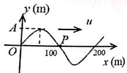
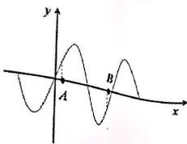
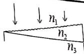
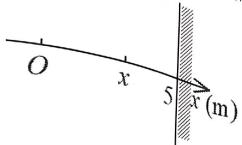

【题目来源】24251 大学物理1B A卷 T1
【教材溯源】第9章 振动 - 9.1 简谐振动
【题目正文】
1. 轻弹簧上端固定，下端系一质量为 $m_{1}$ 的物体，稳定后在 $m_{1}$ 下边又系一质量为 $m_{2}$ 的物体，于是弹簧又伸长了 $\Delta x$ 。若将 $m_{2}$ 移去，并令其振动，则振动频率f为

A. $f = \frac{1}{2\pi} \sqrt{\frac{m_{1} g}{m_{2} \Delta x}}$
B. $f = \frac{1}{2\pi} \sqrt{\frac{m_{2} g}{m_{1} \Delta x}}$
C. $f = \frac{1}{2\pi} \sqrt{\frac{m_{2}\Delta x}{m_{1}g}}$
D. $f = \frac{1}{2\pi} \sqrt{\frac{m_{2}\Delta x}{(m_{1} + m_{2})g}}$
【答案】B
【AI解析】挂上 $m_2$ 后弹簧再伸长 $\Delta x$，由受力平衡 $m_2g=k\Delta x$，得劲度系数 $k=\frac{m_2g}{\Delta x}$。移去 $m_2$ 后，$m_1$ 与弹簧构成弹簧振子，固有频率 $f=\frac{1}{2\pi}\sqrt{\frac{k}{m_1}}$。代入 $k$ 得 $f=\frac{1}{2\pi}\sqrt{\frac{m_2g}{m_1\Delta x}}$。易错点：频率只与 $m_1$ 有关，$m_2$ 仅通过 $\Delta x$ 决定弹簧的劲度系数，不要把 $m_1+m_2$ 当作振动质量。

【题目来源】24251 大学物理1B A卷 T2
【教材溯源】第10章 波动 - 10.1 波动方程、平面简谐波
【题目正文】
2. 一列一维平面简谐波在t=0时刻的波形图如图所示，波速u=200 m/s，则P处质点的振动速度表达式为

A. $v = -2\pi A \cos(2\pi t - \pi)$ m/s
B. $v = -2\pi A \cos(\pi t - \pi)$ m/s
C. $v = 2\pi A \cos(2\pi t - \pi/2)$ m/s
D. $v = 2\pi A \cos(\pi t - 3\pi/2)$ m/s

【答案】A
【AI解析】由图得波长 $\lambda=200\ \mathrm{m}$，波速 $u=200\ \mathrm{m/s}$，故周期 $T=\frac{\lambda}{u}=1\ \mathrm{s}$，$\omega=2\pi\ \mathrm{rad/s}$。设波形为 $y=A\cos(\omega t-kx+\varphi)$，$t=0$ 时 O 点 $y=0$ 且波形在该处斜率为正，右行波的质元速度 $v=-u\frac{\partial y}{\partial x}<0$，故 O 点初相 $\varphi=\frac{\pi}{2}$。P 点位于 $x=100\ \mathrm{m}$ 处，$kx_P=\pi$，其振动方程为 $y_P=A\cos(2\pi t-\frac{\pi}{2})$。振动速度 $v_P=\frac{dy_P}{dt}=-2\pi A\sin(2\pi t-\frac{\pi}{2})=2\pi A\cos(2\pi t)=-2\pi A\cos(2\pi t-\pi)$。易错点：判断 O 点初相须结合波形斜率和传播方向确定质元速度方向，$-\cos(\theta-\pi)=\cos\theta$ 是选项 A 与结果的等价变形。

【题目来源】24251 大学物理1B A卷 T3
【教材溯源】第10章 波动 - 10.4 电磁波
【题目正文】
3. 在真空中沿着 z 轴负方向传播的平面电磁波，其磁场强度波的表达式为 $H_{x} = -H_{0} \cos \omega (t + z / c)$ ，则电场强度波的表达式为

A. $E_{y}=\sqrt{\mu_{0}/\varepsilon_{0}}H_{0}\cos\omega(t+z/c)$
B. $E_{x}=\sqrt{\mu_{0}/\varepsilon_{0}}H_{0}\cos\omega(t+z/c)$
C. $E_{y} = -\sqrt{\mu_{0}/\varepsilon_{0}} H_{0} \cos \omega (t + z/c)$
D. $E_{y} = -\sqrt{\mu_{0}/\varepsilon_{0}} H_{0} \cos \omega (t - z/c)$
【答案】C
【AI解析】电磁波中电场与磁场相互垂直且同相，振幅满足 $\sqrt{\varepsilon_0}E_0=\sqrt{\mu_0}H_0$，故 $E_0=\sqrt{\frac{\mu_0}{\varepsilon_0}}H_0$。相位项 $t+z/c$ 表明波沿 z 轴负方向传播。能量传播方向 $\vec{S}=\vec{E}\times\vec{H}$ 应沿 $-z$ 方向，磁场沿 x 方向，则电场须沿 y 方向（$\hat{y}\times\hat{x}=-\hat{z}$）。由 $H_x=-H_0\cos\omega(t+z/c)$ 得 $E_y=-\sqrt{\frac{\mu_0}{\varepsilon_0}}H_0\cos\omega(t+z/c)$，使 $E_yH_x$ 乘积为正，坡印廷矢量指向 $-z$。易错点：$E$、$H$ 的方向与传播方向构成右手系，符号取错会导致坡印廷矢量方向反向。

【题目来源】24251 大学物理1B A卷 T4
【教材溯源】第13章 狭义相对论 - 13.3 相对论力学
【题目正文】
4. 如果电子的速度为光速的 60%，则电子的相对论动能是其静止能量的

A. 2 倍
B. 1.5 倍
C. 0.5 倍
D. 0.25 倍
【答案】D
【AI解析】洛伦兹因子 $\gamma=\frac{1}{\sqrt{1-\frac{v^2}{c^2}}}=\frac{1}{\sqrt{1-0.6^2}}=\frac{1}{0.8}=1.25$。相对论动能 $E_k=\gamma m_0c^2-m_0c^2=(\gamma-1)m_0c^2$。故 $E_k=(1.25-1)m_0c^2=0.25m_0c^2$，是静能的 0.25 倍。易错点：相对论动能是 $(\gamma-1)m_0c^2$ 而不是 $\gamma m_0c^2$，后者是总能量。

【题目来源】24251 大学物理1B A卷 T5
【教材溯源】第12章 波动光学 - 12.1 光的干涉
【题目正文】
5. 在双缝干涉实验中，两条缝的宽度原来是相等的。若其中一缝的宽度略变窄(缝中心位置不变)，则
A. 干涉条纹的间距变宽
B. 干涉条纹的间距变窄
C. 干涉条纹的间距不变，但原极小处的强度不再为零
D. 不再发生干涉现象
【答案】C
【AI解析】双缝干涉条纹间距由缝中心间距 d、波长 $\lambda$ 和屏距 D 决定，$\Delta x=\frac{D\lambda}{d}$，与缝宽无关，故间距不变。缝宽变窄后，该缝衍射光强减弱，两缝到达屏上的光振幅不再相等。干涉相消处两束光振幅不能完全抵消，原极小处的强度不再为零。易错点：条纹间距取决于缝中心距离，缝宽影响的是单缝衍射光强分布，两者不要混淆。

【题目来源】24251 大学物理1B A卷 T6
【教材溯源】第12章 波动光学 - 12.1 光的干涉
【题目正文】
6. 在迈克尔逊干涉仪的一支光路中放入一片折射率为 $n = 1.4$ 的透明介质薄膜后，干涉条纹产生了7.0条条纹的移动。如果入射光波长为589nm，则透明介质膜的厚度为
A. 10307.5nm
B. 1472.5nm
C. 5153.8nm
D. 2945.0nm
【答案】C
【AI解析】放入薄膜后，光两次穿过薄膜，该支光路的光程改变为 $2(n-1)d$。条纹移动 7 条说明 $2(n-1)d=7\lambda$。解得 $d=\frac{7\lambda}{2(n-1)}=\frac{7\times589}{2\times0.4}=5153.75\ \mathrm{nm}$。易错点：光程改变量既含因子 2（往返两次）又含 $n-1$（相对真空的附加光程），漏掉任一因子结果都会错。

【题目来源】24251 大学物理1B A卷 T7
【教材溯源】第14章 物质的波粒二象性 - 14.1 黑体辐射与能量子
【题目正文】
7. 在 1965 年，Penzias 和 Wilson 发现宇宙背景辐射的峰值出现在波长为 1.06mm 处，由此可知，若把整个宇宙看作是一个黑体，则其黑体辐射的温度约为（维恩位移常量 $b = 2.898 \times 10^{-3} \, \text{m} \cdot \text{K}$ ）

A. $2.7^{\circ}$ C
B. $-270^{\circ}C$
C. 0.0027K
D. $-2.7^{\circ}C$
【答案】B
【AI解析】由维恩位移定律 $\lambda_m T=b$，得温度 $T=\frac{b}{\lambda_m}=\frac{2.898\times10^{-3}}{1.06\times10^{-3}}=2.73\ \mathrm{K}$。换算成摄氏温度 $t=T-273\approx-270^{\circ}\mathrm{C}$。宇宙微波背景辐射温度约 2.7K 是著名的实测结果。易错点：2.7 是开尔文温标下的数值，摄氏温度还要减去 273，选项 A 混淆了两种温标。

【题目来源】24251 大学物理1B A卷 T8
【教材溯源】第12章 波动光学 - 12.3 光的偏振
【题目正文】
8. 自然光以 $60^{\circ}$ 的入射角照射到某两介质交界面时，反射光为完全线偏振光，则知折射光为

A. 完全线偏振光且折射角是 $30^{\circ}$
B. 部分偏振光且只是在该光由真空入射到折射率为 $\sqrt{3}$ 的介质时，折射角是 $30^{\circ}$
C. 部分偏振光，但须知两种介质的折射率才能确定折射角
D. 部分偏振光且折射角是 $30^{\circ}$
【答案】D
【AI解析】反射光为完全线偏振光说明入射角为布儒斯特角，此时反射光与折射光相互垂直。折射角 $\gamma=90^\circ-i_B=90^\circ-60^\circ=30^\circ$，与介质折射率的具体数值无关。自然光以布儒斯特角入射时，反射光为完全线偏振光，折射光仍为部分偏振光。易错点：布儒斯特角下反射光与折射光始终垂直，折射角可直接由 $90^\circ$ 减去入射角得到。

【题目来源】24251 大学物理1B A卷 T9
【教材溯源】第11章 几何光学基础 - 11.2 单球面上的近轴成像
【题目正文】
9. 一个折射率为 1.5、直径为 20cm 的玻璃球内有一气泡，看上去该气泡在球心与球面连线的中点处，则气泡实际的位置应为

A. 离球心 2cm 处
B. 离球心 3cm 处
C. 离球心 4cm 处
D. 离球心 6cm 处
【答案】C
【AI解析】玻璃球半径 $R=10\ \mathrm{cm}$，观察者看到气泡的虚像在球心与球面连线的中点，即像距球面顶点 $5\ \mathrm{cm}$ 处。由单球面折射公式，物方为玻璃 $(n_1=1.5)$，像方为空气 $(n_2=1)$，从玻璃内看球面为凹面，$\frac{n_1}{u}+\frac{n_2}{v}=\frac{n_2-n_1}{R}$。代入 $v=-5\ \mathrm{cm}$（虚像）、$R=-10\ \mathrm{cm}$ 得 $\frac{1.5}{u}+\frac{1}{-5}=\frac{1-1.5}{-10}$，解得 $u=6\ \mathrm{cm}$。故气泡距球面顶点 6 cm，离球心 $10-6=4\ \mathrm{cm}$。易错点：折射面曲率半径的符号因观察方向而异，从玻璃内看球面取负，符号取反会得到错误位置。

【题目来源】24251 大学物理1B A卷 T10
【教材溯源】第15章 量子力学基础 - 15.5 电子的自旋 原子的壳层结构
【题目正文】
10. 下列各组量子数中，哪一组可以描述原子中电子的状态？

A. n = 2, l = 2, $m_{l} = 0$ , $m_{s} = \frac{1}{2}$
B. n = 3, l = 1, $m_{l} = -1$ , $m_{s} = -\frac{1}{2}$
C. n = 1, l = 2, $m_{l} = 1$ , $m_{s} = \frac{1}{2}$
D. n=1, l=0, $m_{l}=1$ , $m_{s}=-\frac{1}{2}$
【答案】B
【AI解析】量子数须满足 $l=0,1,\cdots,n-1$ 和 $|m_l|\leq l$。选项 A 中 $n=2$ 而 $l=2$，违反 $l\leq n-1$。选项 C 中 $n=1$ 而 $l=2$，同样违反。选项 D 中 $l=0$ 但 $m_l=1$，违反 $|m_l|\leq l$。只有选项 B 满足 $l=1\leq n-1=2$ 且 $|m_l|=1\leq l=1$。易错点：$m_l$ 的取值范围由 $l$ 决定，$l$ 的取值范围由 $n$ 决定，逐级检查才不会漏判。

【题目来源】24251 大学物理1B A卷 T11
【教材溯源】第9章 振动 - 9.4 简谐振动的合成
【题目正文】
11. 已知两个同方向的简谐运动，它们的振动表达式分别为：

$$
x _ {1} = 0. 0 4 \cos (1 0 t + \pi / 3) (\mathrm{SI}), \qquad x _ {2} = 0. 0 3 \cos (1 0 t + \varphi) (\mathrm{SI})
$$

当合振动能量为最大时， $\varphi$ 为____。
【答案】$\frac{\pi}{3}$
【AI解析】合振动的能量与合振幅的平方成正比，能量最大即合振幅最大。两个同方向、同频率的简谐振动同相时，合振幅等于两振幅之和，达到最大值。故两振动须相位相同，$\varphi=\frac{\pi}{3}$。易错点：同相时合振幅最大为 $A_1+A_2$，反相时合振幅最小为 $|A_1-A_2|$，振动能量正比于振幅的平方。

【题目来源】24251 大学物理1B A卷 T12
【教材溯源】第10章 波动 - 10.2 波的能量、能流密度
【题目正文】
12. 如图所示，有一平面简谐波在 t 时刻的波形曲线。若此时 A 点处质元的弹性势能在减小，则，B 处质元的振动动能在 ____（填写“增大”还是“减小”）；该波的传播方向沿 x 轴 ____ 方向（填“正”或“负”）。

【答案】减小，正
【AI解析】波动中质元的动能与势能同相变化，A 点势能减小说明 A 点质元正从平衡位置向最大位移处运动，即 A 点质元向下运动。A 点处波形斜率为正，对右行波质元速度 $v=-u\frac{\partial y}{\partial x}<0$ 与向下运动一致，故波沿 x 轴正方向传播。B 点位于波形上升段（斜率为正），其质元速度 $v=-u\frac{\partial y}{\partial x}<0$，B 点位移为负，向下运动即远离平衡位置，动能减小。易错点：波的传播方向由质元速度与波形斜率的关系确定，动能与势能同时增、同时减。

【题目来源】24251 大学物理1B A卷 T13
【教材溯源】第10章 波动 - 10.6 波的干涉
【题目正文】
13. 两个完全相同的喇叭相距 6.0m，两者是被同一个振荡器驱动的，振动始终同相，频率都在 1500Hz 到 1800Hz 之间。一点 P 到两个喇叭的距离分别是 3.6m 和 4.9m。若使 P 点发生相消干涉，则振荡器的频率可调为 ____ Hz。（已知空气中声速为 344m/s）
【答案】1720 Hz
【AI解析】P 点到两喇叭的波程差 $\Delta r=4.9-3.6=1.3\ \mathrm{m}$。相消干涉要求 $\Delta r=(2k+1)\frac{\lambda}{2}$，故 $\lambda=\frac{2.6}{2k+1}$。频率 $f=\frac{v}{\lambda}=\frac{344(2k+1)}{2.6}=132.3(2k+1)\ \mathrm{Hz}$。在 1500 到 1800 Hz 范围内，$k=5$ 时 $f=1455\ \mathrm{Hz}$ 偏小，$k=6$ 时 $f=1720\ \mathrm{Hz}$ 符合要求，$k=7$ 时 $f=1985\ \mathrm{Hz}$ 偏大。故频率为 1720 Hz。易错点：波程差为半波长的奇数倍时相消，逐一代入整数 k 并在给定范围内筛选。

【题目来源】24251 大学物理1B A卷 T14
【教材溯源】第14章 物质的波粒二象性 - 14.3 康普顿散射
【题目正文】
14. 用波长 $\lambda_{0}=0.1nm$ 的X射线做康普顿实验，在散射角 $\phi=90^{\circ}$ 的方向上，散射射线波长的改变量是____nm；散射射线中除了原波长 $\lambda_{0}$ 的成分之外，新出现的X射线的波长为____nm。（普朗克常量 $h=6.63\times10^{-34}J\cdot s$ ，电子静止质量 $m_{e}=9.11\times10^{-31}kg$ ）
【答案】$0.00243$ nm，$0.1024$ nm
【AI解析】康普顿散射波长改变量 $\Delta\lambda=\frac{h}{m_ec}(1-\cos\phi)$。散射角 $\phi=90^\circ$ 时，$\Delta\lambda=\frac{h}{m_ec}=\frac{6.63\times10^{-34}}{9.11\times10^{-31}\times3\times10^{8}}=2.43\times10^{-12}\ \mathrm{m}=0.00243\ \mathrm{nm}$。新出现的 X 射线波长为 $\lambda=\lambda_0+\Delta\lambda=0.1+0.00243=0.1024\ \mathrm{nm}$。易错点：$\frac{h}{m_ec}$ 是康普顿波长，散射角 $90^\circ$ 时波长改变量恰等于它，波长改变量要加到原波长上。

【题目来源】24251 大学物理1B A卷 T15
【教材溯源】第12章 波动光学 - 12.1 光的干涉
【题目正文】
15. 用波长为 $\lambda$ 的单色光垂直照射折射率为 $n_{2}$ 的劈形膜，如图所示。图中各部分折射率的关系是 $n_{1}<n_{2}<n_{3}$ ，观察反射光的干涉条纹，从劈形膜顶开始向右数第5条暗条纹中心所对应的厚度e=____。

【答案】$e=\frac{9\lambda}{4n_2}$
【AI解析】反射光干涉的两束光分别来自劈形膜上、下表面。由于 $n_1<n_2$ 和 $n_2<n_3$，两次反射都是从光疏介质到光密介质，均发生半波损失，附加光程差相互抵消。故光程差 $\delta=2n_2e$。第 k 条暗纹满足 $2n_2e=(2k-1)\frac{\lambda}{2}$。从劈尖顶端向右数第 5 条暗纹对应 $k=5$，解得 $e=\frac{(2\times5-1)\lambda}{4n_2}=\frac{9\lambda}{4n_2}$。易错点：本题两次半波损失抵消，光程差不再加 $\frac{\lambda}{2}$，暗纹从 $k=1$ 开始计数。

【题目来源】24251 大学物理1B A卷 T16
【教材溯源】第12章 波动光学 - 12.3 光的偏振
【题目正文】
16. 用相互平行的一束自然光和一束线偏振光构成混合光，垂直照射在一偏振片上，以光的传播方向为轴，旋转偏振片时，发现透射光强的最大值为最小值的5倍，则入射光中，自然光的光强 $I_{0}$ 和线偏振光的光强I之比为____。
【答案】$I_0:I=1:2$
【AI解析】自然光通过偏振片后光强恒为 $\frac{I_0}{2}$，与偏振片取向无关。线偏振光通过偏振片的光强为 $I\cos^2\theta$，在 $0$ 到 $I$ 之间变化。透射光强的最大值 $I_{\max}=\frac{I_0}{2}+I$，最小值 $I_{\min}=\frac{I_0}{2}$。由 $\frac{I_{\max}}{I_{\min}}=5$ 得 $\frac{\frac{I_0}{2}+I}{\frac{I_0}{2}}=5$，即 $1+\frac{2I}{I_0}=5$。解得 $\frac{I}{I_0}=2$，故 $I_0:I=1:2$。易错点：自然光部分通过偏振片后始终减半，不随旋转变化，变化的部分只来自线偏振光。

【题目来源】24251 大学物理1B A卷 T17
【教材溯源】第12章 波动光学 - 12.3 光的偏振
【题目正文】
17. 用石英晶体制成一厚度为5μm的晶片，其表面与晶体的光轴方向平行。一束波长为500nm的自然光垂直入射到该晶片上，产生的o光和e光在通过晶片的过程中产生的光程差为____nm，相位差为____。（已知石英晶体的主折射率分别为 $n_{o}=1.543$ 和 $n_{e}=1.552$ ）
【答案】45 nm，$0.18\pi$（即 $\frac{9\pi}{50}$）
【AI解析】o 光和 e 光在晶片中传播速度不同，通过厚度 d 的晶片后产生的光程差 $\delta=(n_e-n_o)d=(1.552-1.543)\times5000\ \mathrm{nm}=45\ \mathrm{nm}$。相位差 $\Delta\varphi=\frac{2\pi}{\lambda}\delta=\frac{2\pi\times45}{500}=0.18\pi=\frac{9\pi}{50}$。易错点：光程差用两折射率之差乘以几何厚度，相位差换算时波长用真空中的 500nm。

【题目来源】24251 大学物理1B A卷 T18
【教材溯源】第13章 狭义相对论 - 13.2 洛伦兹变换与狭义相对论的时空观
【题目正文】
18. 惯性系 $S'$ 相对于惯性系S以速率v=0.8c匀速运动。在S系中测得，某两个事件的时间间隔为 $\Delta t=5s$ ，若在 $S'$ 中这两个事件发生在同一地点，则在 $S'$ 中看这两个事件的时间间隔为____s。
【答案】3 s
【AI解析】两事件在 $S'$ 系中发生在同一地点，$S'$ 系中测得的时间间隔为原时 $\Delta t_0$。S 系测得的时间间隔满足 $\Delta t=\gamma\Delta t_0$，其中 $\gamma=\frac{1}{\sqrt{1-0.8^2}}=1.667$。故 $\Delta t_0=\frac{\Delta t}{\gamma}=5\times0.6=3\ \mathrm{s}$。易错点：同地发生的两事件的时间间隔才是原时，原时最短，S 系测得的时间是膨胀后的值。

【题目来源】24251 大学物理1B A卷 T19
【教材溯源】第14章 物质的波粒二象性 - 14.2 光电效应与光子
【题目正文】
19. 某光电管阴极，对于 $\lambda_{1}$ 的入射光，其发射光电子的遏止电势差为 $U_{1}$ ；当入射光的波长为 $\lambda_{2}=$ ____ 时，遏止电势差变为 $2U_{1}$ 。(已知普朗克常量为 h，电子电量为 e，光速为 c)
【答案】$\lambda_{2}=\frac{hc\lambda_{1}}{hc+eU_{1}\lambda_{1}}$
【AI解析】由爱因斯坦光电效应方程 $eU_a=h\nu-W=\frac{hc}{\lambda}-W$。对第一种情况 $eU_1=\frac{hc}{\lambda_1}-W$，第二种情况 $2eU_1=\frac{hc}{\lambda_2}-W$。两式相减消去逸出功 W，得 $eU_1=\frac{hc}{\lambda_2}-\frac{hc}{\lambda_1}$。解得 $\lambda_2=\frac{hc\lambda_1}{hc+eU_1\lambda_1}$。易错点：两式相减可消去未知的逸出功，遏止电势差加倍并不意味着波长减半。

【题目来源】24251 大学物理1B A卷 T20
【教材溯源】第14章 物质的波粒二象性 - 14.4 物质波与德布罗意关系
【题目正文】
20. 一束电子垂直入射到宽度为 $1.5 \mu \mathrm{m}$ 的单缝上，在距缝 $1.20 \mathrm{~m}$ 的屏幕上有清晰的衍射图样， $\pm 1$ 级衍射极小到中央主极大的距离均为 $1.73 \mathrm{~cm}$ ，则电子束中电子的德布罗意波长为 ____ nm。
【答案】21.6 nm
【AI解析】单缝衍射第一级极小满足 $a\sin\theta=\lambda$，其中衍射角近似 $\sin\theta\approx\tan\theta=\frac{x_1}{L}=\frac{1.73\times10^{-2}}{1.20}=0.0144$。故电子的德布罗意波长 $\lambda=a\sin\theta=1.5\times10^{-6}\times0.0144=2.16\times10^{-8}\ \mathrm{m}=21.6\ \mathrm{nm}$。易错点：第一级极小对应 $a\sin\theta=\lambda$ 而不是 $\frac{\lambda}{2}$，衍射角小角近似时 $\sin\theta\approx\tan\theta\approx\frac{x}{L}$。

【题目来源】24251 大学物理1B A卷 T21
【教材溯源】第10章 波动 - 10.6 波的干涉
【题目正文】
21. 波动方程为 $y = 0.04 \cos \left( 5t - \frac{\pi}{2}x - \frac{1}{2}\pi \right)$ (SI)的一列一维平面波在空传播。在 $x = 5.00 \, \text{m}$ 处有一固定的墙面使入射波发生反射，设反射波的强波动方程：

(1) 反射波的波动方程;
(2) 驻波方程:
(3) 波腹与波节坐标。

【答案】(1) $y'=0.04\cos\left(5t+\frac{\pi}{2}x-\frac{\pi}{2}\right)$；(2) $y=0.08\cos\frac{\pi x}{2}\sin(5t)$；(3) 波腹 $x=2n\ \mathrm{m}$，波节 $x=(2n+1)\ \mathrm{m}$（n=0,1,2）
【AI解析】入射波中 $\omega=5\ \mathrm{rad/s}$，$k=\frac{\pi}{2}\ \mathrm{rad/m}$。波在固定端（墙面）反射有半波损失，反射波沿 x 负方向传播，设为 $y'=0.04\cos(5t+\frac{\pi}{2}x+\varphi')$。在 $x=5\ \mathrm{m}$ 处反射波振动与入射波反相，$0.04\cos(5t+\frac{5\pi}{2}+\varphi')=-0.04\cos(5t-\frac{5\pi}{2}-\frac{\pi}{2})=-0.04\cos(5t-\pi)$。解得 $\varphi'=-\frac{\pi}{2}$（模 $2\pi$），故反射波 $y'=0.04\cos(5t+\frac{\pi}{2}x-\frac{\pi}{2})$。驻波方程 $y+y'=0.04\cos(5t-\frac{\pi}{2}x-\frac{\pi}{2})+0.04\cos(5t+\frac{\pi}{2}x-\frac{\pi}{2})=0.08\cos\frac{\pi x}{2}\cos(5t-\frac{\pi}{2})=0.08\cos\frac{\pi x}{2}\sin(5t)$。波腹处 $\cos\frac{\pi x}{2}=\pm1$，得 $x=2n$；波节处 $\cos\frac{\pi x}{2}=0$，得 $x=2n+1$。易错点：反射波的空间项要改号，半波损失体现在反射波的初相中，波腹波节坐标从驻波方程的振幅因子解出。

【题目来源】24251 大学物理1B A卷 T22
【教材溯源】第12章 波动光学 - 12.2 光的衍射
【题目正文】
22. 用钠光( $\lambda=589.3\ nm$ )垂直照射到某光栅上，测得第三级光谱的衍射角为 60°。

(1) 求光栅常数 $a + b$ ;
(2) 若该光栅常数中包含的透光部分宽度 a 与不透光部分的宽度 b 相等，在衍射角 $-\frac{\pi}{2} < \varphi < \frac{\pi}{2}$ 的范围内可以观察到的全部主极大的级次；
(3) 若以白光(400 \~760 nm) 照射在该光栅上，求第三级光谱的张角。
【答案】(1) $a+b=2.04\times10^{-6}\ \mathrm{m}$（2041.7 nm）；(2) 级次为 0、±1、±3（±2 缺级）；(3) 约 $54^{\circ}$
【AI解析】(1) 由光栅方程 $(a+b)\sin\varphi=k\lambda$，$k=3$、$\varphi=60^\circ$，得 $a+b=\frac{3\times589.3}{\sin60^\circ}=2041.7\ \mathrm{nm}$。(2) $a=b$ 时 $\frac{a+b}{a}=2$，缺级级次为 $k=\pm2,\pm4,\cdots$。最大级次 $k_{\max}<\frac{a+b}{\lambda}=\frac{2041.7}{589.3}=3.46$，故可见级次为 $0$、$\pm1$、$\pm3$，共 5 条。(3) 第三级光谱满足 $\sin\varphi=\frac{3\lambda}{a+b}$。对 $\lambda=400\ \mathrm{nm}$，$\sin\varphi=0.5877$，$\varphi=36.0^\circ$。对 $\lambda=760\ \mathrm{nm}$，$\sin\varphi=1.117>1$，该波长第三级不存在；第三级光谱的长波极限由 $\sin\varphi=1$ 决定，对应 $\lambda_{\max}=\frac{a+b}{3}=680.6\ \mathrm{nm}$，$\varphi=90^\circ$。故第三级光谱张角为 $90^\circ-36^\circ=54^\circ$。易错点：白光第三级中波长大于 $\frac{a+b}{3}$ 的部分不存在，不能直接用 760nm 计算张角。

【题目来源】24251 大学物理1B A卷 T23
【教材溯源】第14章 物质的波粒二象性 - 14.5 氢原子和玻尔的量子论
【题目正文】
23. 氢原子光谱的巴尔末线系中，有一光谱线的波长为 434 nm。求：

(1) 与此谱线相应的光子的能量是多少eV；
(2) 设此谱线是电子由能级 $E_{n}$ 跃迁到能级 $E_{m}$ 时释放的，相应 $m、n$是多少？；
(3) 最高能级为 $E_{n}$的大量氢原子，最多可发射几条谱线？波长最短的是哪一条？

(普朗克常量$h=6.63\times10^{-34}\ \mathrm{J\cdot s}$，电子电量$e=1.6\times10^{-19}\ \mathrm{C}$，$1\ \mathrm{eV}=1.6\times10^{-19}\ \mathrm{J}$)
【答案】(1) $2.86\ \mathrm{eV}$；(2) $m=2$，$n=5$；(3) 10 条，最短为 $n=5\to n=1$ 的谱线（波长约 95 nm）
【AI解析】(1) 光子能量 $E=\frac{hc}{\lambda}=\frac{1240\ \mathrm{eV\cdot nm}}{434\ \mathrm{nm}}=2.86\ \mathrm{eV}$。(2) 巴尔末线系终态 $m=2$，由 $E=E_n-E_2=13.6(\frac{1}{4}-\frac{1}{n^2})=2.86\ \mathrm{eV}$，解得 $\frac{1}{n^2}=\frac{1}{4}-\frac{2.86}{13.6}=0.04$，故 $n=5$。(3) 处于 $n=5$ 的大量氢原子向低能级跃迁，可发射的谱线数为 $C_5^2=10$ 条。能量差最大的是 $n=5\to n=1$ 的跃迁，波长最短，$\lambda_{\min}=\frac{1240}{13.6\times(1-\frac{1}{25})}=\frac{1240}{13.06}\approx95\ \mathrm{nm}$。易错点：谱线条数用组合数 $C_n^2$ 计算，波长最短对应能级间隔最大的跃迁。

【题目来源】24251 大学物理1B A卷 T24
【教材溯源】第15章 量子力学基础 - 15.3 一维定态系统
【题目正文】
24. 质量为 m 的粒子被限制在 $[-a, a]$ 的一维无限深势阱中运动，其定态波 $A \cos \left( \frac{n \pi x}{2a} \right) (-a \leq x \leq a)$ 。求：

(1) 归一化因子A及归一化形式的波函数 $\psi_{n}(x)$ ;
(2) 当n=3时，粒子在 $x=\frac{5}{6}a$ 处出现的概率密度；
(3) 当n=3 时，粒子出现在 $\left[-\frac{2a}{3},\frac{2a}{3}\right]$ 区间的概率。
【答案】(1) $A=\frac{1}{\sqrt{a}}$，$\psi_n(x)=\frac{1}{\sqrt{a}}\cos\frac{n\pi x}{2a}$（n=1,3,5,…）；(2) $\frac{1}{2a}$；(3) $\frac{2}{3}$
【AI解析】(1) 由边界条件 $\psi(\pm a)=0$ 得 $\cos\frac{n\pi}{2}=0$，故 n 只能取奇数。归一化 $\int_{-a}^{a}A^2\cos^2\frac{n\pi x}{2a}dx=1$，令 $u=\frac{n\pi x}{2a}$，积分区间为 $[-\frac{n\pi}{2},\frac{n\pi}{2}]$，n 为奇数时积分为 $\frac{n\pi}{2}$，得 $A^2\cdot\frac{2a}{n\pi}\cdot\frac{n\pi}{2}=A^2a=1$，故 $A=\frac{1}{\sqrt{a}}$。(2) n=3 时，$\rho(\frac{5a}{6})=\frac{1}{a}\cos^2\frac{3\pi}{2a}\cdot\frac{5a}{6}=\frac{1}{a}\cos^2\frac{5\pi}{4}=\frac{1}{a}\times\frac{1}{2}=\frac{1}{2a}$。(3) n=3 时，$P=\int_{-2a/3}^{2a/3}\frac{1}{a}\cos^2\frac{3\pi x}{2a}dx$，令 $u=\frac{3\pi x}{2a}$，积分限为 $[-\pi,\pi]$，得 $P=\frac{1}{a}\cdot\frac{2a}{3\pi}\int_{-\pi}^{\pi}\cos^2u\,du=\frac{2}{3\pi}\times\pi=\frac{2}{3}$。易错点：该势阱的波函数取余弦形式时 n 只能取奇数，归一化积分限是 $[-a,a]$，换元后要重新确定上下限。
