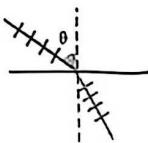
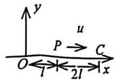
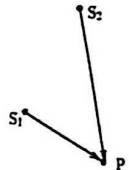
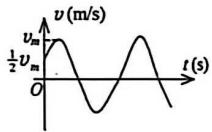
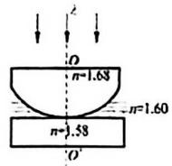
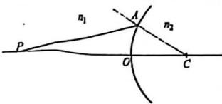
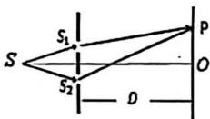

【题目来源】25261 大学物理1B T1
【教材溯源】第12章 波动光学 - 12.3 光的偏振
【题目正文】如图所示，一束线偏振光从空气入射到某透明介质界面上，实验发现当入射角为 $\theta$ 时，反射光消失，可以判定该透明介质的折射率为

A. $n = \tan \theta$
B. $n=1/\tan\theta$
C. $n=\sin\theta$
D. $n=1/\sin\theta$ 

【答案】A
【AI解析】反射光消失（反射光中平行于入射面的 p 分量消失）对应布儒斯特角入射，反射光为完全偏振光且与折射光垂直，此时 $\tan i_B = n_2/n_1$。空气中 $n_1=1$，故介质折射率 $n=\tan\theta$。易错点：光从光密介质射向光疏介质时才是 $n=1/\tan\theta$，本题为空气入射透明介质，应取 $\tan\theta$。

【题目来源】25261 大学物理1B T2
【教材溯源】第15章 量子力学基础 - 15.1 物质波波函数的特性
【题目正文】波长 $\lambda = 400 \, nm$ 的光沿 x 轴正向传播，若光的波长的不确定量 $\Delta\lambda = 10^{-4} \, nm$ ，则利用不确定关系式 $\Delta p_{x} \Delta x \geq h (h = 6.63 \times 10^{-34} \, J \cdot s)$ ，可得光子的 x 坐标的不确定量至少为

A. 320cm
B. 160cm
C. 80cm
D. 40cm

【答案】B
【AI解析】由 $p_x = h/\lambda$ 得 $\Delta p_x = h\Delta\lambda/\lambda^2$，代入不确定关系 $\Delta p_x \Delta x \geq h$ 得 $\Delta x \geq \lambda^2/\Delta\lambda = (400\,\mathrm{nm})^2/(10^{-4}\,\mathrm{nm}) = 1.6\times10^9\,\mathrm{nm} = 160\,\mathrm{cm}$。易错点：注意 $\mathrm{nm}$ 到 $\mathrm{cm}$ 的换算（$10^7\,\mathrm{nm}=1\,\mathrm{cm}$），且光子动量用 $h/\lambda$ 而非 $mv$。

【题目来源】25261 大学物理1B T3
【教材溯源】第14章 物质的波粒二象性 - 14.5 氢原子和玻尔的量子论
【题目正文】已知氢原子从基态激发到某一定态所需能量为10.20eV，当氢原子从能量为-0.85eV的状态跃迁到上述定态时，所发射的光子的能量为 

A. 2.55eV
B. 3.41eV
C. 4.25eV
D. 9.95eV

【答案】A
【AI解析】氢原子基态能量 $E_1=-13.6\,\mathrm{eV}$，激发到某定态需 $10.20\,\mathrm{eV}$，则该定态能量为 $-13.6+10.20=-3.4\,\mathrm{eV}$（即 $n=2$）。跃迁发射光子能量等于初末能级之差：$E=-0.85-(-3.4)=2.55\,\mathrm{eV}$。易错点：光子能量取两能级差值的绝对值，且激发能是能级差而非能级本身。

【题目来源】25261 大学物理1B T4
【教材溯源】第14章 物质的波粒二象性 - 14.2 光电效应与光子
【题目正文】设用频率为 $v_{1}$ 和 $v_{2}$ 的两种单色光先后照射同一种金属均能产生光电效应。已知金属的红限频率为 $v_{0}$ ，测得两次照射时的遏止电势差 $\left|U_{02}\right|=2\left|U_{01}\right|$ ，则这两种单色光的频率有如下关系 

A. $\nu_{2}=\nu_{1}-\nu_{0}$
B. $\nu_{2}=\nu_{1}+\nu_{0}$
C. $\nu_{2}=\nu_{1}-2\nu_{0}$
D. $\nu_{2}=2\nu_{1}-\nu_{0}$

【答案】D
【AI解析】由爱因斯坦光电效应方程 $e|U_0| = h
u - h
u_0$，两次照射分别有 $e|U_{01}| = h
u_1 - h
u_0$、$e|U_{02}| = h
u_2 - h
u_0$。因 $\left|U_{02}\right|=2\left|U_{01}\right|$，代入得 $h
u_2 - h
u_0 = 2(h
u_1 - h
u_0)$，化简得 $
u_2 = 2
u_1 - 
u_0$。易错点：遏止电压与频率为线性关系，注意展开后消去 $-
u_0$ 项时的符号。

【题目来源】25261 大学物理1B T5
【教材溯源】第12章 波动光学 - 12.2 光的衍射
【题目正文】一束单色平行光垂直照射在宽度为 $1.0 \, mm$ 的单缝上，在缝后放一焦距为 $2.0 \, m$ 的会聚透镜。已知位于透镜焦平面处的屏幕上的中央明条纹宽度为 $2.0 \, mm$ ，则入射光的波长约为 

A. 100 nm
B. 400 nm
C. 500 nm
D. 600 nm

【答案】C
【AI解析】单缝夫琅禾费衍射中央明纹宽度为两第一级暗纹间距：$\Delta x = 2f\lambda/a$。代入 $\Delta x=2.0\times10^{-3}\,\mathrm{m}$、$f=2.0\,\mathrm{m}$、$a=1.0\times10^{-3}\,\mathrm{m}$，解得 $\lambda = a\Delta x/(2f) = 5\times10^{-7}\,\mathrm{m} = 500\,\mathrm{nm}$。易错点：中央明纹宽度是 $\lambda f/a$ 的两倍，勿忘因子 2。

【题目来源】25261 大学物理1B T6
【教材溯源】第10章 波动 - 10.1 波动方程、平面简谐波
【题目正文】如图，一平面简谐波以波速 u 沿 x 轴正方向传播，O 为坐标原点。已知 P 点的振动方程为 $y = A \cos \omega t$ ，则： 

A. O 点的振动方程为 $y = A \cos \omega (t - l / u)$  
B. 波的表达式为 $y = A \cos \omega (t - 2l / u)$  
C. 波的表达式为 $y = A \cos \omega (t + l / u - x / u)$  
D. C 点的振动方程为 $y = A \cos \omega (t - 3l / u)$

【答案】A
【AI解析】波沿 x 轴正方向传播时，下游点的振动滞后于上游点。由图中 P（$x=-l$）、O（$x=0$）、C（$x=l$）的位置关系，波从 P 传到 O 需时 $l/u$，故 O 点振动方程为 $y_O = A\cos\omega(t - l/u)$；波的表达式应为 $y = A\cos\omega[t-(x+l)/u]$，C 点振动为 $y_C = A\cos\omega(t - 2l/u)$。易错点：判断超前/滞后方向（传播下游滞后），以及写波表达式时参考点坐标的代入。

【题目来源】25261 大学物理1B T7
【教材溯源】第10章 波动 - 10.6 波的干涉
【题目正文】如图所示， $S_{1}$ 和 $S_{2}$ 为两个相干波源，它们的振动方向均垂直于图面，发出波长为 $\lambda$ 的简谐波，P 为两列波相遇区域内的一点。已知 $S_{1}P = 12\lambda$ ， $S_{2}P = 20.5\lambda$ ，且两列波在 P 点干涉相长。若 $S_{1}$ 的振动方程为 $y_{1} = A \cos(\pi t + \frac{\pi}{3})$ ，则 $S_{2}$ 的振动方程为 

A. $y_{2}=A\cos(\pi t+\frac{\pi}{3})$
B. $y_{2}=2A\cos(\pi t+\frac{2\pi}{3})$
C. $y_{2}=A\cos(\pi t+\pi)$
D. $y_{2}=2A\cos(\pi t+\frac{4\pi}{3})$

【答案】D
【AI解析】波传播引起相位延迟 $\Delta\phi_{延迟} = -2\pi r/\lambda$。P 点两波相位差为 $\varphi_2 - \varphi_1 - 2\pi(S_2P - S_1P)/\lambda$，其中波程差 $20.5\lambda - 12\lambda = 8.5\lambda$ 对应相位差 $17\pi$。干涉相长要求相位差为 $2k\pi$：$\varphi_2 - \pi/3 - 17\pi = 2k\pi$，取 $k=-8$ 得 $\varphi_2 = 4\pi/3$。易错点：波程差引起的相位延迟符号，及相位需取与 $\pi/3$ 同区间的值。

【题目来源】25261 大学物理1B T8
【教材溯源】第15章 量子力学基础 - 15.4 氢原子
【题目正文】某原子的一个电子的轨道角动量大小为3.464h，则电子的轨道角动量量子数为

A. 1
B. 2
C. 3
D. 4

【答案】C
【AI解析】轨道角动量量子化条件为 $L = \sqrt{l(l+1)}\hbar$。令 $\sqrt{l(l+1)} = 3.464$，平方得 $l(l+1) = 12$，解得 $l = 3$（另一根 $l=-4$ 舍去）。易错点：角动量大小是 $\sqrt{l(l+1)}\hbar$ 而非 $l\hbar$，3.464 即 $\sqrt{12}$。

【题目来源】25261 大学物理1B T9
【教材溯源】第9章 振动 - 9.1 简谐振动
【题目正文】一质点作简谐振动，其运动速度与时间的曲线如图所示。若质点的振动规律用余弦函数描述，则其初相位应为

A. $\frac{\pi}{6}$
B. $-\frac{5\pi}{6}$
C. $\frac{5\pi}{6}$
D. $-\frac{\pi}{6}$

【答案】B
【AI解析】设位移 $x = A\cos(\omega t + \varphi)$，则速度 $v = -A\omega\sin(\omega t + \varphi)$。由 v-t 图，$t=0$ 时 $v = v_m/2$ 且速度随后增大，即 $-A\omega\sin\varphi = A\omega/2$、$\mathrm{d}v/\mathrm{d}t|_{t=0} = -A\omega^2\cos\varphi > 0$，联立得 $\sin\varphi = -1/2$ 且 $\cos\varphi < 0$，故 $\varphi = -5\pi/6$。易错点：速度比位移相位超前 $\pi/2$，且"速度增大"对应 $\cos\varphi<0$。

【题目来源】25261 大学物理1B T10
【教材溯源】第12章 波动光学 - 12.1 光的干涉
【题目正文】如图所示, 平板玻璃和凸透镜构成牛顿环装置全部浸入 $n = 1.60$ 的液体中, 凸透镜可沿 $OO'$ 移动, 用波长 $\lambda = 500 \mathrm{~nm}$ 的单色光垂直入射。从上向下观察, 看到中心是一个暗斑, 此时凸透镜顶点距平板玻璃的距离最少是 

A. 74.4 nm
B. 78.1 nm
C. 148.8 nm
D. 156.3 nm

【答案】B
【AI解析】液体 $n=1.60$ 的折射率介于凸透镜（$n=1.68$）与平板玻璃（$n=1.58$）之间，两个反射界面上光均由光密介质射向光疏介质，均无半波损失，故顶点处（$e=0$）为亮斑。中心暗斑要求光程差 $2ne = \lambda/2$（$k=0$ 最小），得 $e = \lambda/(4n) = 500/(4\times1.60) = 78.1\,\mathrm{nm}$。易错点：光程差用真空波长 $\lambda$ 而光程含折射率 $n$；先判断半波损失决定暗斑条件。

【题目来源】25261 大学物理1B T11
【教材溯源】第14章 物质的波粒二象性 - 14.4 物质波与德布罗意关系
【题目正文】设电子静止能量为 $m_{0}$ ，光速为 c，普朗克常数为 h，当电子加速到动能是静能的 0.5 倍时，其德布罗意波长为 \_\_\_\_。  
【答案】(1) $\lambda = \dfrac{2h}{\sqrt{5}\,m_0 c}$
【AI解析】由相对论动能公式 $E_k = (\gamma-1)m_0c^2 = 0.5m_0c^2$ 得 $\gamma = 1.5$，再由 $E_k^2 + 2E_k m_0c^2 = p^2c^2$ 求动量 $p = \sqrt{5}\,m_0c/2$，最后由德布罗意关系 $\lambda = h/p = 2h/(\sqrt{5}\,m_0c)$。易错点：高速电子必须用相对论动量 $p = \gamma m_0 v$，不能写成 $m_0v$ 或直接用 $m_0c$。

【题目来源】25261 大学物理1B T12
【教材溯源】第13章 狭义相对论 - 13.2 洛伦兹变换与狭义相对论的时空观
【题目正文】匀质细棒静止时的质量为 $m_{0}$ ，长度为 $l_{0}$ ，当它沿棒长方向作匀速直线运动时，测得它的长为 l，那么该棒的运动速度 v= \_\_\_\_，该棒所具有的动能 $E_{K}=$ \_\_\_\_。  
【答案】(1) $v = c\sqrt{1-(l/l_0)^2}$　(2) $E_K = m_0c^2\left(\dfrac{l_0}{l}-1\right)$
【AI解析】由动尺收缩公式 $l = l_0\sqrt{1-v^2/c^2}$ 反解得 $v = c\sqrt{1-l^2/l_0^2}$，且洛伦兹因子 $\gamma = l_0/l$。相对论动能 $E_K = (\gamma-1)m_0c^2 = m_0c^2(l_0/l - 1)$。易错点：沿运动方向长度收缩用静止长度 $l_0$ 作参照，动能公式中的 $\gamma$ 与长度收缩因子直接关联。

【题目来源】25261 大学物理1B T13
【教材溯源】第12章 波动光学 - 12.3 光的偏振
【题目正文】光垂直入射到波片上，在波片形成的 o 光和 e 光在通过波片的过程中产生一定的相位差，其中半波片使 o 光和 e 光产生的相位差为 \_\_\_\_，1/4 波片使 o 光和 e 光产生的相位差为 \_\_\_\_。  
【答案】(1) $\pi$　(2) $\pi/2$
【AI解析】波片由 o 光与 e 光折射率不同而产生光程差，相位差 $\Delta\varphi = 2\pi(n_o - n_e)d/\lambda$。半波片光程差为 $\lambda/2$，对应相位差 $\pi$；1/4 波片光程差为 $\lambda/4$，对应相位差 $\pi/2$。易错点：相位差是光程差与波长之比的 $2\pi$ 倍，半波片使偏振面旋转 $90°$ 的根源就是 $\pi$ 相位差。

【题目来源】25261 大学物理1B T14
【教材溯源】第14章 物质的波粒二象性 - 14.1 黑体辐射与能量子
【题目正文】设太阳表面行为和黑体表面一样，若测得太阳的辐射波谱的峰值波长 $\lambda_{m}=510nm$ ，则太阳的表面温度约为 \_\_\_\_ K；总辐出度约为 \_\_\_\_ W·m $^{-2}$ 。（已知维恩位移常量 $b=2.898\times10^{-3}m\cdot K$ ，斯特藩常量 $\sigma=5.670\times10^{-8}W\cdot m^{-2}\cdot K^{-1}$ ）  
【答案】(1) $T \approx 5.68\times10^3\,\mathrm{K}$　(2) $M \approx 5.9\times10^7\,\mathrm{W\cdot m^{-2}}$
【AI解析】由维恩位移定律 $\lambda_m T = b$ 得 $T = b/\lambda_m = 2.898\times10^{-3}/(510\times10^{-9}) \approx 5.68\times10^3\,\mathrm{K}$；再由斯特藩-玻尔兹曼定律 $M = \sigma T^4 = 5.670\times10^{-8}\times(5.68\times10^3)^4 \approx 5.9\times10^7\,\mathrm{W\cdot m^{-2}}$。易错点：波长需换算为米，$T^4$ 的量级计算易错。

【题目来源】25261 大学物理1B T15
【教材溯源】第12章 波动光学 - 12.3 光的偏振
【题目正文】一束自然光和一束线偏振光构成的混合光的光强 $I$ 未知。若将混合光垂直照射到偏振片 $P_{1}$ 上，出射光的光强为 $I_{1}$ ；将混合光垂直照射到偏振片 $P_{2}$ 上，出射光的光强为 $I_{2}$ 。已知 $P_{1}$ 与 $P_{2}$ 的偏振化方向相互垂直，则混合光的光强 $I=$ \_\_\_\_。  
【答案】(1) $I = I_1 + I_2$
【AI解析】设混合光中自然光强为 $I_n$、线偏振光强为 $I_p$，线偏振光偏振方向与 $P_1$ 夹角为 $\alpha$。自然光过偏振片减半，故 $I_1 = I_n/2 + I_p\cos^2\alpha$，$I_2 = I_n/2 + I_p\sin^2\alpha$（$P_2 \perp P_1$）。两式相加得 $I_1 + I_2 = I_n + I_p = I$。易错点：自然光过偏振片光强减半（马吕斯定律不适用于自然光）。

【题目来源】25261 大学物理1B T16
【教材溯源】第12章 波动光学 - 12.1 光的干涉
【题目正文】在迈克耳逊干涉仪的可动反射镜移动了距离 d 的过程中，若观察到干涉条纹移动了 N 条，则所用光波的波长 $\lambda=$ \_\_\_\_。
【答案】(1) $\lambda = \dfrac{2d}{N}$
【AI解析】迈克耳逊干涉仪可动镜移动距离 $d$，两臂光程差变化 $2d$。每移动一条条纹对应光程差改变一个波长 $\lambda$，故 $2d = N\lambda$，得 $\lambda = 2d/N$。易错点：光在镜面往返一次，光程差变化为 $2d$ 而非 $d$。

【题目来源】25261 大学物理1B T17
【教材溯源】第11章 几何光学基础 - 11.2 单球面上的近轴成像
【题目正文】一均匀折射球面镜，其曲率半径为 10 cm，折射率 $n_{2}=2$ ，置于空气中 $(n_{1}=1)$ 。物点在顶点 O 左边 30 cm 处，C 为球心，则像的位置在顶点 \_\_\_\_ （填“左”或“右”）侧的 \_\_\_\_ cm 处。

【答案】(1) 右　(2) 30
【AI解析】由图中球心 C 在顶点 O 右侧可知球面向左凸、$R = +10\,\mathrm{cm}$，物在左侧为实物 $s = 30\,\mathrm{cm}$。代入单球面折射成像公式 $\dfrac{n_1}{s} + \dfrac{n_2}{s'} = \dfrac{n_2 - n_1}{R}$，即 $\dfrac{1}{30} + \dfrac{2}{s'} = \dfrac{1}{10}$，解得 $s' = 30\,\mathrm{cm} > 0$，为右侧实像。易错点：符号约定（实物、球心在出射侧时 $s$、$R$ 取正），像距为正表示实像在出射侧。

【题目来源】25261 大学物理1B T18
【教材溯源】第10章 波动 - 10.4 电磁波
【题目正文】一平面电磁波在真空中沿 x 方向传播，任意时刻 t 和任意坐标 x 处的场强为 $E_{y}=E_{0}\cos(\omega t-kx)$ ， $E_{x}=0$ ， $E_{z}=0$ ，这里 $E_{0}$ 、 $\omega$ 和 k 为正常数，则任意时刻 t 和任意坐标 x 处的磁场强度 H 的表达式为 \_\_\_\_。（已知真空介电常数为 $\varepsilon_{0}$ ，真空磁导率为 $\mu_{0}$ ）
【答案】(1) $H_z = \sqrt{\dfrac{\varepsilon_0}{\mu_0}}\,E_0\cos(\omega t - kx)$（沿 z 轴正方向）
【AI解析】平面电磁波中电场与磁场同相位变化，振幅关系 $\sqrt{\varepsilon_0}E_0 = \sqrt{\mu_0}H_0$，故 $H_0 = \sqrt{\varepsilon_0/\mu_0}\,E_0$。由 $\vec{E}\times\vec{H}$ 指向传播方向（沿 x 轴），电场沿 y 轴，可知磁场沿 z 轴正方向，$H_z = \sqrt{\varepsilon_0/\mu_0}\,E_0\cos(\omega t - kx)$。易错点：磁场方向须由右手定则确定，且电场与磁场同相（波阻抗为实数）。

【题目来源】25261 大学物理1B T19
【教材溯源】第9章 振动 - 9.4 简谐振动的合成
【题目正文】两个简谐运动的方程分别为 $x_{1}=6\times10^{-2}\cos(\omega t-\frac{\pi}{6})m$ 和 $x_{2}=8\times10^{-2}\cos(\omega t+\frac{\pi}{3})m$ ，这两个简谐振动的合振动的振幅为 \_\_\_\_，初相位为 \_\_\_\_。
【答案】(1) $0.10\,\mathrm{m}$　(2) $\varphi \approx 23.1°$（约 $0.40\,\mathrm{rad}$）
【AI解析】两振动相位差 $\Delta\varphi = \pi/3 - (-\pi/6) = \pi/2$，由旋转矢量合成振幅 $A = \sqrt{A_1^2 + A_2^2 + 2A_1A_2\cos\Delta\varphi} = \sqrt{6^2 + 8^2}\times10^{-2} = 0.10\,\mathrm{m}$。初相位 $\tan\varphi = \dfrac{A_1\sin\varphi_1 + A_2\sin\varphi_2}{A_1\cos\varphi_1 + A_2\cos\varphi_2} = \dfrac{4\sqrt3 - 3}{3\sqrt3 + 4}$，得 $\varphi \approx 23.1°$。易错点：相位差为 $\pi/2$ 时振幅可直接勾股合成；初相位须用 $x$、$y$ 分量同时确定象限。

【题目来源】25261 大学物理1B T20
【教材溯源】第12章 波动光学 - 12.1 光的干涉
【题目正文】如图所示, 杨氏双缝干涉实验中, 线光源 $S$ 到双缝的距离相等, 入射光波长为 $\lambda = 500 \mathrm{~nm}$ , 双缝间距 $d = 2 \mathrm{~mm}$ , 光屏到双缝的距离 $D = 1 \mathrm{~m}$ , 则双缝

发出的两束光在光屏上距离中央 O 点 0.25 mm 处的相位差为\_\_\_\_，此处为\_\_\_\_纹（填“明”、“暗”或“介于明暗之间”）。
【答案】(1) $2\pi$　(2) 明
【AI解析】双缝干涉中屏上 $x$ 处两光光程差 $\delta = dx/D = 2\times10^{-3}\times0.25\times10^{-3}/1 = 5\times10^{-7}\,\mathrm{m} = \lambda$，相位差 $\Delta\varphi = 2\pi\delta/\lambda = 2\pi$。光程差恰为一个波长（$k=1$ 级），满足明纹条件 $\delta = k\lambda$。易错点：相位差是 $2\pi\delta/\lambda$，光程差等于整数倍波长即为明纹。

【题目来源】25261 大学物理1B T21
【教材溯源】第10章 波动 - 10.6 波的干涉
【题目正文】设入射波的方程为 $y=0.2\cos(\pi t-1.5\pi x+0.4\pi)\mathrm{m}$ ，波在固定端 x=0处反射。在振幅不衰减的情况下，求：

(1) 反射波的方程;  
(2) 合成驻波的方程;  
(3) 波节和波腹的坐标。
【答案】(1) $y_r = 0.2\cos(\pi t + 1.5\pi x + 1.4\pi)\,\mathrm{m}$；(2) $y = 0.4\cos(1.5\pi x + \dfrac{\pi}{2})\cos(\pi t + 0.9\pi)\,\mathrm{m}$；(3) 波节 $x = \dfrac{2k}{3}\,\mathrm{m}$，波腹 $x = \dfrac{2k-1}{3}\,\mathrm{m}$（$k = 0,1,2,\cdots$）
【AI解析】固定端反射有半波损失（相位突变 $\pi$），入射波在 $x=0$ 处相位为 $0.4\pi$，故反射波 $y_r = 0.2\cos(\pi t + 1.5\pi x + 0.4\pi + \pi)$。两波叠加用和差化积得驻波 $y = 0.4\cos(1.5\pi x + \pi/2)\cos(\pi t + 0.9\pi)$。波节由 $\cos(1.5\pi x + \pi/2)=0$ 得 $x = 2k/3$，波腹由 $\cos(1.5\pi x + \pi/2)=\pm1$ 得 $x = (2k-1)/3$。易错点：反射波传播方向反向（$kx$ 变号）且必须加半波损失相位；固定端是波节。

【题目来源】25261 大学物理1B T22
【教材溯源】第12章 波动光学 - 12.2 光的衍射
【题目正文】一衍射光栅每条透光缝的宽度为 $4 \mu m$ ，相邻两缝之间不透光部分的宽度也为 $4 \mu m$ ，在光栅后放有一焦距为 1m 的凸透镜。现以波长为 600 nm 的平行单色光垂直照射光栅，求：

(1) 在置于透镜焦平面上的屏幕上，一共可以观察到多少个明条纹（中心）？±3级明条纹（中心）之间的距离是多少？  
(2) 若将整个实验装置放在折射率 n = 4/3 的水中，屏幕上一共可以观察到多少个明条纹（中心）？
【答案】(1) 15 条；$\pm3$ 级间距 $\approx 0.46\,\mathrm{m}$（$2f\tan\theta_3$，$\sin\theta_3 = 0.225$）。(2) 19 条
【AI解析】光栅常数 $d = 4+4 = 8\,\mu\mathrm{m}$。主极大条件 $d\sin\theta = k\lambda$：$k_{max} = d/\lambda = 8000/600 = 13.3$，取 13；缺级条件 $k = (d/a)k' = 2k'$ 使 ±2,±4,±6,±8,±10,±12 级缺，故可见 $0,\pm1,\pm3,\pm5,\pm7,\pm9,\pm11,\pm13$ 共 15 条。$\pm3$ 级间距 $2f\tan\theta_3 = 2\times1\times\dfrac{0.225}{\sqrt{1-0.225^2}} \approx 0.46\,\mathrm{m}$。水中 $\lambda' = \lambda/n = 450\,\mathrm{nm}$，$k_{max} = 17$，缺级不变，可见奇数级 17 以内共 19 条。易错点：缺级条件只由 $d/a$ 决定（与波长无关），水中波长变短使可见级次增多。

【题目来源】25261 大学物理1B T23
【教材溯源】第14章 物质的波粒二象性 - 14.3 康普顿散射
【题目正文】用波长 $\lambda_{0}=0.1nm$ 的 X 射线做康普顿散射实验，在散射角 $\theta=60^{\circ}$ 的方向上，求：

(1) X 射线的波长改变量、新波长成分的 X 射线的波长及相应的散射光子的能量;  
(2) 反冲电子获得的动能。  
(已知普朗克常量 $h=6.63\times10^{-34}$ J·s，电子的静止质量 $m_{e}=9.11\times10^{-31}$ kg)
【答案】(1) $\Delta\lambda \approx 1.21\times10^{-3}\,\mathrm{nm}$，$\lambda' \approx 0.1012\,\mathrm{nm}$，$E' = hc/\lambda' \approx 1.97\times10^{-15}\,\mathrm{J}$；(2) $E_k \approx 2.4\times10^{-17}\,\mathrm{J}$
【AI解析】由康普顿散射公式 $\Delta\lambda = \dfrac{h}{m_ec}(1-\cos\theta) = 2.426\times10^{-12}\times(1-0.5) \approx 1.21\times10^{-12}\,\mathrm{m}$；散射波长 $\lambda' = \lambda_0 + \Delta\lambda \approx 0.1012\,\mathrm{nm}$，散射光子能量 $E' = hc/\lambda' \approx 1.97\times10^{-15}\,\mathrm{J}$。反冲电子动能由能量守恒 $E_k = hc/\lambda_0 - hc/\lambda' \approx 1.989\times10^{-15} - 1.965\times10^{-15} \approx 2.4\times10^{-17}\,\mathrm{J}$。易错点：康普顿波长改变量只与散射角有关，与入射波长无关；能量用 $hc/\lambda$ 计算并注意单位换算。

【题目来源】25261 大学物理1B T24
【教材溯源】第15章 量子力学基础 - 15.3 一维定态系统
【题目正文】粒子在宽度为 a 的一维无限深方势阱中运动, 其在阱内的波函数为:

$$
\psi_ {n} (x) = \sqrt {\frac {2}{a}} \sin \frac {n \pi x}{a} (0 \leq x \leq a)
$$

(1) 若粒子处于第一激发态，求粒子在阱内出现概率最大的位置及在 $0 \leq x \leq \frac{a}{3}$ 区间内出现的概率；  
(2) 当量子数 $n \rightarrow +\infty$ 时，求粒子在 $0 \leq x \leq \frac{a}{3}$ 区间内出现的概率。  
(提示: $\int\sin^{2}x dx=\frac{x}{2}-\frac{\sin2x}{4}+C$ )
【答案】(1) 概率最大位置 $x = \dfrac{a}{4}$、$\dfrac{3a}{4}$；$P = \dfrac{1}{3} + \dfrac{\sqrt3}{8\pi} \approx 0.402$；(2) $P = \dfrac{1}{3}$
【AI解析】第一激发态 $n=2$，概率密度 $P(x) = \dfrac{2}{a}\sin^2\dfrac{2\pi x}{a}$，最大处 $\sin^2 = 1$，即 $\dfrac{2\pi x}{a} = \dfrac{\pi}{2}, \dfrac{3\pi}{2}$，得 $x = \dfrac{a}{4}, \dfrac{3a}{4}$。区间概率 $P = \int_0^{a/3}\dfrac{2}{a}\sin^2\dfrac{2\pi x}{a}\,\mathrm{d}x$，令 $u = 2\pi x/a$ 代入提示公式得 $P = \dfrac{1}{\pi}\left(\dfrac{\pi}{3} + \dfrac{\sqrt3}{8}\right) = \dfrac{1}{3} + \dfrac{\sqrt3}{8\pi} \approx 0.402$。$n\to\infty$ 时概率趋于经典均匀分布，$P = (a/3)/a = 1/3$。易错点：第一激发态是 $n=2$ 而非 $n=1$；积分换元后上下限变为 $0 \to 2\pi/3$。
