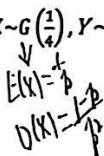

【题目来源】23242 概率论与数理统计 B卷 T1
【教材溯源】第1章 随机事件与概率 - 1.5 独立性
【题目正文】
设两两独立且概率相等的三事件 A、B、C 满足条件 $P(A \cup B \cup C) = \frac{9}{16}$ ，且 $ABC = \varnothing$ ，则 $P(A) =$ \_\_\_\_ .
【答案】$\frac{1}{4}$
【AI解析】设 $P(A)=p$，两两独立且等概率，$P(AB)=P(AC)=P(BC)=p^{2}$，$ABC=\varnothing$。加法公式 $P(A\cup B\cup C)=3p-3p^{2}=\frac{9}{16}$。解 $p^{2}-p+\frac{3}{16}=0$ 得 $p=\frac{1}{4}$ 或 $\frac{3}{4}$。由 $P(A\cup B\cup C)\geq P(A)$ 取 $p=\frac{1}{4}$。易错点：两根中用 $p\leq\frac{9}{16}$ 筛选。

【题目来源】23242 概率论与数理统计 B卷 T2
【教材溯源】第4章 随机变量的数字特征 - 4.3 随机变量的协方差与相关系数
【题目正文】
设随机变量 X 和 Y 的相关系数 $\rho_{X,Y}=0.5$ ，且 $X\sim G\left(\frac{1}{4}\right), Y\sim U(0,1)$ ，

则 $E(XY)=$ \_\_\_\_ .

【答案】$\frac{5}{2}$
【AI解析】几何分布 $G(\frac{1}{4})$：$E(X)=4,D(X)=\frac{1-p}{p^{2}}=12$；$U(0,1)$：$E(Y)=\frac{1}{2},D(Y)=\frac{1}{12}$。$E(XY)=\mathrm{Cov}(X,Y)+E(X)E(Y)=\rho\sqrt{D(X)D(Y)}+E(X)E(Y)$。$=0.5\times\sqrt{12\cdot\frac{1}{12}}+4\times\frac{1}{2}=\frac{1}{2}+2=\frac{5}{2}$。易错点：几何分布方差是 $\frac{1-p}{p^{2}}$。

【题目来源】23242 概率论与数理统计 B卷 T3
【教材溯源】第2章 随机变量及分布 - 2.3 连续型随机变量的分布
【题目正文】
设随机变量 $X \sim N(\mu, 4)$ ，方程 $y^{2} + 4y + X = 0$ 无实根的概率为 $\frac{1}{2}$ ，

则 $P\{2<X<6\}=$ \_\_\_\_. (答案用标准正态分布的分布函数 $\Phi(x)$ 表示)
【答案】$2\Phi(1)-1$
【AI解析】无实根要求 $16-4X<0$ 即 $X>4$，$P\{X>4\}=\frac{1}{2}$ 说明 4 为中位数，故 $\mu=4$。$X\sim N(4,4)$，$P\{2<X<6\}=\Phi(\frac{6-4}{2})-\Phi(\frac{2-4}{2})=\Phi(1)-\Phi(-1)=2\Phi(1)-1$。易错点：先由概率 1/2 定 $\mu$。

【题目来源】23242 概率论与数理统计 B卷 T4
【教材溯源】第5章 大数定律和中心极限定理 - 5.3 中心极限定理
【题目正文】
设随机变量序列 $X_{n} \sim B\left(n, \frac{1}{2}\right) (n = 1, 2, \cdots)$ ，则 $\lim_{n \to \infty} P\left\{\frac{2X_{n}-n}{\sqrt{n}} \leq 0\right\} =$ \_\_\_\_.
【答案】$\frac{1}{2}$
【AI解析】$X_{n}\sim B(n,\frac{1}{2})$：$E(2X_{n}-n)=0$，$D(2X_{n}-n)=4\cdot\frac{n}{4}=n$。标准化 $\frac{2X_{n}-n}{\sqrt{n}}\to N(0,1)$。极限 $\Phi(0)=\frac{1}{2}$。易错点：右端是常数 0，不随 $n$ 变。

【题目来源】23242 概率论与数理统计 B卷 T5
【教材溯源】第2章 随机变量及分布 - 2.4 随机变量函数的分布
【题目正文】
设随机变量X的分布函数为 $F(x)=\left\{\begin{aligned}&0,&x<-1,\\ &0.3,-1\leq x<0,\\ &0.7,0\leq x<1,\\ &1,&x\geq1\end{aligned}\right.$ 令 $Y=X^{2}+1$

则 $P\{Y=2\}=$ \_\_\_\_.
【答案】0.6
【AI解析】$Y=2$ 等价于 $X^{2}=1$，即 $X=\pm1$。$P\{X=-1\}=F(-1)=0.3$（$-1$ 处跳跃），$P\{X=1\}=1-F(1-0)=1-0.7=0.3$。和为 0.6。易错点：离散跳跃点的概率由分布函数的跳跃高度读出。

【题目来源】23242 概率论与数理统计 B卷 T6
【教材溯源】第1章 随机事件与概率 - 1.5 独立性
【题目正文】
某人向同一目标独立重复射击，每次击中目标的概率为 P，则此人的第 n 次射击恰好是第 k 次击中目标的概率为 \_\_\_\_.
【答案】$C_{n-1}^{k-1}p^{k}(1-p)^{n-k}$
【AI解析】第 $n$ 次恰好第 $k$ 次命中：前 $n-1$ 次中恰 $k-1$ 次命中，第 $n$ 次命中。概率 $C_{n-1}^{k-1}p^{k-1}(1-p)^{n-k}\cdot p$。即 $C_{n-1}^{k-1}p^{k}(1-p)^{n-k}$。易错点：最后一次必命中，前 $n-1$ 次用二项。

【题目来源】23242 概率论与数理统计 B卷 T7
【教材溯源】第1章 随机事件与概率 - 1.5 独立性
【题目正文】
设 A、B、C 为事件， $P(ABC) > 0$ ，则 $P(AB|C) = P(A|C)P(B|C)$ 充要条件是().
A. $P(A|C)=P(A)$
B. $P(B|C)=P(B)$
C. $P(AB|C)=P(AB)$
D. $P(B|AC) = P(B|C)$ .
【答案】D
【AI解析】$P(AB|C)=\frac{P(ABC)}{P(C)}$，$P(A|C)P(B|C)=\frac{P(AC)P(BC)}{P(C)^{2}}$。两者相等等价于 $P(ABC)P(C)=P(AC)P(BC)$。而 $P(B|AC)=P(B|C)$ 即 $\frac{P(ABC)}{P(AC)}=\frac{P(BC)}{P(C)}$，化简同式，故选 D。易错点：条件独立要同除以 $P(C)$ 比对。

【题目来源】23242 概率论与数理统计 B卷 T8
【教材溯源】第5章 大数定律和中心极限定理 - 5.2 大数定律
【题目正文】
设随机变量序列 $X_{1}, X_{2}, \cdots, X_{n}, \cdots$ 相互独立，且都服从参数为2的指数分布，记 $\bar{X}_n = \frac{1}{n}\sum_{i=1}^{n} X_i$ 则当 $n \to \infty$ 时， $\frac{1}{n}\sum_{i=1}^{n}(X_i - \bar{X}_n)^2$ 依概率收敛于（ ）.
A. 4
B. $\frac{1}{4}$
C. 2
D. $\frac{1}{2}$
【答案】B
【AI解析】$\mathrm{Exp}(2)$：$E(X)=\frac{1}{2},D(X)=\frac{1}{4}$。$\frac{1}{n}\sum(X_{i}-\bar{X})^{2}=\frac{1}{n}\sum X_{i}^{2}-\bar{X}^{2}\to E(X^{2})-[E(X)]^{2}=D(X)=\frac{1}{4}$，选 B。易错点：样本二阶中心矩收敛于总体方差。

【题目来源】23242 概率论与数理统计 B卷 T9
【教材溯源】第4章 随机变量的数字特征 - 4.2 随机变量的方差
【题目正文】
设随机变量 $X \sim N(1,2)$ ，令 $Y = (X - 1)^{2}$ ，则 $D(Y) = (\quad)$ .
A. 8
B. 12
C. 4
D. 10
【答案】A
【AI解析】$X\sim N(1,2)$，$X-1\sim N(0,2)$，记 $Z=X-1$。$Y=Z^{2}$。$E(Z^{2})=2$，$E(Z^{4})=3\sigma^{4}=3\times4=12$。$D(Y)=E(Z^{4})-[E(Z^{2})]^{2}=12-4=8$，选 A。易错点：正态四阶矩 $E(Z^{4})=3\sigma^{4}$。

【题目来源】23242 概率论与数理统计 B卷 T10
【教材溯源】第6章 数理统计的基本概念与抽样分布 - 6.1 基本概念
【题目正文】
设 (2,1,5,2,1,3,1) 是来自总体 X 的一个简单随机样本值，则总体的经验分布函数值 $F_{7}(2)=(\quad)$ .
A. $\frac{3}{7}$
B. $\frac{5}{7}$
C. $\frac{6}{7}$
D. $\frac{2}{7}$
【答案】B
【AI解析】经验分布函数 $F_{7}(2)$ 是样本值不超过 2 的频率。观测值 2,1,5,2,1,3,1 中不超过 2 的有 5 个（2,1,2,1,1）。故 $\frac{5}{7}$，选 B。易错点：5 与 3 大于 2 不计入。

【题目来源】23242 概率论与数理统计 B卷 T11
【教材溯源】第2章 随机变量及分布 - 2.1 随机变量及分布函数
【题目正文】
假设随机变量 X 的分布函数有两个间断点，则随机变量 X( ).
A. 为离散型随机变量
B. 为连续型随机变量
C. 不为连续型随机变量
D. 不为离散型随机变量
【答案】C
【AI解析】分布函数有两个间断点，说明不是连续型随机变量（连续型分布函数必连续），选 C。它可能是离散型也可能是混合型，故“不为离散型”不必然。易错点：间断点只排除连续型。

【题目来源】23242 概率论与数理统计 B卷 T12
【教材溯源】第8章 假设检验 - 8.1 假设检验的基本概念
【题目正文】
在假设检验问题中，如果原假设 $H_{0}$ 的拒绝域是 W，那么样本值 $x_{1}, x_{2}, \cdots, x_{n}$ 只可能有下列四种情况，其中拒绝 $H_{0}$ 且不犯错误的是().
A. $H_{0}$ 成立， $(x_{1},x_{2},\cdots,x_{n})\in W$
B. $H_{0}$ 成立， $(x_{1},x_{2},\cdots,x_{n})\notin W$
C. $H_{0}$ 不成立， $(x_{1},x_{2},\cdots,x_{n})\in W$
D. $H_{0}$ 不成立， $(x_{1},x_{2},\cdots,x_{n})\notin W$
【答案】C
【AI解析】拒绝 $H_{0}$ 且不犯错误，即 $H_{0}$ 实际不成立而拒绝，是正确决策，选 C。A 是弃真（第一类错误），D 是取伪（第二类错误）。易错点：分清两类错误的定义。

【题目来源】23242 概率论与数理统计 B卷 T13
【教材溯源】第3章 多维随机变量及分布 - 3.4 二维随机变量函数的分布
【题目正文】
三、(10分) 设随机变量 X,Y 相互独立，且 X 的概率分布律

$$
P \{X = - 1 \} = P \{X = 0 \} = \frac {1}{4}, P \{X = 1 \} = \frac {1}{2}, Y \text {的概率密度函数} f _ {Y} (y) = \left\{ \begin{array}{c c} 2 y, 0 <   y <   1 \\ 0, & \text {其他} \end{array} \right..
$$

求 $Z = \min\{X, Y\}$ 的分布函数.
【答案】$F_{Z}(z)=\begin{cases}0,&z<-1\\\frac{1}{4},&-1\leq z<0\\\frac{3}{4}+\frac{z^{2}}{4},&0\leq z<1\\1,&z\geq1\end{cases}$
【AI解析】$Z=\min(X,Y)$，$F_{Z}(z)=1-P\{X>z\}P\{Y>z\}$（独立）。$-1\leq z<0$：$P\{X>z\}=\frac{3}{4},P\{Y>z\}=1$，$F_{Z}=\frac{1}{4}$。$0\leq z<1$：$P\{X>z\}=\frac{1}{4},P\{Y>z\}=1-z^{2}$，$F_{Z}=1-\frac{1}{4}(1-z^{2})=\frac{3}{4}+\frac{z^{2}}{4}$。易错点：$X$ 离散，$P\{X>z\}$ 随 $z$ 分段取值。

【题目来源】23242 概率论与数理统计 B卷 T14
【教材溯源】第1章 随机事件与概率 - 1.4 条件概率与乘法公式
【题目正文】
四、（10分）10台洗衣机有7台一等品，3台二等品，现已售出1台.在余下的9台中任取2台发现均为一等品，则原先售出1台为二等品的概率为多少？
【答案】$\frac{3}{8}$
【AI解析】设 $B=\{$售出的为二等品$\}$，$A=\{$余下 9 台任取 2 均一等品$\}$。$P(A|B)=\frac{C_{7}^{2}}{C_{9}^{2}}$（剩 7 一等 2 二等），$P(A|\bar{B})=\frac{C_{6}^{2}}{C_{9}^{2}}$。贝叶斯 $P(B|A)=\frac{(3/10)C_{7}^{2}}{(3/10)C_{7}^{2}+(7/10)C_{6}^{2}}=\frac{63}{168}=\frac{3}{8}$。易错点：售出后剩余一等品数随售出等级变化。

【题目来源】23242 概率论与数理统计 B卷 T15
【教材溯源】第3章 多维随机变量及分布 - 3.3 二维连续型随机变量及分布
【题目正文】
五、(16分) 已知二维随机变量(X,Y)的联合概率密度函数为

$$
f (x, y) = \left\{ \begin{array}{c c} 2 - x - y; & 0 \leq x \leq 1, 0 \leq y \leq 1 \\ 0; & \text {其他} \end{array} \right.
$$

(1) 求 $(X,Y)$ 的联合分布函数 $F(x,y)$ ;  
(2) 求 X, Y 的边缘概率密度函数 $f_{X}(x)$ 和 $f_{Y}(y)$ 并判断 X, Y 是否独立:  
(3) 求 $f_{Y|X}(y|x)$ ;  
(4) 求 $P\left\{\frac{1}{4}<Y<\frac{3}{4}\mid X\leq\frac{1}{2}\right\}$ .
【答案】(1) $F(x,y)=2xy-\frac{xy^{2}}{2}-\frac{x^{2}y}{2}$（$0\leq x,y\leq1$），其余分段见解析；(2) $f_{X}=\frac{3}{2}-x$，$f_{Y}=\frac{3}{2}-y$，不独立；(3) $f_{Y|X}=\frac{2-x-y}{3/2-x}$；(4) $\frac{1}{2}$
【AI解析】(1) $F(x,y)=\int_{0}^{x}\int_{0}^{y}(2-s-t)\mathrm{d}t\mathrm{d}s=2xy-\frac{xy^{2}}{2}-\frac{x^{2}y}{2}$（单位正方形内），边界分别取 $\frac{3x}{2}-\frac{x^{2}}{2}$ 等。(2) $f_{X}=\int_{0}^{1}(2-x-y)\mathrm{d}y=\frac{3}{2}-x$，$f_{X}f_{Y}$ 与 $f$ 不相等，不独立。(3) 条件密度为商。(4) 分母 $\int_{0}^{1/2}(\frac{3}{2}-x)\mathrm{d}x=\frac{5}{8}$，分子 $\int_{0}^{1/2}\int_{1/4}^{3/4}(2-x-y)\mathrm{d}y\mathrm{d}x=\frac{5}{16}$，比值 $\frac{1}{2}$。易错点：联合分布函数在正方形内外分四段。

【题目来源】23242 概率论与数理统计 B卷 T16
【教材溯源】第2章 随机变量及分布 - 2.4 随机变量函数的分布
【题目正文】
六、(10分)设随机变量 $X \sim U(-\frac{\pi}{2}, \frac{\pi}{2})$ ，令 $Y = \cos X$ ，求 $Y$ 的分布函数.
【答案】$F_{Y}(y)=\begin{cases}0,&y<0\\1-\frac{2}{\pi}\arccos y,&0\leq y<1\\1,&y\geq1\end{cases}$
【AI解析】$X\sim U(-\frac{\pi}{2},\frac{\pi}{2})$，密度 $\frac{1}{\pi}$。$0\leq y<1$ 时 $F_{Y}(y)=P\{\cos X\leq y\}=P\{|X|\geq\arccos y\}$。$=\frac{2}{\pi}(\frac{\pi}{2}-\arccos y)=1-\frac{2}{\pi}\arccos y$。易错点：$\cos$ 在 0 两侧对称，取 $|X|\geq\arccos y$。

【题目来源】23242 概率论与数理统计 B卷 T17
【教材溯源】第8章 假设检验 - 8.2 正态总体参数的假设检验
【题目正文】
七、(6分)用老工艺生产的机械零件方差较大，随机抽查25个零件，得 $s_{1}^{2}=6.62$ 。
现改用新工艺生产，随机抽查25个零件，得 $s_{2}^{2}=3.19$ ．设这两种生产过程皆服从正态分布，问新工艺的精度是否比老工艺的精度显著的提高( $\alpha=0.05$ )？

(附表： $F_{25,25}(0.025)=2.25$ ; $F_{25,25}(0.05)=1.95$

$$
F _ {2 4, 2 4} (0. 0 2 5) = 2. 2 7 \quad F _ {2 4, 2 4} (0. 0 5) = 1. 9 8)
$$
【答案】拒绝 $H_{0}$，新工艺精度显著提高
【AI解析】检验 $H_{0}:\sigma_{新}^{2}\geq\sigma_{旧}^{2}$，$H_{1}:\sigma_{新}^{2}<\sigma_{旧}^{2}$。取 $F=\frac{S_{旧}^{2}}{S_{新}^{2}}\sim F(24,24)$，右尾拒绝。$F=\frac{6.62}{3.19}\approx2.07>F_{24,24}(0.05)=1.98$，拒绝 $H_{0}$，认为新工艺方差更小、精度更高。易错点：比值为旧/新，方差小对应比值大。

【题目来源】23242 概率论与数理统计 B卷 T18
【教材溯源】第7章 参数估计 - 7.1 参数的点估计
【题目正文】
八、(12分) 设 $(X_{1}, X_{2}, \cdots, X_{n})$ 是来自总体的一个简单随机样本，

其总体的概率密度函数 $f(x;\theta)=\left\{\begin{aligned}\frac{1}{k\theta};&\quad\theta\leq x\leq(k+1)\theta\\ 0;&\quad\text{其他}\end{aligned}\right.$

其中k>0是已知数， $\theta>0$ 是未知参数，求未知参数 $\theta$ 的矩估计量和最大似然估计量
【答案】(1) $\hat{\theta}=\frac{2\bar{X}}{k+2}$；(2) $\hat{\theta}=\frac{X_{(n)}}{k+1}$
【AI解析】(1) 均匀分布 $U(\theta,(k+1)\theta)$：$E(X)=\frac{(k+2)\theta}{2}$，令其等于 $\bar{X}$ 得 $\hat{\theta}=\frac{2\bar{X}}{k+2}$。(2) 似然 $L=(k\theta)^{-n}$（$\theta\leq x_{i}\leq(k+1)\theta$），关于 $\theta$ 单调减。可行域 $\theta\in[\frac{X_{(n)}}{k+1},X_{(1)}]$，取最小值 $\hat{\theta}=\frac{X_{(n)}}{k+1}$（原 OCR 答案误作 $X_{(1)}$，此为正确结果）。易错点：似然单调减，应在可行域下界取最大。
